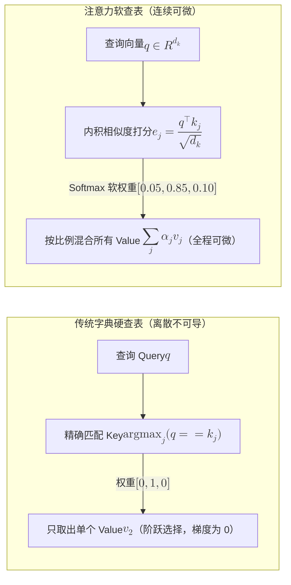
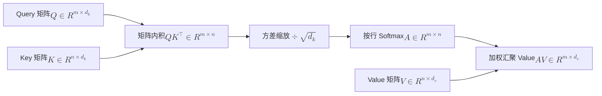
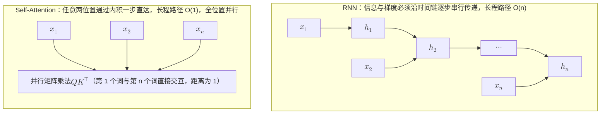

# 注意力：可微的查表

上一篇结尾我们看到了经典 Seq2Seq 架构的死穴：Encoder 读完源句后，把沿途产生的隐状态 $h_1, h_2, \dots, h_{n-1}$ 统统扔掉，只把最后一个向量 $h_n$ 塞给 Decoder。

2015 年 Bahdanau 等人在研究机器翻译时提出了一个看似极其朴素、实则颠覆全局的改动：**既然 Encoder 在每个词位置都已经算出了隐状态 $h_1, h_2, \dots, h_n$，为什么只留最后一个？把它们全部保留下来，让 Decoder 在生成每一个目标词时，自己动态回头去查这排向量不就行了？**

这个"按需动态回头查表"的机制就是**注意力（Attention）**。它最初只是贴在 RNN 上的一个补丁，随后被提炼为通用的 Query-Key-Value 原语，最终反客为主，把整个 RNN 送进了历史博物馆。

---

## 破除瓶颈：从静态单向量到动态上下文 $c_t$

在引入注意力之后，Encoder 的输出不再是一个孤零零的末状态向量，而是一排完整的源端隐状态序列 $(h_1, h_2, \dots, h_n)$——你可以把它看作源句子的**记忆库**，其中 $h_j$ 重点编码了源句第 $j$ 个词及其周边的上下文。

当 Decoder 在第 $t$ 步准备生成第 $t$ 个译文词时，它拿着自己当前的解码状态 $s_{t-1}$，按三步走动态提取专属于当前步的上下文向量 $c_t$：

1. **对齐打分（Score）**：拿当前解码状态 $s_{t-1}$ 与源句每一个位置的 $h_j$（$j=1,\dots,n$）比对相关性，算出原始打分 $e_{t,j} = \mathrm{score}(s_{t-1}, h_j)$；
2. **归一化为权重（Softmax）**：对这 $n$ 个打分做 Softmax，得到概率分布 $\alpha_{t,1}, \dots, \alpha_{t,n}$（满足 $\alpha_{t,j} \ge 0$ 且 $\sum_{j=1}^n \alpha_{t,j} = 1$）；
3. **加权汇聚（Weighted Sum）**：按权重 $\alpha_{t,j}$ 把源句所有隐状态加权求和，得到当前步专属的上下文向量 $c_t$：

$$
e_{t,j} = \mathrm{score}\!\left(s_{t-1},\, h_j\right), \qquad \alpha_{t,j} = \frac{\exp(e_{t,j})}{\sum_{k=1}^n \exp(e_{t,k})}, \qquad c_t = \sum_{j=1}^{n} \alpha_{t,j}\, h_j
$$

```mermaid
flowchart TB
    subgraph mem["Encoder 全序列隐状态记忆库"]
        h1["$$h_1$$（我）"]
        h2["$$h_2$$（爱）"]
        h3["$$h_3$$（自然语言）"]
    end
    st["Decoder 当前状态<br/>$$s_{t-1}$$"] --> sc1["$$e_{t,1} = \mathrm{score}(s_{t-1}, h_1)$$"]
    st --> sc2["$$e_{t,2} = \mathrm{score}(s_{t-1}, h_2)$$"]
    st --> sc3["$$e_{t,3} = \mathrm{score}(s_{t-1}, h_3)$$"]
    h1 --> sc1
    h2 --> sc2
    h3 --> sc3
    sc1 & sc2 & sc3 --> sm["Softmax 归一化<br/>$$\alpha_{t,j} = \mathrm{softmax}_j(e_{t,j})$$"]
    sm -- "$$\alpha_{t,1}, \alpha_{t,2}, \alpha_{t,3}$$" --> wsum["加权求和<br/>$$c_t = \sum_{j=1}^n \alpha_{t,j} h_j$$"]
    h1 & h2 & h3 -. "携带内容" .-> wsum
    wsum --> out["拼入 $$s_{t-1}$$ 预测当前译文词 $$\hat{y}_t$$"]
```

这一改动瞬间带来了两大红利：

- **信息瓶颈彻底消失**：源句有 $n$ 个词，记忆库就有 $n$ 个槽位，存储容量随句子长度线性扩展。生成译文第 $1$ 个词时注意力权重 $\alpha_{1,\cdot}$ 可以聚焦在源句开头，生成第 $10$ 个词时 $\alpha_{10,\cdot}$ 可以聚焦在源句末尾。
- **全程连续可微，无需监督对齐标签**：你不需要人工标注"中文第几个词对应英文第几个词"。因为加权求和与 Softmax 处处可导，反向传播会自动把预测错误顺着 $\alpha_{t,j}$ 传回打分网络——如果看错了位置导致翻译出错，梯度会自动压低错误位置的打分、抬高正确位置的打分！

---

## 通用抽象：Query、Key、Value 与"可微查表"

很快研究者意识到，上面这套"比对相关性 $\to$ Softmax 权重 $\to$ 加权求和"的机制根本不需要绑定在 RNN 上。把它抽离出来，实质上是一个**连续可微的键值字典查询（Differentiable Dictionary Lookup）**。

对比一下我们在普通编程里写的硬查表（`dict[query]`）与注意力机制的软查表：



在注意力机制中，每次查询涉及三种标准角色：

- **Query（查询向量 $q \in \mathbb{R}^{d_k}$）**：当前主动发起检索的一方，表达"**我现在需要找什么信息**"（对应刚才的解码器状态 $s_{t-1}$）；
- **Key（键向量 $k_j \in \mathbb{R}^{d_k}$）**：记忆库里每个条目的索引标签，表达"**我这里存放的是什么类型的信息**"，专门用来和 Query 做内积比对；
- **Value（值向量 $v_j \in \mathbb{R}^{d_v}$）**：记忆库里每个条目真正携带的载荷内容，表达"**一旦我被选中，你要拿走的实际内容**"（刚才的 $h_j$ 同时兼任了 Key 和 Value；将 Key 与 Value 分开投影后，"用来检索的标签"和"实际提取的内容"就解耦了）。

当手头有 $m$ 个 Query 同时发起检索、记忆库里有 $n$ 对 Key-Value 时，把它们按行堆叠成矩阵 $Q \in \mathbb{R}^{m \times d_k}$、$K \in \mathbb{R}^{n \times d_k}$、$V \in \mathbb{R}^{n \times d_v}$，所有查询就能合并成一行极其优雅的矩阵运算——**缩放点积注意力（Scaled Dot-Product Attention）**：

$$
\mathrm{Attention}(Q, K, V) = \underbrace{\mathrm{softmax}\!\left(\frac{Q K^\top}{\sqrt{d_k}}\right)}_{A \in \mathbb{R}^{m \times n}\text{（注意力权重矩阵）}} V
$$



### 为什么要除以缩放因子 $\sqrt{d_k}$？

公式里的分母 $\sqrt{d_k}$ 看似不起眼，却是大维度下注意力能够正常训练的命门。

假设查询向量 $q$ 和键向量 $k$ 的各个分量相互独立，且均值为 $0$、方差为 $1$（这正是 LayerNorm 之后的常态）。那么它们的内积 $q^\top k = \sum_{i=1}^{d_k} q_i k_i$ 是 $d_k$ 个独立随机变量之和，其均值仍为 $0$，但**方差会随维度 $d_k$ 线性膨胀**：

$$
\mathbb{E}[q^\top k] = 0, \qquad \mathrm{Var}(q^\top k) = \sum_{i=1}^{d_k} \mathrm{Var}(q_i k_i) = d_k \quad \Longrightarrow \quad \mathrm{Std}(q^\top k) = \sqrt{d_k}
$$

如果 $d_k = 64$，内积的标准差就会放大到 $8$，打分动辄出现 $+20$ 或 $-20$ 的极端值。把差距如此悬殊的数值喂给指数函数 $\exp(\cdot)$，Softmax 的输出会瞬间坍缩成非 $0$ 即 $1$ 的 one-hot 分布（比如 $[0.99999, 0.00001, 0]$）。

回忆《训练实战》里的教训：一旦 Softmax 进入饱和区，它的雅可比导数 $\alpha_i(\delta_{ij} - \alpha_j)$ 就会全面趋近于 $0$，**梯度当场消失**！除以 $\sqrt{d_k}$ 的唯一目的，就是把内积的方差重新压回恒定的 $1$，确保无论维度 $d_k$ 设多大，Softmax 始终工作在梯度充沛的敏感区间。

---

## 自注意力（Self-Attention）：序列内部的相互对齐

最初的注意力发生在两个序列之间（Decoder 查询 Encoder，称为**交叉注意力 Cross-Attention**）。紧接着，研究者迈出了更具革命性的一步：**如果让 $Q, K, V$ 全部来自同一个输入序列 $X \in \mathbb{R}^{n \times d}$ 呢？**

只需设置三个可学习的线性投影矩阵 $W_Q, W_K \in \mathbb{R}^{d \times d_k}$ 和 $W_V \in \mathbb{R}^{d \times d_v}$：

$$
Q = X W_Q, \qquad K = X W_K, \qquad V = X W_V
$$

然后再算 $\mathrm{Attention}(Q, K, V)$。这就是**自注意力（Self-Attention）**——序列中的每一个词各自生成查询向量 $q_i$，同时去检索同一句话里所有词（包括它自己）的键向量 $k_j$，把上下文相关的语义融合进自己的新表示里。

看一个经典的指代消解与词义消歧例子：

> "那只动物没有穿过马路，因为**它**太累了。"

静态词向量里，"它"只是一个模糊的代词。而在自注意力层中，"它"字的 Query 向量通过与全句所有词的 Key 做内积，发现与句首的"动物"匹配度最高，于是赋予"动物"极高的注意力权重 $\alpha$，直接把"动物"的 Value 向量吸纳进"它"的表示中；如果把句尾改成"因为**它**太宽了"，"它"的注意力权重就会自动转移到"马路"上。

---

## 结构对决：自注意力 vs 循环神经网络（RNN）

既然自注意力自己就能在序列各个位置之间传递并融合上下文信息，把它和上一篇的 RNN 放在一起正面对比，高下立判：



| 评估维度                 |        循环神经网络（RNN / LSTM）         |                   自注意力（Self-Attention）                   | 胜出方与原因                                                            |
| :----------------------- | :---------------------------------------: | :------------------------------------------------------------: | :---------------------------------------------------------------------- |
| **最大交互路径长度**     |    $O(n)$（相距 $n$ 的词需跨 $n$ 步）     |           **$O(1)$**（任意两词直接算内积，一步直达）           | **Self-Attention**：在结构上彻底根除长程梯度消失                        |
| **训练期并行度**         | $O(n)$ 步串行（第 $t$ 步苦等第 $t-1$ 步） |         **$O(1)$ 全并行**（整句打包为一次大矩阵乘法）          | **Self-Attention**：完美契合 GPU 张量核高并发吞吐                       |
| **单层计算与显存复杂度** | $O(n \cdot d^2)$（关于序列长度 $n$ 线性） | **$O(n^2 \cdot d)$**（需算 $n \times n$ 注意力矩阵 $QK^\top$） | 短中序列 Self-Attention 快得多；超长序列 $n \gg d$ 时 $O(n^2)$ 成为瓶颈 |
| **位置顺序感知**         |        天然内置（按先后顺序递推）         |                       **无（置换等变）**                       | 自注意力打乱词序输出仅跟着重排，需额外注入**位置编码**                  |

注意表格最后两行揭示的**两条代价**：

1. **计算复杂度 $O(n^2)$**：因为每个词都要和全部 $n$ 个词算内积，注意力矩阵 $A \in \mathbb{R}^{n \times n}$ 的大小随序列长度呈平方增长；
2. **丢失天生的顺序感（置换等变性 Permutation Equivariance）**：内积和加权求和完全不看词的下标——如果你把输入句子的词序打乱，自注意力的输出向量内容不会发生任何改变，只是跟着按相同顺序洗牌而已。

但相比于"一步直达的 $O(1)$ 长程依赖"和"彻底解放 GPU 算力的全并行训练"，这两条代价完全可以修补：顺序感只需在输入端加上**位置编码**即可找回；而把 RNN 彻底扔掉、完全围绕自注意力搭建起的新一代架构，就是本系列的收官之作——**Transformer**。

---

## 小结

- **注意力起源**：为打破 Seq2Seq 单向量瓶颈而生，保留源句全部位置的隐状态，让解码器每一步按相关性打分动态加权提取上下文向量 $c_t = \sum_j \alpha_{t,j} h_j$。
- **Q/K/V 可微查表**：Query 发起提问，Key 充当比对索引，Value 提供实际内容；$\mathrm{softmax}(QK^\top / \sqrt{d_k})V$ 将离散字典检索软化为处处可导的矩阵运算。
- **缩放因子 $\sqrt{d_k}$**：抵消点积方差随维度 $d_k$ 的线性膨胀，防止 Softmax 落入饱和区导致梯度归零。
- **自注意力的降维打击**：序列内部两两直接交互，把长程依赖路径从 RNN 的 $O(n)$ 直接缩短为 $O(1)$，并将串行递推改造成全并行矩阵乘法；留下的顺序缺失与单表视角局限，将在下一篇《Transformer 入门》中补齐。
