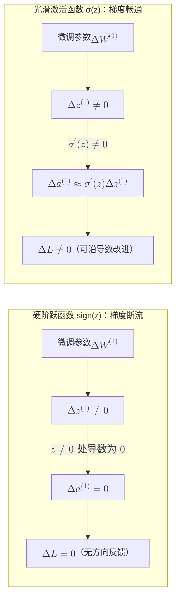
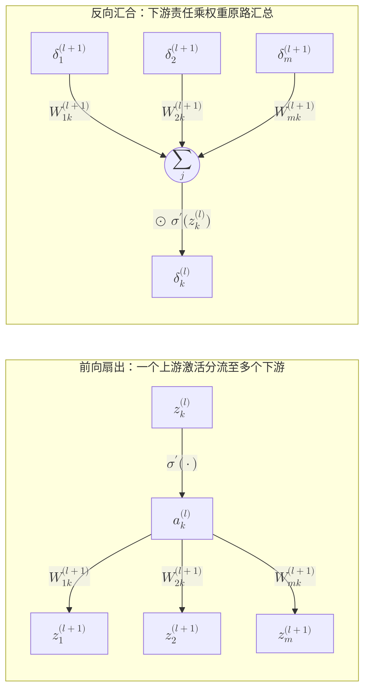
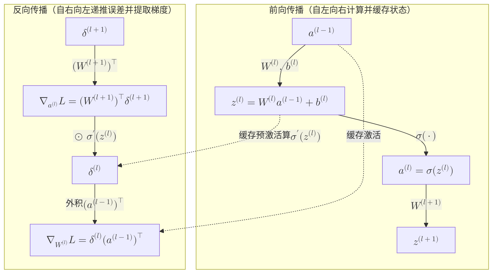

# 多层感知机：把误差传回去

上一篇结尾留下了一个核心矛盾：两层感知机在**表达能力**上足以通过空间折叠解开 XOR，但在**训练方法**上却陷入死局——隐藏层夹在网络内部，训练集只给出了最终输出的标准答案 $y$，没有给隐藏层神经元配发标准答案。当网络预测出错时，中间层的参数该如何分摊责任？

要解开这个死结，需要走完两步：

1. **把硬阶跃磨成光滑曲线**：让参数的微小扰动能够连续地反映为误差的微小变化，使"求导"成为可能；
2. **反向传播（Backpropagation）**：利用微积分链式法则，把输出层的误差敏感度像记账一样从后往前逐层拆解，让每一层参数各领一份梯度。

---

## 第一步：把硬台阶磨光滑

为什么单层感知机里的阶跃函数 $\mathrm{sign}(z)$ 在多层网络里行不通？

设想你微调了第一层的某个权重 $\Delta w$，使得预激活值 $z^{(1)}$ 变化了一点点 $\Delta z^{(1)}$。只要 $z^{(1)}$ 没有恰好跨过 $0$ 这个阈值，$\mathrm{sign}(z^{(1)})$ 的输出就纹丝不动，最终损失的变化量 $\Delta L = 0$。导数处处为零（在 $z=0$ 处则不可导），意味着你站在原地环顾四周，完全不知道往哪个方向微调参数能让误差变小：



因此，多层感知机（MLP）的第一项改造就是把硬阈值替换为**（几乎）处处可微的非线性激活函数** $\sigma(z)$：

| 激活函数    | 数学定义                                        | 导数 $\sigma'(z)$                                    |      值域      | 核心特性                                           |
| :---------- | :---------------------------------------------- | :--------------------------------------------------- | :------------: | :------------------------------------------------- |
| **Sigmoid** | $\sigma(z) = \dfrac{1}{1 + e^{-z}}$             | $\sigma(z)\bigl(1 - \sigma(z)\bigr)$                 |    $(0, 1)$    | 把实轴平滑压进概率区间；两端饱和区导数趋于 $0$     |
| **Tanh**    | $\tanh(z) = \dfrac{e^z - e^{-z}}{e^z + e^{-z}}$ | $1 - \tanh^2(z)$                                     |   $(-1, 1)$    | 零均值输出，训练收敛通常优于 Sigmoid；两端同样饱和 |
| **ReLU**    | $\max(0, z)$                                    | $\begin{cases} 1, & z > 0 \\ 0, & z < 0 \end{cases}$ | $[0, +\infty)$ | 正半轴导数恒为 $1$，计算极简，现代深层网络主力     |

（注：ReLU 在 $z=0$ 处单点不可导，工程实现中直接取次梯度 $0$ 或 $1$ 即可，完全不影响梯度下降。）

### 为什么激活函数必须是非线性的？

既然要求可微，直接用最简单的线性恒等函数 $\sigma(z) = z$ 行不行？**绝对不行。**

如果去掉非线性激活，一个两层网络的前向计算就会退化为矩阵结合律：

$$
\hat{y} = W^{(2)}\!\left(W^{(1)} x + b^{(1)}\right) + b^{(2)} = \underbrace{\left(W^{(2)} W^{(1)}\right)}_{\tilde{W}} x + \underbrace{\left(W^{(2)} b^{(1)} + b^{(2)}\right)}_{\tilde{b}} = \tilde{W} x + \tilde{b}
$$

无论你堆叠一百层还是一千层线性变换，乘在一起依然等价于**单层线性变换**，照样画不出折线，照样解不开 XOR。**非线性激活函数是层数堆叠能够产生新表达能力的唯一来源。**

---

## 网络结构与万能近似定理

一个 $L$ 层的多层感知机，每一层都由"仿射变换 + 逐元素非线性激活"两步串联而成。记输入层为 $a^{(0)} = x$，第 $l$ 层（$l = 1, \dots, L$）的计算为：

$$
z^{(l)} = W^{(l)} a^{(l-1)} + b^{(l)}, \qquad a^{(l)} = \sigma\!\left(z^{(l)}\right)
$$

其中 $z^{(l)}$ 称为**预激活**（pre-activation），$a^{(l)}$ 为该层的**激活输出**（activation）。最后一层 $a^{(L)} = \hat{y}$ 给出预测，并送入可微损失函数 $L(\hat{y}, y)$（如回归用均方误差 $\frac{1}{2}\|\hat{y}-y\|^2$，分类用交叉熵）评估误差：

```mermaid
flowchart LR
    x["输入<br/>$$a^{(0)} = x$$"] --> lin1["线性变换<br/>$$z^{(1)} = W^{(1)}a^{(0)} + b^{(1)}$$"]
    lin1 --> act1["非线性激活<br/>$$a^{(1)} = \sigma(z^{(1)})$$"]
    act1 --> dots["$$\cdots$$"]
    dots --> linL["输出层线性变换<br/>$$z^{(L)} = W^{(L)}a^{(L-1)} + b^{(L)}$$"]
    linL --> actL["输出激活<br/>$$\hat{y} = a^{(L)} = \sigma(z^{(L)})$$"]
    actL --> loss["损失函数<br/>$$L(\hat{y}, y)$$"]
```



这样的两层（单隐层）网络到底能表达什么函数？1989 年 Cybenko 等人证明了著名的**万能近似定理**（Universal Approximation Theorem）：

> 只要隐藏层神经元数量足够多，一个仅含**单个隐藏层**（配 Sigmoid 或 ReLU 等非常数有界/分段线性激活）的前馈网络，就能以任意精度逼近紧集 $K \subset \mathbb{R}^d$ 上的任意连续函数。

几何直觉其实非常朴素：在一维输入下，每个隐藏神经元 $\sigma(w_j x + b_j)$ 都是一个位置与陡峭度可调的"软台阶"（或 ReLU 的"折角"）；两个错位的台阶相减就能拼出一个局部凸起的矩形脉冲；把成百上千个不同位置、不同高度的脉冲线性叠加起来，就能像搭积木一样逼近任何连续曲线。

因此，**表达能力从来不是瓶颈，真正的瓶颈是如何从数据中把这堆参数找出来**。

---

## 反向传播：链式法则的局部递推

训练网络需要求出损失 $L$ 对每一层参数 $W^{(l)}$ 和 $b^{(l)}$ 的梯度。如果直接对第一层的某个权重 $W^{(1)}_{jk}$ 硬套链式法则，梯度需要沿着它通往输出层的所有路径展开求和，路径数量随层数呈指数爆炸，还会产生海量重复计算。

Rumelhart、Hinton 与 Williams（1986）推广的**反向传播算法**（Backpropagation）点破了窗户纸：**不要从前往后枚举路径，而是定义一个每层局部的"误差信号"，从输出层往回递推。**

### 核心中间量：误差信号 $\delta^{(l)}$

我们定义第 $l$ 层的**误差信号**（error signal）$\delta^{(l)}$ 为最终损失 $L$ 对该层预激活向量 $z^{(l)}$ 的偏导数：

$$
\delta^{(l)} := \frac{\partial L}{\partial z^{(l)}}
$$

它的物理含义极其清晰：**如果把第 $l$ 层每个神经元的预激活值 $z^{(l)}\_j$ 轻轻拨动一丁点，最终的损失 $L$ 会跟着变化多少？** $\delta^{(l)}$ 就是隐藏层神经元的"责任账本"——虽然隐藏层没有标准答案，但只要算出 $\delta^{(l)}$，这一层的权重该往哪改就一清二楚了。

### 为什么误差能顺着 $W^\top$ 传回来？

假设我们已经算出了第 $l+1$ 层的责任 $\delta^{(l+1)}$，怎么求前一层第 $k$ 个神经元的责任 $\delta^{(l)}_k$？

看前向计算图：第 $l$ 层的神经元 $k$ 先经过激活函数变成 $a^{(l)}_k = \sigma(z^{(l)}_k)$，然后通过权重 $W^{(l+1)}_{jk}$ 同时向第 $l+1$ 层的所有神经元 $j = 1, \dots, m$ 输送信号。因此，拨动 $z^{(l)}_k$ 会通过所有下游神经元 $j$ 影响最终损失：



根据多元链式法则，把所有下游分支的责任加起来：

$$
\delta^{(l)}_k = \frac{\partial L}{\partial z^{(l)}_k} = \left(\sum_{j} \frac{\partial L}{\partial z^{(l+1)}_j} \frac{\partial z^{(l+1)}_j}{\partial a^{(l)}_k}\right) \frac{\partial a^{(l)}_k}{\partial z^{(l)}_k} = \left(\sum_{j} W^{(l+1)}_{jk} \delta^{(l+1)}_j\right) \sigma'\!\left(z^{(l)}_k\right)
$$

注意求和项 $\sum_j W^{(l+1)}_{jk} \delta^{(l+1)}_j$ 恰好是用权重矩阵的**转置** $(W^{(l+1)})^\top$ 左乘向量 $\delta^{(l+1)}$ 的第 $k$ 行！写成紧凑的向量形式，整个反向传播就浓缩为**四个基本方程**：

| 步骤                | 公式（向量/矩阵形式）                                                                                   | 物理与计算解读                                             |
| :------------------ | :------------------------------------------------------------------------------------------------------ | :--------------------------------------------------------- |
| **1. 输出层误差**   | $\delta^{(L)} = \nabla_{a^{(L)}} L \;\odot\; \sigma'\!\left(z^{(L)}\right)$                             | 起点：损失对预测值的导数 $\times$ 输出层激活导数           |
| **2. 误差向后递推** | $\delta^{(l)} = \left(W^{(l+1)}\right)^{\!\top} \delta^{(l+1)} \;\odot\; \sigma'\!\left(z^{(l)}\right)$ | 传导：下游误差经 $W^\top$ 汇总回本层，再过本层激活导数门控 |
| **3. 权重梯度**     | $\dfrac{\partial L}{\partial W^{(l)}} = \delta^{(l)} \left(a^{(l-1)}\right)^{\!\top}$                   | 归因：本层误差信号（列向量）与上游输入激活（行向量）的外积 |
| **4. 偏置梯度**     | $\dfrac{\partial L}{\partial b^{(l)}} = \delta^{(l)}$                                                   | 归因：偏置的乘数是常数 $1$，梯度直接等于误差信号本身       |

（其中 $\odot$ 表示逐元素相乘 Hadamard 积。）

把前向与反向放在同一张图上对比，对称之美一目了然：**前向传播时，激活信号乘以 $W$ 从左往右流，并沿途缓存 $z^{(l)}$ 和 $a^{(l)}$；反向传播时，误差信号乘以 $W^\top$ 从右往左流，与缓存的激活碰撞出参数梯度。**



用 Python 写出来，一次完整的训练步（前向 + 反向）干净利落：

```python
# 1. 前向传播：逐层计算并缓存预激活 z 与激活 A
A = {0: x}
z = {}
for l in range(1, L + 1):
    z[l] = W[l] @ A[l - 1] + b[l]
    A[l] = act(z[l])

# 2. 反向传播：从输出层误差信号 d = δ⁽ᴸ⁾ 出发逆向递推
d = loss_grad(A[L], y) * act_grad(z[L])
for l in range(L, 0, -1):
    dW[l] = np.outer(d, A[l - 1])            # δ⁽ˡ⁾ (a⁽ˡ⁻¹⁾)ᵀ
    db[l] = d                                # δ⁽ˡ⁾
    if l > 1:
        d = (W[l].T @ d) * act_grad(z[l - 1])  # 传给上一层的 δ⁽ˡ⁻¹⁾
```

由于所有运算都是标准的矩阵乘法与逐元素乘法，当我们把一个批次（mini-batch）的 $B$ 个样本按列拼成矩阵 $X \in \mathbb{R}^{d \times B}$ 时，上述公式无需任何修改即可并行算完整个批次的梯度。

---

## 与感知机规则重逢

仔细端详第 3 条方程中单个权重 $W^{(l)}_{jk}$ 的梯度更新项：

$$
W^{(l)}_{jk} \leftarrow W^{(l)}_{jk} - \eta\, \delta^{(l)}_j a^{(l-1)}_k
$$

每个权重的更新量都严格遵循 **"学习率 $\times$ 下游误差责任 $\times$ 上游输入信号"** 的格式。这与上一篇感知机的更新规则 $w \leftarrow w + \eta\, y_i x_i$ 长得如此相似，绝非巧合。

如果我们给单层线性打分 $z = w^\top x_i$ 配上一个**感知机铰链损失**（Perceptron Hinge Loss）：

$$
L(w) = \max\!\left(0,\; -y_i (w^\top x_i)\right)
$$

当样本分类正确（$y_i w^\top x_i > 0$）时，损失为 $0$，梯度为 $0$；当样本分类错误（$y_i w^\top x_i \le 0$）时，损失对打分 $z$ 的误差信号恰好是 $\delta = \frac{\partial L}{\partial z} = -y_i$。套用梯度下降公式：

$$
w \leftarrow w - \eta\, \delta x_i = w - \eta (-y_i) x_i = w + \eta\, y_i x_i
$$

**原来感知机的错误驱动更新，本质上就是在不可微阶跃被揭去面纱后，在铰链损失上执行的一步随机梯度下降！** 换上光滑激活函数、引入链式法则之后，同一条"沿负梯度方向修正参数"的原则便从最后一层彻底贯通到了任意深度的隐藏层。

回到上一篇的 XOR 问题：现在我们不需要再对照真值表手工设计 $\mathrm{OR}$ 和 $\mathrm{NAND}$ 的权重了。只需随机初始化一个包含 2 个隐藏神经元的 MLP，前向算出预测误差，反向传播算出两层权重的梯度，迭代几百步后，第一层就会自动学出两条分割线把对角点折叠到一起，第二层自动学出切分超平面。

---

## 小结

- **激活函数的双重使命**：光滑可微让微小的参数改动可以转化为连续的损失梯度；非线性打破矩阵连乘的坍缩，赋予多层网络折叠空间的表达力。
- **万能近似定理**：单隐层网络已具备逼近任意连续函数的能力，核心挑战在于参数寻优而非函数表达。
- **反向传播四方程**：围绕误差信号 $\delta^{(l)} = \partial L / \partial z^{(l)}$ 展开；前向信号乘 $W$ 推进并缓存状态，反向误差乘 $W^\top$ 回传并经 $\sigma'(z^{(l)})$ 门控，参数梯度等于下游误差 $\delta^{(l)}$ 与上游激活 $a^{(l-1)}$ 的外积。
- **留下的实战问题**：梯度算出来之后，损失函数该怎么和输出层配对？一次喂多少样本最划算？原始梯度下降在弯曲峡谷里来回震荡怎么治？这是下一篇《训练实战》的主题。
