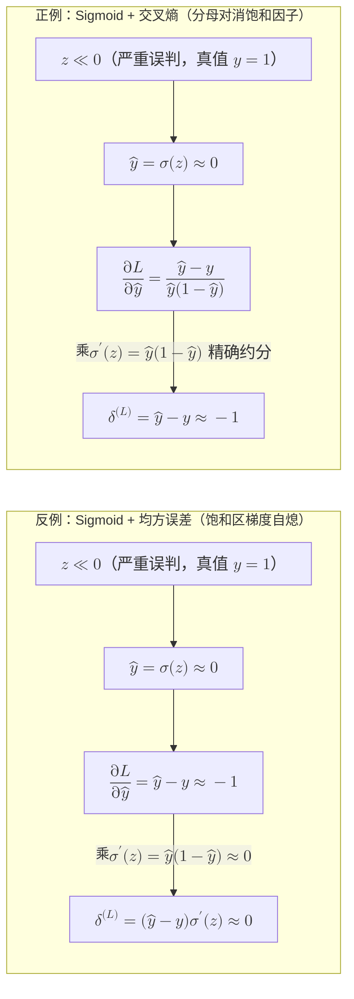
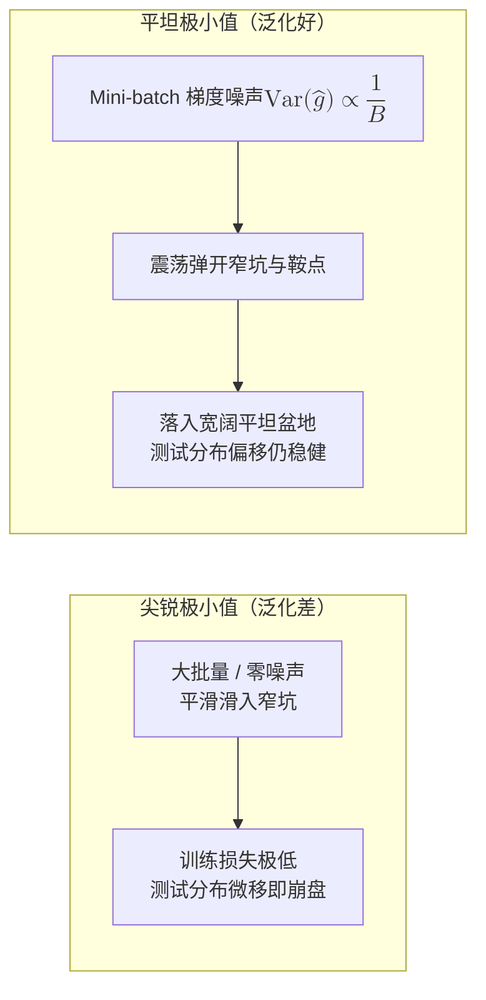
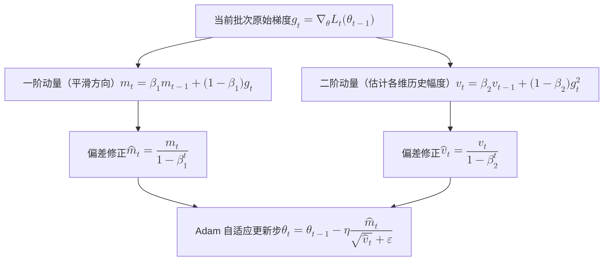
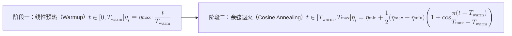

# 训练实战：损失、批量与优化器

反向传播解决了"给定损失函数，如何算出每个参数的梯度"，但要真正把一个神经网络训练起来，在写下训练循环的那一刻还会立刻撞上三个实战问题：

1. **输出层与损失函数怎么配对**，才不会让梯度在第一站（输出层门口）就熄火？
2. **每步梯度用多少个样本来算**，如何在梯度准确度、逃离鞍点与 GPU 吞吐之间取舍？
3. **拿到梯度后怎么迈步子**，才能在狭窄弯曲的高维损失峡谷里快速收敛？

这篇把训练循环拆开，逐一拆解这三个组件。

---

## 损失函数：与输出层绑定的搭档

在神经网络里，损失函数从来不是孤立挑选的，它和**输出层的激活函数**是一对强绑定的组合。三大标准任务的标准配对如下：

| 任务类型     | 输出层激活 $\sigma(z^{(L)})$                          | 损失函数 $L(\hat{y}, y)$                          | 输出层误差信号 $\delta^{(L)} = \dfrac{\partial L}{\partial z^{(L)}}$ |
| :----------- | :---------------------------------------------------- | :------------------------------------------------ | :------------------------------------------------------------------: |
| **连续回归** | 恒等映射 $\hat{y} = z^{(L)}$                          | 均方误差 $\frac{1}{2}\|\hat{y} - y\|^2$           |                            $\hat{y} - y$                             |
| **二分类**   | Sigmoid $\hat{y} = \sigma(z^{(L)})$                   | 二元交叉熵 $-y\log\hat{y} - (1-y)\log(1-\hat{y})$ |                            $\hat{y} - y$                             |
| **多分类**   | Softmax $\hat{y}_k = \dfrac{e^{z_k}}{\sum_j e^{z_j}}$ | 交叉熵 $-\sum_k y_k \log \hat{y}_k$               |                            $\hat{y} - y$                             |

仔细看上表最右列：不论是回归、二分类还是多分类，只要按标准组合配对，输出层预激活的误差信号 $\delta^{(L)}$ 全都化简成了同一个极其干净的式子——**预测值减去真实值 $\hat{y} - y$**！

### 为什么分类不用均方误差（MSE）？

初学者常问：二分类输出了概率 $\hat{y} = \sigma(z) \in (0, 1)$，直接和标签 $y \in \{0, 1\}$ 算均方误差 $\frac{1}{2}(\hat{y} - y)^2$ 不行吗？

对比一下两种损失在输出层的梯度传导路径就明白了：



- **Sigmoid + 均方误差的病灶**：当真实标签 $y=1$，而当前参数错得非常离谱（比如 $z = -10$，预测概率 $\hat{y} \approx 0.00005$）时，Sigmoid 处于平坦的饱和区，导数 $\sigma'(z) = \hat{y}(1-\hat{y}) \approx 0$。结果 $\delta^{(L)} = (\hat{y}-y)\sigma'(z) \approx 0$——**模型错得越离谱，纠错信号反而越微弱**，训练在起步阶段就会卡死在饱和区。
- **交叉熵的救赎**：交叉熵里的对数项 $-\log \hat{y}$ 求导会产生一个分母 $\frac{1}{\hat{y}(1-\hat{y})}$，在链式法则相乘时，刚好把 Sigmoid（或 Softmax）导数里惹祸的饱和因子 $\hat{y}(1-\hat{y})$ **精确约掉**，只留下线性误差 $\delta^{(L)} = \hat{y} - y$。**错得越多，梯度越大**，这才是符合直觉的纠错动力学。

---

## 批量大小（Batch Size）：噪声与吞吐的折中

理论上的经验风险是整个训练集 $N$ 个样本损失的平均值：$L(\theta) = \frac{1}{N}\sum_{i=1}^N \ell(f_\theta(x_i), y_i)$。但在每一步参数更新时，我们用多少个样本来估计梯度 $\nabla_\theta L(\theta)$？

这引出了三种梯度下降模式，它们在计算开销与梯度质量上处于光谱的两端：

| 策略                     | 每次更新样本数 $B$ |        单步计算耗时        |       梯度估计方差       | 轨迹特征与适用场景                                   |
| :----------------------- | :----------------: | :------------------------: | :----------------------: | :--------------------------------------------------- |
| **全批量（Batch GD）**   |    全部样本 $N$    | 极慢（扫完整个库才走一步） |   $0$（精确全局梯度）    | 轨迹平滑，但算力浪费严重，易困于尖锐局部极小值       |
| **纯随机（SGD）**        |    单个样本 $1$    |  极快（看一个样本走一步）  | 极大（与真实梯度夹角大） | 轨迹剧烈震荡如醉汉，且无法发挥 GPU 矩阵并行优势      |
| **小批量（Mini-batch）** |   $32 \sim 4096$   |  适中（打满 GPU 张量核）   |  适中（$\propto 1/B$）   | **现代深度学习唯一标配**：兼顾硬件并行与适度随机噪声 |

### 为什么适度的梯度噪声反而是好事？

全批量梯度虽然方向最准，但在高度非凸的高维损失曲面上，梯度为零的地方未必是全局谷底，更可能是**鞍点**（saddle point）或狭窄陡峭的**尖锐极小值**（sharp minimum）：



Mini-batch 引入的采样噪声相当于给参数更新加上了天然的"热运动"：狭窄的尖坑容不下震荡的步子，只有宽阔平坦的盆地（flat minimum）才能留住参数，而平坦盆地对训练集与测试集之间的分布偏移更不敏感，泛化能力往往更好。

> **工程经验法则**：在显存允许的范围内将 Batch Size 设为 $2$ 的幂次（对齐 GPU warp 与矩阵分块）；当把 Batch Size 扩大 $k$ 倍时，梯度方差缩小为 $1/k$，通常需要将学习率 $\eta$ 也同步放大（线性缩放规则 $\eta \propto k$ 或平方根缩放 $\eta \propto \sqrt{k}$），以维持相同的有效更新步伐。

---

## 优化器演进：从朴素 SGD 到 Adam

拿到当前 mini-batch 的梯度 $g_t = \nabla_\theta L_t(\theta_{t-1})$ 后，最朴素的更新是沿负梯度走一步：

$$
\theta_t = \theta_{t-1} - \eta\, g_t
$$

然而高维神经网络的损失面往往像一条**狭长的弯曲峡谷**：横跨峡谷壁的方向曲率极大（坡极陡，梯度极大），而顺着谷底通向最优点的方向曲率极小（坡极缓，梯度极小）。

如果用朴素 SGD：

- 学习率 $\eta$ 稍大，参数就会在两侧峭壁之间剧烈来回反弹甚至发散；
- 学习率 $\eta$ 调小以迁就峭壁，顺着谷底前进的速度又会慢如蜗牛。

现代优化器的演进史，就是一部**改造梯度 $g_t$ 的方向与步长**的历史：



### 1. 动量法（Momentum）：用惯性抵消正负震荡

物理直觉是让一颗有质量的小球滚下山坡。我们维护历史梯度的**指数移动平均**（Exponential Moving Average, EMA）作为速度向量 $m_t$：

$$
m_t = \beta\, m_{t-1} + g_t, \qquad \theta_t = \theta_{t-1} - \eta\, m_t
$$

（常取 $\beta = 0.9$，相当于对最近约 $\frac{1}{1-\beta} = 10$ 步的梯度做加权平均。）

- **在峡谷横截面方向**：梯度每步正负交替，累加进 $m_t$ 时正负相消，来回震荡被大幅压平；
- **在顺着谷底方向**：梯度符号始终一致，在 $m_t$ 中不断同向累积放大，小球越滚越快。

### 2. 自适应步长与 Adam：每个参数一套专属学习率

动量法解决了方向震荡，但所有参数依然共用同一个标量步长 $\eta$。在深度网络（尤其是含词嵌入层或深浅层跨度大的模型）中，不同参数的梯度量级可能相差几百倍——高频特征梯度常年巨大，低频特征梯度常年稀疏微小。

2015 年提出的 **Adam**（Adaptive Moment Estimation）把**一阶动量**（管方向）与**二阶动量**（管幅度）结合起来，为每个参数分量动态定制步长：

$$
\begin{aligned}
m_t &= \beta_1 m_{t-1} + (1-\beta_1)\, g_t && \text{（一阶矩：平滑梯度方向，}\beta_1 = 0.9\text{）} \\
v_t &= \beta_2 v_{t-1} + (1-\beta_2)\, g_t \odot g_t && \text{（二阶矩：统计梯度平方幅度，}\beta_2 = 0.999\text{）} \\
\hat{m}_t &= \frac{m_t}{1-\beta_1^t}, \qquad \hat{v}_t = \frac{v_t}{1-\beta_2^t} && \text{（冷启动偏差修正）} \\
\theta_t &= \theta_{t-1} - \eta\, \frac{\hat{m}_t}{\sqrt{\hat{v}_t} + \varepsilon} && \text{（逐元素归一化更新，}\varepsilon = 10^{-8}\text{）}
\end{aligned}
$$

看最后一步的核心分式 $\dfrac{\hat{m}_t}{\sqrt{\hat{v}_t} + \varepsilon}$：

- 分母 $\sqrt{\hat{v}_t}$ 是该参数近期梯度的均方根（RMS）幅度。
- **常年梯度巨大的参数**（陡坡方向），$\sqrt{\hat{v}_t}$ 大，有效步长被自动缩小，防止飞出峡谷；
- **常年梯度微弱的参数**（缓坡或稀疏方向），$\sqrt{\hat{v}_t}$ 小，有效步长被自动放大，加速收敛；
- **为什么要除以 $1 - \beta^t$ 做偏差修正？** 因为初始化 $m_0 = 0, v_0 = 0$，当 $\beta_2 = 0.999$ 时，第一步 $v_1 = 0.001 g_1^2$，比真实幅度小了整整一千倍！如果不除以 $1 - 0.999^1 = 0.001$ 把尺度拉回无偏估计，训练前几十步的步长就会失控爆炸。

---

## 学习率调度：Warmup 与余弦退火

即使有了 Adam，全局基础学习率 $\eta$ 依然是训练中最敏感的超参数。在现代深度网络（尤其是 Transformer）训练中，$\eta$ 从不保持恒定，而是随训练步数 $t$ 按**预热（Warmup）+ 余弦衰减（Cosine Decay）**的曲线动态演进：



为什么要先升后降？

1. **开局为什么要 Warmup（从小步试探开始）？** 训练刚开始时，参数完全是随机的，梯度方向极不稳定；更重要的是，Adam 的二阶统计量 $v_t$ 刚攒了寥寥几个样本，方差估计极不准确。如果一上来就迈大步子 $\eta_{\max}$，参数很容易在头几步就被异常梯度踹进坏死区间。先用千余步把学习率从 $0$ 线性升到 $\eta_{\max}$，相当于给 $v_t$ 留出"热身校准"的时间。
2. **中后期为什么要衰减？** 当参数已经进入损失盆地内部，带有 mini-batch 噪声的大步长会让参数在谷底周围来回横跳而无法落入最深处。按余弦曲线平滑降低 $\eta_t$，能让模型在后期逐步收小步幅，稳稳收敛在盆地底部。

把前向、反向、Adam 与学习率调度拼在一起，就是现代深度学习的标准训练主循环：

```python
for step, (x_batch, y_batch) in enumerate(dataloader, start=1):
    lr = get_cosine_schedule_with_warmup(step, lr_max, warmup_steps, total_steps)

    y_pred, cache = forward(x_batch, params)          # 1. 前向计算预测与缓存
    grads = backward(y_pred, y_batch, cache, params)  # 2. 反向传播计算梯度 g_t

    for k in params:                                  # 3. Adam 状态更新与迈步
        m[k] = beta1 * m[k] + (1 - beta1) * grads[k]
        v[k] = beta2 * v[k] + (1 - beta2) * (grads[k] ** 2)
        m_hat = m[k] / (1 - beta1 ** step)
        v_hat = v[k] / (1 - beta2 ** step)
        params[k] -= lr * m_hat / (np.sqrt(v_hat) + 1e-8)
```

然而，这套精良的优化工具箱有一个隐含前提：**反向传播算出来的梯度 $g_t$ 本身是健康的。** 当我们把网络从两三层加深到几十上百层时，梯度在传回前排层的路上就会发生毁灭性的畸变——这是下一篇《深层的代价》要诊断并攻克的难题。

---

## 小结

- **损失与输出层配对**：分类任务用 Sigmoid/Softmax 配合交叉熵，对数导数的分母刚好约掉激活函数的饱和导数因子，使输出层误差信号恒为干净的 $\delta^{(L)} = \hat{y} - y$。
- **Mini-batch 折中**：兼顾 GPU 矩阵并行吞吐与适当的随机梯度噪声，噪声有助于跳出鞍点与尖锐极小值，落入泛化更好的平坦盆地。
- **优化器直觉**：Momentum 用一阶指数平均 $m_t$ 抵消峡谷壁的横跳、累积谷底方向；Adam 再除以二阶幅度均方根 $\sqrt{\hat{v}_t}$，为每个参数动态归一化步长。
- **学习率日程**：开局用 Warmup 等待统计量校准并避免早期震荡，中后期用余弦衰减逐步收小步幅精修收敛。
