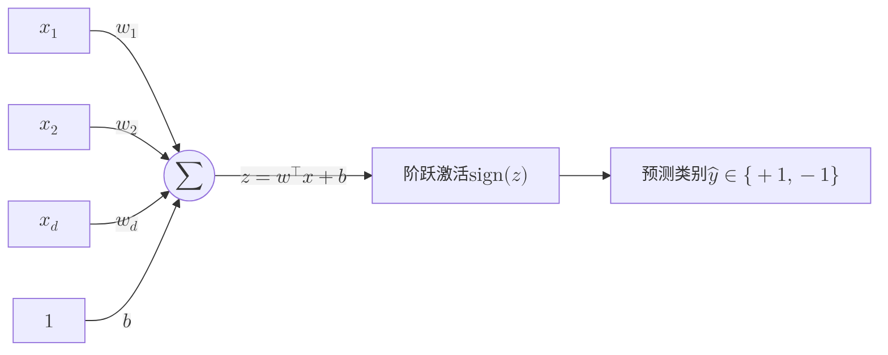
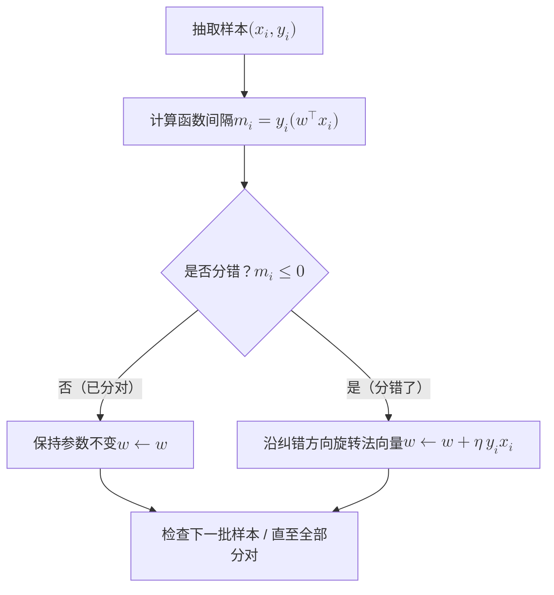
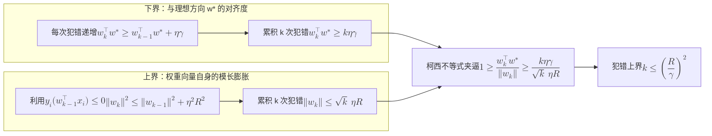
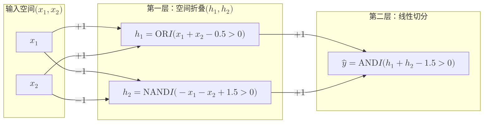
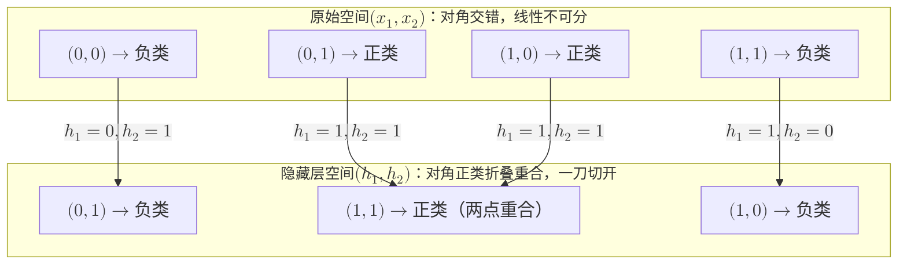

# 感知机：一切从一条直线开始

神经网络的历史可以追溯到 1958 年 Rosenblatt 提出的**感知机**（Perceptron）。它的结构简单到近乎简陋，却已经具备了现代深度神经网络的三个核心基因：**参数化的函数假设、错误驱动的迭代更新、以及当线性表达力见顶时"向外堆叠层数"的出路**。

把单层感知机的几何图像与失败边界彻底想透，后面的多层感知机与反向传播就会变成顺理成章的推演。

---

## 问题设定：用超平面切开空间

给定二分类数据集 $\{(x_i, y_i)\}_{i=1}^N$，其中特征向量 $x_i \in \mathbb{R}^d$，类别标签 $y_i \in \{+1, -1\}$。感知机的假设极其直接：在 $\mathbb{R}^d$ 空间里找一个超平面，把正负两类样本切在两侧。

超平面由法向量 $w \in \mathbb{R}^d$ 和偏置 $b \in \mathbb{R}$ 唯一决定。感知机先计算线性打分 $z = w^\top x + b$，再用符号函数 $\mathrm{sign}(z)$ 给出二元决策：

$$
f(x) = \mathrm{sign}\!\left(w^\top x + b\right) = \begin{cases} +1, & w^\top x + b > 0 \\ -1, & w^\top x + b \le 0 \end{cases}
$$



代数的每一项在几何上都有精确的对应：

| 代数表达                      | 几何含义                            | 直觉读法                               |
| :---------------------------- | :---------------------------------- | :------------------------------------- |
| $w^\top x + b = 0$            | 分割超平面本身                      | 决策边界（二维下是一条直线）           |
| 法向量 $w$                    | 垂直于超平面、指向 $+1$ 侧的向量    | 决定分割面的**朝向**                   |
| 偏置 $b$                      | 超平面沿法向量的平移量              | 决定分割面离原点的**远近**             |
| $\dfrac{w^\top x + b}{\|w\|}$ | 样本点 $x$ 到超平面的**带符号距离** | 符号代表预测类别，绝对值代表分类置信度 |

为了记号干净，常把偏置吸收进权重向量：令增广特征 $\tilde{x} = (x; 1) \in \mathbb{R}^{d+1}$，增广权重 $\tilde{w} = (w; b) \in \mathbb{R}^{d+1}$，于是打分简化为纯粹的内积 $\tilde{w}^\top \tilde{x}$。下文推导省略波浪号，直接写 $w^\top x$，默认偏置项已包含其中。

---

## 学习规则：哪里分错往哪改

如果随机初始化一条过原点的超平面 $w$，大概率会分错不少样本。怎么判断样本 $(x_i, y_i)$ 有没有分对？不需要分类讨论，只需看乘积 $y_i(w^\top x_i)$ 的符号：

- **分类正确**：$w^\top x_i$ 与 $y_i$ 同号 $\iff y_i(w^\top x_i) > 0$；
- **分类错误**（或压在边界上）：$w^\top x_i$ 与 $y_i$ 异号 $\iff y_i(w^\top x_i) \le 0$。

感知机的学习规则完全由**错误驱动**——分对的样本什么都不做，一旦遇到分错的样本 $(x_i, y_i)$，立刻把权重 $w$ 朝 $y_i x_i$ 的方向推一步：

$$
w \leftarrow w + \eta\, y_i x_i \quad \text{（当 } y_i(w^\top x_i) \le 0 \text{ 时触发）}
$$

其中 $\eta > 0$ 是学习率（步长）。整套算法的训练流转如下：



### 为什么加上 $\eta y_i x_i$ 就能纠错？

我们可以从**几何旋转**和**代数增量**两个角度同时看清这一步更新：

1. **几何视角（旋转法向量）**：
   - 假设正样本 $y_i = +1$ 被误判为负，说明当前法向量 $w$ 与 $x_i$ 的夹角大于 $90^\circ$（$w^\top x_i < 0$）。更新 $w \leftarrow w + \eta x_i$ 相当于把法向量 $w$ 往 $x_i$ 的方向拉拢，减小两者夹角，带动分割面旋转，直到把 $x_i$ 包进正侧。
   - 假设负样本 $y_i = -1$ 被误判为正，说明 $w$ 与 $x_i$ 夹角小于 $90^\circ$。更新 $w \leftarrow w - \eta x_i$ 把 $w$ 往 $x_i$ 的反方向推开，把 $x_i$ 甩回负侧。

2. **代数视角（单步距离严格改善）**：
   考察更新前后，同一个误分样本 $(x_i, y_i)$ 的带符号得分变化（利用 $y_i^2 = 1$）：

$$
y_i \left(w + \eta y_i x_i\right)^\top x_i = y_i w^\top x_i + \eta\, y_i^2 \|x_i\|^2 = \underbrace{y_i w^\top x_i}_{\le 0\text{（原得分）}} + \underbrace{\eta \|x_i\|^2}_{> 0\text{（严格正增量）}}
$$

每次更新都让当前误分样本的带符号得分严格增加 $\eta\|x_i\|^2$。用代码写出来不过寥寥数行：

```python
def train_perceptron(X, y, lr=1.0, max_epochs=100):
    w = np.zeros(X.shape[1])
    for _ in range(max_epochs):
        mistakes = 0
        for xi, yi in zip(X, y):
            if yi * (w @ xi) <= 0:      # 仅在分错时更新
                w = w + lr * yi * xi
                mistakes += 1
        if mistakes == 0:               # 全部分对，算法收敛
            break
    return w
```

---

## 收敛性：Novikoff 定理的上下界夹逼

一个自然的问题是：修正样本 A 的时候，会不会把原本分对的样本 B 又搞错，导致超平面永远在原地来回震荡？

1962 年的 **Novikoff 定理**给出了定心丸：**只要数据集线性可分，感知机算法必然在有限次犯错内彻底停机。**

> **定理前提**：设数据集线性可分，即存在单位法向量 $w^\ast$（$\|w^\ast\|=1$）和正间隔 $\gamma > 0$，使得所有样本都以至少 $\gamma$ 的几何间隔被正确分开：$y_i(w^{\ast\top} x_i) \ge \gamma$；且所有样本的模长有上界 $\|x_i\| \le R$。
>
> **结论**：从 $w_0 = 0$ 出发，感知机的总犯错次数 $k$ 满足：
> $$k \le \left(\frac{R}{\gamma}\right)^2$$

这个上界不依赖特征维度 $d$，也不依赖样本总数 $N$，甚至与学习率 $\eta$ 无关（$\eta$ 只缩放 $w$ 的模长，不改变超平面方向）。它的证明思路非常漂亮——跟踪第 $k$ 次犯错后的权重 $w_k$，用两个相反方向的不等式把 $k$ "夹"出来：



- **直觉读法**：每次犯错，$w_k$ 在理想方向 $w^\ast$ 上的投影至少线性增长 $O(k)$，而 $w_k$ 自身的长度最多按平方根 $O(\sqrt{k})$ 增长。余弦值不可能超过 $1$，所以犯错次数 $k$ 一定有上限。
- **几何推论**：数据的分类间隔 $\gamma$ 越大（两类点分得越开），或者样本分布半径 $R$ 越小，上限 $(R/\gamma)^2$ 就越小，收敛越快；反之若两类点紧贴在一起（$\gamma \to 0$），收敛步数就会急剧膨胀；若数据根本**线性不可分**，感知机就会陷入无限循环。

---

## 表达极限：XOR 问题与空间变换

感知机的阿喀琉斯之踵正是"线性可分"这四个字。1969 年 Minsky 与 Papert 在《Perceptrons》一书中指出，单层感知机连最基础的**异或（XOR）**逻辑都无法表示：

| 输入 $x_1$ | 输入 $x_2$ | 逻辑或 $\mathrm{OR}$ | 逻辑与非 $\mathrm{NAND}$ | 异或 $\mathrm{XOR}$ |
| :--------: | :--------: | :------------------: | :----------------------: | :-----------------: |
|    $0$     |    $0$     |         $0$          |           $1$            |     $0$（负类）     |
|    $0$     |    $1$     |         $1$          |           $1$            |     $1$（正类）     |
|    $1$     |    $0$     |         $1$          |           $1$            |     $1$（正类）     |
|    $1$     |    $1$     |         $1$          |           $0$            |     $0$（负类）     |

（注：为方便逻辑运算，表中用 $0/1$ 表示负类与正类，对应阶跃函数 $\mathbb{I}(z > 0)$。）

在二维平面 $(x_1, x_2)$ 上，XOR 的两个正样本 $(0,1)$、$(1,0)$ 和两个负样本 $(0,0)$、$(1,1)$ 分别占据正方形的两条对角线。要在平面上画一条直线把两组对角点分开，几何上绝无可能；代数上，四个点的不等式约束加起来会直接导出 $0 > 0$ 的矛盾。

### 破解之道：用第一层重塑空间，用第二层切分

一条直线切不开，就先用**两条直线**对空间做一次特征变换。观察上表最后三列：

$$
\mathrm{XOR}(x_1, x_2) = \mathrm{OR}(x_1, x_2) \;\land\; \mathrm{NAND}(x_1, x_2)
$$

$\mathrm{OR}$、$\mathrm{NAND}$、$\mathrm{AND}$ 三个子问题各自都是线性可分的！把 $\mathrm{OR}$ 和 $\mathrm{NAND}$ 作为第一层（隐藏层）的两个神经元 $h_1, h_2$，再把它们的输出喂给第二层的 $\mathrm{AND}$ 神经元，XOR 迎刃而解：



为什么加了一层隐藏层就能切开？看四个样本经过第一层映射后的坐标变化：



这就是深度神经网络最核心的几何直觉：**隐藏层的作用是扭曲和折叠输入空间，把原本纠缠在一起的非线性分布，映射到一个新的特征空间 $(h_1, h_2)$ 中，让它们在最后一层面前变得线性可分。**

但这里留下了一个致命悬念：上面的权重是我们看着真值表手工凑出来的。如果给你一个未知任务，两层感知机怎么从数据里自动学出参数？

感知机的更新规则依赖"当前神经元的正确标签 $y_i$"，而**隐藏层神经元 $h_1, h_2$ 夹在网络中间，训练集里根本没有它们的标准答案**。当最终输出 $\hat{y}$ 算错时，到底该怪第二层的权重，还是怪第一层的 $h_1$ 或 $h_2$？阶跃函数 $\mathrm{sign}(z)$ 把微小的参数变动全部抹平为零，误差信号根本传不回第一层。

如何打通多层网络的误差归因通路，正是下一篇《多层感知机》要解决的核心问题。

---

## 小结

- **几何本质**：感知机用超平面 $w^\top x + b = 0$ 做线性二分类，打分 $w^\top x + b$ 正比于样本到超平面的带符号距离。
- **错误驱动学习**：仅在 $y_i(w^\top x_i) \le 0$ 时执行 $w \leftarrow w + \eta y_i x_i$，每次更新保证当前误分样本的带符号得分严格提升 $\eta\|x_i\|^2$。
- **收敛保证**：Novikoff 定理证明线性可分数据至多犯错 $(R/\gamma)^2$ 次即停机；分类间隔 $\gamma$ 决定了收敛速度。
- **层数堆叠的动机与难题**：XOR 揭示了单层线性分类器的极限；引入隐藏层可以通过空间折叠解决表达力问题，但阶跃函数的不可微阻断了中间层的误差归因。
