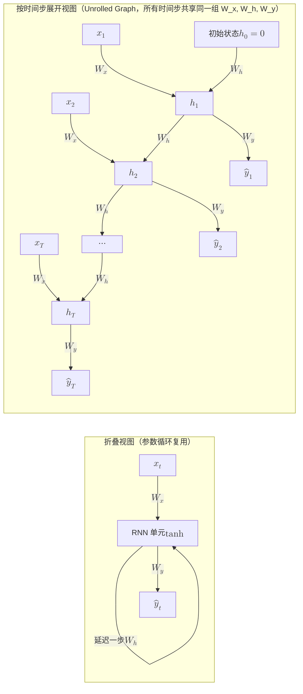
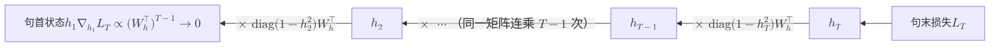
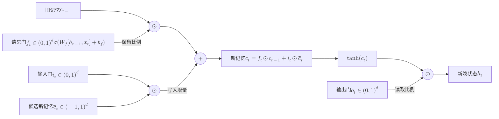
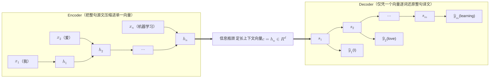

# 序列建模：RNN 与它的记忆瓶颈

前四篇处理的输入都是**固定维度的静态向量** $x \in \mathbb{R}^d$。但在真实世界里，最核心的信息载体——自然语言文本、语音波形、代码、时间序列——全都是**变长序列** $\mathbf{x} = (x_1, x_2, \dots, x_T)$。

序列数据有两个让普通多层感知机（MLP）束手无策的特征：

1. **长度 $T$ 动态变化**：一句话可以是 $3$ 个词，也可以是 $300$ 个词，而 MLP 的输入层矩阵 $W^{(1)}$ 维度在初始化时就焊死了；
2. **位置顺序决定语义，且局部模式需跨位置复用**："狗咬人"与"人咬狗"包含完全相同的词，顺序颠倒则含义反转；同时，无论一个短语出现在句首还是句尾，识别它的语法规则应当是同一套，不能每个位置各学一套互不相干的参数。

因此，合格的序列模型必须同时满足两条铁律：**接受任意长度 $T$ 的输入**，且**在所有时间步共享同一套参数**。

---

## 循环神经网络（RNN）：把历史浓缩成隐状态

循环神经网络（Recurrent Neural Network, RNN）的设计非常符合人类逐字阅读的直觉：不试图一次吞下整句话，而是维护一个固定维度的**隐状态向量**（Hidden State）$h_t \in \mathbb{R}^d$，作为"读到第 $t$ 个词为止的全部上下文摘要"。

每到一个新的时间步 $t$，RNN 读入当前词向量 $x_t$ 和上一时刻的旧摘要 $h_{t-1}$，用**同一套权重矩阵** $(W_x, W_h, b)$ 算出新摘要 $h_t$，并按需输出当前步的预测 $\hat{y}_t$：

$$
h_t = \tanh\!\left(W_h h_{t-1} + W_x x_t + b\right), \qquad \hat{y}_t = \mathrm{softmax}\!\left(W_y h_t + b_y\right)
$$

把循环结构沿时间轴展开，就能看清信息是如何在词与词之间传递的：



请特别留意展开图中的一个关键事实：图中的每一个节点并不是拥有独立权重的不同层，而是**同一个函数 $(W_x, W_h, W_y)$ 在不同时刻 $t=1, 2, \dots, T$ 的反复调用**。正因如此，无论句子长 $5$ 个词还是 $500$ 个词，模型的参数量都恒定不变：

```python
def rnn_forward(x_seq, h0, W_x, W_h, b, W_y, b_y):
    h = h0
    hs, ys = [], []
    for x_t in x_seq:                             # 逐时间步串行推进，共享同一套权重
        h = np.tanh(W_h @ h + W_x @ x_t + b)
        y_t = softmax(W_y @ h + b_y)
        hs.append(h)
        ys.append(y_t)
    return hs, ys
```

注意这个 `for x_t in x_seq` 循环：第 $t$ 步必须等第 $t-1$ 步算出 $h_{t-1}$ 后才能开始。这种**时间步之间的强串行依赖**，既是 RNN 的立身之本，也将成为后来它在 GPU 大规模并行时代被淘汰的伏笔。

---

## 沿时间反向传播（BPTT）与长期依赖死穴

展开后的 RNN 计算图就是一个深度为 $T$、层间共享权重的深层网络。因此训练它不需要发明新理论，直接沿着展开图从右往左跑反向传播即可——这套算法称为**沿时间反向传播**（Backpropagation Through Time, BPTT）。由于参数 $(W_h, W_x)$ 在每个时间步都被使用了一次，它们最终的总梯度就是所有时间步局部梯度的总和。

然而，上一篇《深层的代价》里刚刚剖析过的**连乘噩梦**，立刻在时间轴上以更惨烈的方式重演了。

假设我们在句末第 $T$ 步算出了损失 $L_T$，要把梯度沿着隐状态链条传回句首第 $1$ 步的 $h_1$，根据链式法则：

$$
\frac{\partial L_T}{\partial h_1} = \frac{\partial L_T}{\partial h_T} \prod_{t=2}^{T} \frac{\partial h_t}{\partial h_{t-1}} = \frac{\partial L_T}{\partial h_T} \prod_{t=2}^{T} \mathrm{diag}\!\left(1 - h_t^2\right) W_h^\top
$$



为什么时间轴上的连乘比普通深层 MLP 更加致命？

- 在普通 MLP 中，每一层乘的是不同的矩阵 $(W^{(l)})^\top$，不同层之间奇异值的涨落还能稍微互相抵消；
- 在 RNN 中，每跨越一个时间步，乘的都是**同一个矩阵 $W_h^\top$**（外加小于等于 $1$ 的 $\tanh'$ 导数因子）！同一个矩阵连乘 $T-1$ 次，其渐近行为完全由 $W_h$ 的最大奇异值 $\sigma_{\max}$ 主导：
  - 若 $\sigma_{\max} > 1$，梯度随句子长度 $T$ 呈指数爆炸（工程上只能靠**梯度裁剪 Gradient Clipping** 强行把超过阈值 $\tau$ 的梯度范数截断：当 $\|g\| > \tau$ 时令 $g \leftarrow \frac{\tau}{\|g\|} g$）；
  - 若 $\sigma_{\max} < 1$（加上 $\tanh$ 饱和区导数趋零），梯度随距离 $T-t$ 呈指数衰减至 $0$。

### 梯度消失的实际后果：近因偏见与长程失忆

看一个直观的语言建模例子：

> "**我出生在中国**，小时候跟着父母搬过好几座城市，读大学时去了欧洲交换，工作后又学了法语和西班牙语……（中间隔了 80 个词）……所以**我的母语是** \_\_\_\_。"

要填出横线上的"中文"，模型在句末必须依赖 80 步之前的句首信息"中国"。然而在反向传播时，句末预测错误产生的梯度 $\frac{\partial L_T}{\partial W_h}$ 由近处时间步和远处时间步的贡献相加而成：

- 距离句末仅 $1 \sim 3$ 步的近期梯度强健有力，牢牢主导了参数更新的方向；
- 穿越了 $80$ 个时间步传回"中国"处的远期梯度，早已被乘成了 $10^{-30}$，对参数更新毫无发言权。

结果，朴素 RNN 理论上能看无限长的历史，**实际上有效记忆跨度只有短短一二十步**。

---

## LSTM 与 GRU：给记忆修一条门控加法传送带

怎么打破时间轴上的连乘衰减？回想上一篇 ResNet 是怎么拯救百层网络的：**把连乘改成连加（$y = x + F(x)$），让导数里出现恒等项**。

早在 1997 年（比 ResNet 早了整整 18 年），Hochreiter 与 Schmidhuber 提出的 **LSTM**（Long Short-Term Memory，长短期记忆网络）就已经在时间轴上用上了完全相同的思想！

LSTM 把单一的隐状态拆成了两条轨道：

- **短期工作状态 $h_t$**：负责当前步的即时交互与输出；
- **长期记忆细胞 $c_t$（Cell State）**：横贯整个时间轴的**线性加法传送带**。



核心奥秘全在顶部那条从 $c_{t-1}$ 到 $c_t$ 的水平主干道上：

$$
c_t = f_t \odot c_{t-1} + i_t \odot \tilde{c}_t
$$

这里完全没有矩阵乘法，只有三个由 Sigmoid（输出在 $(0, 1)$ 之间，充当软开关）控制的**门控向量**（Gates）：

| 组件名称         | 计算公式                                        | 角色直觉                                                                                  |
| :--------------- | :---------------------------------------------- | :---------------------------------------------------------------------------------------- |
| **遗忘门 $f_t$** | $\sigma\!\left(W_f [h_{t-1}, x_t] + b_f\right)$ | 决定旧记忆 $c_{t-1}$ 的每个维度**保留多少**（接近 $1$ 为完整记住，接近 $0$ 为清空）       |
| **输入门 $i_t$** | $\sigma\!\left(W_i [h_{t-1}, x_t] + b_i\right)$ | 决定当前步提炼出的候选内容 $\tilde{c}_t = \tanh(W_c[h_{t-1}, x_t] + b_c)$ **写入多少**    |
| **输出门 $o_t$** | $\sigma\!\left(W_o [h_{t-1}, x_t] + b_o\right)$ | 决定从长期记忆 $\tanh(c_t)$ 中**提取多少**暴露给当前工作状态 $h_t = o_t \odot \tanh(c_t)$ |

看梯度沿着记忆传送带 $c_t \to c_{t-1}$ 回传时的偏导数主项：

$$
\frac{\partial c_t}{\partial c_{t-1}} = \mathrm{diag}(f_t) + \text{（跨门控旁路项）}
$$

只要模型学会把某个记忆维度上的遗忘门 $f_t$ 打开到接近 $1$（例如在读到"中国"后，把记录国籍维度的遗忘门一直置为 $1$），信息与梯度就能顺着这条加法传送带跨越上百步而几乎不衰减！2014 年提出的 **GRU**（Gated Recurrent Unit）进一步把遗忘门与输入门合并为单一的更新门 $z_t$（令保留比例与写入比例互补：$h_t = (1-z_t)\odot h_{t-1} + z_t \odot \tilde{h}_t$），在省去三分之一参数的同时达到了与 LSTM 相当的效果。

---

## Seq2Seq 范式与绕不开的"单向量瓶颈"

有了 LSTM/GRU，我们终于能搭出处理机器翻译、文本摘要等"序列到序列"任务的经典架构——**Encoder–Decoder（编码器–解码器 / Seq2Seq）**（Sutskever et al., 2014）：

1. **编码器（Encoder）**：一个 RNN 逐词读入源语言句子 $(x_1, \dots, x_n)$，不断更新隐状态；读完最后一个词后，得出最终隐状态向量 $c = h_n \in \mathbb{R}^d$；
2. **解码器（Decoder）**：另一个 RNN 以这个浓缩向量 $s_0 = c$ 作为初始状态，以自回归（Autoregressive）方式逐词吐出目标语言译文 $(y_1, y_2, \dots, y_m)$——每一步生成的词 $y_{t-1}$ 作为下一步的输入喂回解码器。



看着这张图中间那根孤零零的粗箭头 $c = h_n$，一个致命的结构缺陷呼之欲出：

**无论源句子是 $5$ 个词还是 $500$ 个词，Encoder 都必须把整句话的全部主谓宾、修饰语、时态细节硬生生塞进这唯一一个固定长度的向量 $c \in \mathbb{R}^d$ 里！**

这就好比让译员先读完一整页英文合同，然后把合同收走，只允许他在掌心写下几个字（定长向量 $c$），再让他凭这几个字一字不差地默写出中文译本。哪怕 LSTM 缓解了梯度消失，一个几百维的定长向量在信息论意义上也装不下一长句话的全部细节——句子超过二三十个词后，Seq2Seq 的翻译质量就会断崖式下跌。

怎么破局？想一想人类译员是怎么翻译长句的：**人类从来不会把原句背下来再扔掉原文，而是边写译文的每一个词，边把目光移回原句的对应位置去"查原文"！**

把"回头查原文"写成可微的数学公式，就是改变了整个深度学习历史进程的机制——**注意力（Attention）**。

---

## 小结

- **序列建模两原则**：兼容变长序列 $T$，且跨所有时间步共享参数。RNN 通过循环传递隐状态 $h_t = \tanh(W_h h_{t-1} + W_x x_t + b)$ 实现这两点，代价是时间步之间必须串行计算。
- **BPTT 与长程失忆**：沿时间反向传播时，梯度每倒退一步都要乘一次相同的 $W_h^\top$，连乘导致远距离梯度指数消失或爆炸，朴素 RNN 难以捕捉长程依赖。
- **LSTM / GRU 的核心直觉**：与残差连接如出一辙——引入线性相加的记忆传送带 $c_t = f_t \odot c_{t-1} + i_t \odot \tilde{c}_t$，用可学习的门控开关保护长程梯度不衰减。
- **Seq2Seq 的单向量瓶颈**：Encoder–Decoder 强行把任意长度的源句压缩进唯一的末状态向量 $c = h_n$，句子一长便发生严重的信息丢失——这直接催生了下一篇的主角：注意力机制。
