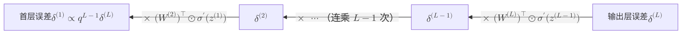
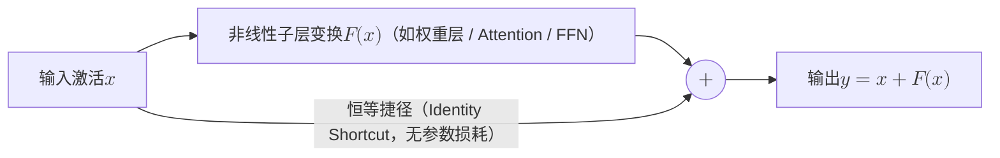

# 深层的代价：梯度消失、初始化与归一化

前两篇备齐了反向传播与 Adam 优化器，训练三四层的浅层网络已经轻车熟路。但深度学习之所以叫"**深度**"学习，是因为深层网络通过逐层组合简单特征（边缘 $\to$ 局部纹理 $\to$ 部件 $\to$ 整体语义），可以用比浅层宽网络少几个数量级的参数表征复杂的层次结构。

然而早期研究者试图把网络堆到十层以上时，无一例外撞上了一堵墙：**层数越深，训练误差反而越高**，靠前的隐藏层参数几乎停留在随机初始化状态一动不动。

问题不在于优化器，而在于反向传播的**矩阵连乘结构**本身。本篇首先诊断深层网络的病理，随后配齐四件拯救深层训练的现代基石工具——它们将在后文的 Transformer 架构中全员登场。

---

## 病理诊断：连乘链条上的指数失控

回顾《多层感知机》中误差信号 $\delta^{(l)} = \frac{\partial L}{\partial z^{(l)}}$ 的反向递推公式：

$$
\delta^{(l)} = \left(W^{(l+1)}\right)^{\!\top} \delta^{(l+1)} \;\odot\; \sigma'\!\left(z^{(l)}\right)
$$

如果网络一共有 $L$ 层，把这条递推式从输出层 $\delta^{(L)}$ 一路展开到第 $1$ 层 $\delta^{(1)}$，中间要经历 $L-1$ 次连乘：

$$
\delta^{(1)} = \left(\prod_{k=2}^{L} \mathrm{diag}\!\left(\sigma'\!\left(z^{(k-1)}\right)\right) \left(W^{(k)}\right)^{\!\top}\right) \delta^{(L)}
$$



小学数学告诉我们，一个因子 $q$ 连乘 $L-1$ 次（$q^{L-1}$），只有两种极端宿命：

|           单层传递因子尺度 $q$            |   经过 $L=30$ 层后的缩放比例 $q^{29}$   | 病理现象                           | 对训练的毁灭性后果                                         |
| :---------------------------------------: | :-------------------------------------: | :--------------------------------- | :--------------------------------------------------------- |
| **$q < 1$**（如 Sigmoid 导数 $\le 0.25$） | $0.25^{29} \approx 3.5 \times 10^{-18}$ | **梯度消失**（Vanishing Gradient） | 传到前几层时梯度已下溢为 $0$，浅层特征提取器完全停止更新   |
|    **$q > 1$**（如权重矩阵奇异值偏大）    |   $2^{29} \approx 5.4 \times 10^{8}$    | **梯度爆炸**（Exploding Gradient） | 前几层梯度比输出层大上亿倍，一步更新直接让参数溢出为 `NaN` |

注意：**靠调学习率或换 Adam 救不了梯度消失/爆炸。** 因为出问题的是**层与层之间的相对比例**——第 $1$ 层的梯度和第 $30$ 层的梯度差了十几个数量级，而前向信号的计算又高度依赖第 $1$ 层先把底层特征提准。

要让信号在前向和反向穿过几十层网络依然保持健康，必须在**起点（初始化）**、**每一步门控（激活函数）**、**中途分布（归一化）**和**拓扑主干（残差连接）**四个环节同时动手术：


---

## 工具一：权重初始化——在起点把方差摆平

怎么让连乘因子 $q$ 从训练的第一步起就恰好等于 $1$？答案是：**控制权重矩阵 $W^{(l)}$ 的初始方差，使得前向传播时各层激活的方差不随层数放大或缩小，反向传播时梯度的方差同样保持恒定。**

考察单层无偏置的线性求和 $z = \sum_{i=1}^{n_{\text{in}}} w_i x_i$，其中 $n_{\text{in}}$ 是该层输入维度（fan-in）。假设权重 $w_i$ 与输入 $x_i$ 相互独立、零均值，且同层各分量同分布，则输出 $z$ 的方差为：

$$
\mathrm{Var}(z) = \sum_{i=1}^{n_{\text{in}}} \mathrm{Var}(w_i x_i) = n_{\text{in}} \cdot \mathrm{Var}(w) \cdot \mathrm{Var}(x)
$$

看清这个乘数 $n_{\text{in}} \cdot \mathrm{Var}(w)$！如果一个隐藏层有 $n_{\text{in}} = 1024$ 个输入，而你随手用标准正态分布 $\mathcal{N}(0, 1)$（即 $\mathrm{Var}(w) = 1$）初始化权重，那么每过一层，方差就会暴涨 $1024$ 倍（标准差暴涨 $32$ 倍），三层之后直接数值溢出！

要让输出方差等于输入方差 $\mathrm{Var}(z) = \mathrm{Var}(x)$，必须满足 $n_{\text{in}} \cdot \mathrm{Var}(w) = 1$：

| 初始化方案                 | 适用激活函数          |                      权重初始方差 $\mathrm{Var}(w)$                       | 推导依据                                                                      |
| :------------------------- | :-------------------- | :-----------------------------------------------------------------------: | :---------------------------------------------------------------------------- |
| **Xavier (Glorot) 初始化** | Tanh / Sigmoid / 线性 | $\dfrac{1}{n_{\text{in}}}$ 或 $\dfrac{2}{n_{\text{in}} + n_{\text{out}}}$ | 零附近近似线性；兼顾前向（$n_{\text{in}}$）与反向（$n_{\text{out}}$）方差守恒 |
| **He (Kaiming) 初始化**    | ReLU 及其变体         |                        $\dfrac{2}{n_{\text{in}}}$                         | ReLU 将负半轴清零，使激活方差折半，需将权重方差乘 $2$ 补偿                    |

---

## 工具二：激活函数演进——从 Sigmoid 到 ReLU 与 GELU

即便用 Xavier 初始化稳住了起点，只要隐藏层还在用 Sigmoid，$\sigma'(z) = \sigma(z)(1-\sigma(z))$ 的最大值也只有 $\sigma'(0) = \frac{1}{4}$。每过一层，梯度至少打二五折，深层网络照样训不动。

破局之道是**放弃两端饱和的 S 型曲线，让正半轴的导数恒等于 $1$**：

| 激活函数       | 表达式              | 正半轴表现                               | 负半轴表现                                             | 典型应用场景                      |
| :------------- | :------------------ | :--------------------------------------- | :----------------------------------------------------- | :-------------------------------- |
| **ReLU**       | $\max(0, z)$        | 恒等映射 $z$，导数恒为 $1$，梯度无损通过 | 硬截断为 $0$，导数为 $0$（存在神经元"坏死"风险）       | CNN 与通用 MLP 默认首选           |
| **Leaky ReLU** | $\max(\alpha z, z)$ | 导数恒为 $1$                             | 保留微小斜率 $\alpha \approx 0.01$，防止神经元永久失活 | 对负半轴梯度敏感的网络            |
| **GELU**       | $z \cdot \Phi(z)$   | $z \gg 0$ 时渐近于 $z$，导数趋于 $1$     | 在 $z=0$ 附近按高斯累积分布 $\Phi(z)$ 平滑过渡         | **Transformer / GPT / BERT 标配** |

ReLU 把激活导数从 $\le 0.25$ 直接变成了正半轴恒等于 $1$，相当于把反向传播路上的"收费站"对正激活彻底敞开；而 GELU（Gaussian Error Linear Unit）则在 ReLU 的转折点处磨出了光滑弧度，成为现代大语言模型前馈层的事实标准。

---

## 工具三：归一化（Normalization）——中途强行拉回分布

好的初始化只能保佑**第 $0$ 步**各层激活方差为 $1$。一旦开始训练，第 $1$ 层的参数发生更新，第 $2$ 层看到的输入分布就会随之漂移；第 $1, 2$ 层一动，第 $3$ 层的输入分布漂移得更厉害——每一层都在追逐一个不断移动的靶子。

既然分布会漂移，最直接的工程手段就是**在每一层内部加一道关卡，强行把当前激活减均值、除标准差，拉回均值为 $0$、方差为 $1$ 的标准分布**，然后再配上一对可学习的缩放参数 $\gamma$ 和平移参数 $\beta$（保留网络在必要时恢复原分布的自由度）：

$$
\hat{x} = \frac{x - \mu}{\sqrt{\sigma^2 + \varepsilon}}, \qquad y = \gamma \odot \hat{x} + \beta
$$

按均值 $\mu$ 和方差 $\sigma^2$ **沿着哪个维度统计**，分化出了视觉与序列两大阵营的核心组件——**BatchNorm** 与 **LayerNorm**。设一批序列特征张量的形状为 $[B\text{（样本数）}, D\text{（特征维）}]$：

```mermaid
flowchart TB
    subgraph bn["BatchNorm（沿 Batch 维纵向统计：同一特征跨样本求均值方差）"]
        direction LR
        b1["样本 1：$$[x_{1,1},\; x_{1,2},\; \dots,\; x_{1,D}]$$"]
        b2["样本 2：$$[x_{2,1},\; x_{2,2},\; \dots,\; x_{2,D}]$$"]
        b3["样本 B：$$[x_{B,1},\; x_{B,2},\; \dots,\; x_{B,D}]$$"]
        b1 & b2 & b3 --> bstat["对每个特征列 $$j$$ 跨样本统计<br/>$$\mu_j = \frac{1}{B}\sum_{i=1}^B x_{i,j}$$"]
    end
    subgraph ln["LayerNorm（沿 Feature 维横向统计：单样本内部跨特征求均值方差）"]
        direction LR
        l1["样本 $$i$$：$$[x_{i,1},\; x_{i,2},\; \dots,\; x_{i,D}]$$"] --> lstat["在单样本 $$i$$ 内部跨特征统计<br/>$$\mu_i = \frac{1}{D}\sum_{j=1}^D x_{i,j}$$"]
    end
```

| 对比维度                   | BatchNorm (BN)                                                   | LayerNorm (LN)                                       |
| :------------------------- | :--------------------------------------------------------------- | :--------------------------------------------------- |
| **统计切片方向**           | 跨样本同特征（依赖当前 Mini-batch 内的其它样本）                 | 单样本全特征（每个样本/每个词位置完全独立计算）      |
| **对 Batch Size 的敏感度** | 极高（Batch Size 太小时统计量噪声大，训练崩溃）                  | **零依赖**（Batch Size 为 $1$ 时照常精确计算）       |
| **训练 vs 推理行为**       | **不一致**（训练用当前批次统计量，推理必须冻结改用全局滑动平均） | **完全一致**（训练和推理都直接算当前输入的均值方差） |
| **变长序列适配性**         | 差（不同样本序列长度不一，尾部填充位污染批次统计）               | **极佳**（逐位置独立归一化，天然适配任意长度序列）   |
| **统治领域**               | 卷积神经网络（CNN / 计算机视觉）                                 | **序列模型与 Transformer（LLM 绝对主力）**           |

现代研究（如 Santurkar et al., 2018）进一步揭示，归一化层最核心的贡献在于**大幅平滑了损失曲面的几何地形（Lipschitz 连续性更好）**，使梯度方向更加稳定可靠，从而允许我们使用大得多的学习率而不至于发散。

---

## 工具四：残差连接与正则化——架设梯度高速公路

即便配齐了 He 初始化、ReLU 和归一化，当网络深度突破 $20 \sim 30$ 层时，连乘路径还是太长了。2015 年何恺明等人提出的 **ResNet（残差网络）**用一行极其简单的结构改造，彻底终结了梯度消失的历史：

与其让网络子层直接去拟合目标映射 $H(x)$，不如给子层旁路并联一条**恒等捷径（Shortcut / Skip Connection）**，让子层只去学习目标与输入之间的**残差修正量** $F(x) = H(x) - x$：

$$
y = x + F(x)
$$



为什么仅仅加了一个 "$+ x$"，就能把网络轻松推到上百层甚至上千层？看反向传播时损失 $L$ 对输入 $x$ 的梯度：

$$
\frac{\partial L}{\partial x} = \frac{\partial L}{\partial y} \cdot \frac{\partial y}{\partial x} = \frac{\partial L}{\partial y} \cdot \left(\mathbf{I} + \frac{\partial F(x)}{\partial x}\right) = \underbrace{\frac{\partial L}{\partial y}}_{\text{无损直达项}} + \frac{\partial L}{\partial y}\frac{\partial F(x)}{\partial x}
$$

**括号里多出来的那个单位矩阵 $\mathbf{I}$，把原本的"连乘"彻底改写成了"连加"！**
哪怕中间某些层的权重梯度 $\frac{\partial F(x)}{\partial x}$ 小到接近 $0$，高层的误差信号 $\frac{\partial L}{\partial y}$ 依然可以顺着 $+x$ 这条没有设卡的"梯度高速公路"原封不动地直达第一层。在 Transformer 中，每一个注意力层和前馈层外面都包裹着这样一条残差连接。

---

## 对抗过拟合：Dropout 与 AdamW 解耦权重衰减

当深层网络终于能够顺畅训练后，巨大的参数容量带来了反面风险：**过拟合（Overfitting）**——模型把训练集的噪声甚至错误标签死记硬背下来，在测试集上却一塌糊涂。两件轻量而标准的正则化工具负责看住模型的复杂度：

### 1. Dropout：训练时的随机断路演习

在训练阶段的前向传播中，以概率 $p$（通常取 $0.1 \sim 0.5$）随机将一部分神经元的激活输出置为 $0$，同时将存活下来的神经元输出放大 $\frac{1}{1-p}$ 倍（称为 **Inverted Dropout**）；而在测试推理阶段，关闭 Dropout，所有神经元全员上阵：

```python
def dropout(x, p=0.1, training=True):
    if not training or p == 0.0:
        return x
    mask = (np.random.rand(*x.shape) >= p) / (1.0 - p)  # 期望保持不变：E[mask] = 1
    return x * mask
```

为什么要在训练时除以 $1-p$？因为这样能保证训练时激活值的数学期望 $\mathbb{E}[\tilde{x}] = (1-p)\cdot\frac{x}{1-p} + p\cdot 0 = x$ 与测试时完全一致，测试阶段无需改动任何权重。直觉上，Dropout 逼迫网络不能把宝押在某几个特定的"明星神经元"上（防止特征共适应），必须在多条通路间建立冗余表征，相当于隐式地对指数多个共享权重的子网络做模型集成。

### 2. 权重衰减（Weight Decay）与 AdamW

为了防止权重参数无限膨胀、拟合出剧烈震荡的复杂边界，经典做法是在损失函数后加上 $L_2$ 正则项 $\frac{\lambda}{2}\|\theta\|^2$。对它求导相当于在梯度里多加了一项 $\lambda\theta$，在标准 SGD 中等价于每次更新先把权重按比例往零收缩一点：$\theta \leftarrow (1 - \eta\lambda)\theta - \eta g_t$。

但到了 Adam 里，如果直接把 $\lambda\theta$ 塞进梯度 $g_t$，这股收缩力也会被除以分母 $\sqrt{\hat{v}_t}$——结果梯度越大的参数，受到的正则化惩罚反而被除得越小！2019 年提出的 **AdamW** 指出了这一谬误，将**权重衰减从梯度计算中彻底解耦**，直接乘在参数本身上：

$$
\theta_t = \underbrace{(1 - \eta\lambda)\,\theta_{t-1}}_{\text{解耦权重衰减}} - \underbrace{\eta\, \frac{\hat{m}_t}{\sqrt{\hat{v}_t} + \varepsilon}}_{\text{纯数据梯度步}}
$$

这一改动恢复了权重衰减在自适应优化器中应有的几何收缩效果，使 **AdamW** 成为了今天训练几乎所有 Transformer 与大语言模型的绝对标配。

---

## 小结

- **深层病理**：反向传播是雅可比矩阵的 $L-1$ 次连乘，单层因子偏离 $1$ 就会引发梯度的指数消失或爆炸，单纯调学习率无法解决层间梯度比例失衡。
- **训练深网四大支柱**：
  1. **Xavier / He 初始化**：按输入维度缩放初始权重方差（$\frac{1}{n_{\text{in}}}$ 或 $\frac{2}{n_{\text{in}}}$），稳住第 $0$ 步的前反向信号方差；
  2. **ReLU / GELU 激活**：正半轴导数为 $1$，消除激活函数的连乘折损；
  3. **BatchNorm / LayerNorm**：中途强制将激活拉回标准分布并平滑损失面；序列模型统一采用与 batch 无关的 **LayerNorm**；
  4. **残差连接 $y = x + F(x)$**：在导数中引入恒等项 $\mathbf{I}$，把连乘改写为连加，为梯度开辟无损直达通道。
- **正则化标配**：Inverted Dropout 通过随机断路防止特征共适应；**AdamW** 将权重衰减与自适应梯度解耦，成为现代大模型默认优化器。
- **下一站**：至此，处理**固定维度向量**的深层网络工具箱已全部齐备。但如果输入是一段长度不固定的文本或语音序列，网络又该如何组织？下一篇进入《序列建模》。
