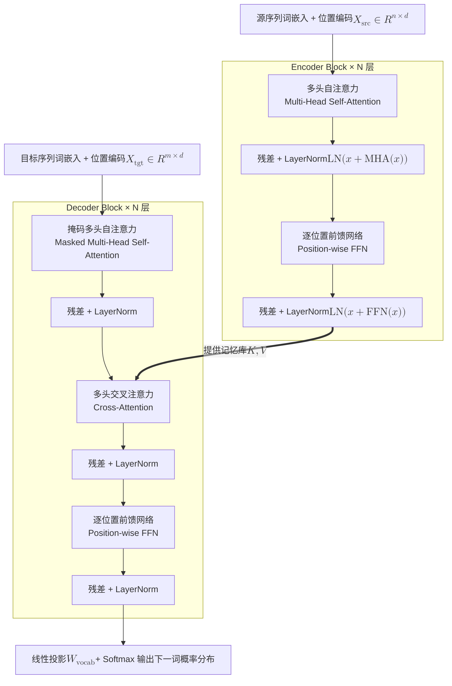
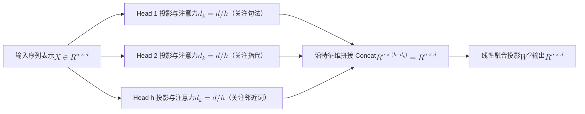
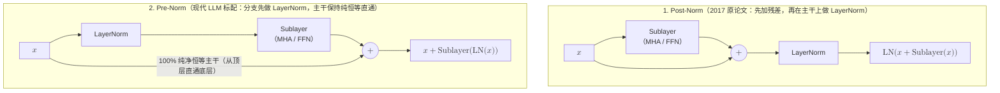

# Transformer 入门：注意力就是全部

2017 年 Vaswani 等人发表的里程碑论文 _Attention Is All You Need_ 做了一个极其激进的决定：**把循环神经网络（RNN / LSTM）彻底扔掉，完全用注意力机制与多层感知机（MLP）搭建序列模型。**

这一决定把上一篇自注意力的两大结构红利兑现到了极致：

- **任意长程依赖一步直达（路径长度 $O(1)$）**：彻底告别沿时间轴连乘的梯度消失；
- **训练阶段全序列并行计算**：整句话所有位置打包成一次矩阵乘法，将 GPU 算力压榨到极限。

本篇作为《神经网络基础》系列的收官之作，将拆解 Transformer 的每一个积木块，并让你看到前六篇积累的所有基本功——MLP、交叉熵、AdamW 与 Warmup、Xavier/He 初始化、GELU、LayerNorm、残差连接与 Q/K/V 注意力——是如何在这一张架构图里严丝合缝地汇合的。

---

## 架构全景：两种正交操作的交替堆叠

原论文中的 Transformer 面向机器翻译任务，依然沿用 Encoder–Decoder 宏观框架，但内部不再有任何按时间步循环的箭头，取而代之的是 $N$ 层完全相同的标准模块（Block）的纵向堆叠：



如果把整张图浓缩成一句话，Transformer 的每一层其实只交替做两件正交的事：

1. **沿序列维混合信息（Token Mixing —— 注意力子层）**：让不同位置的词互相检索、交换上下文，但不在特征通道间做复杂的非线性变换；
2. **沿特征维加工表示（Channel Mixing —— FFN 子层）**：对每个词位置独立施加同一个两层 MLP，提炼高阶非线性特征，但位置与位置之间互不通信。

下面我们逐一拆解构成这座大厦的四个核心零件。

---

## 零件一：位置编码（Positional Encoding）——把顺序加回输入

上一篇指出，自注意力只算内积和加权和，天生具有**置换等变性**——把输入句子的词序打乱，注意力算出来的向量内容丝毫不变。为了让模型分清"狗咬人"和"人咬狗"，必须在进入第一层之前，把每个词所处的位置编号 $pos \in \{0, 1, \dots, n-1\}$ 编码成一个 $d$ 维向量 $\mathrm{PE}_{pos} \in \mathbb{R}^d$，**直接加**在词嵌入向量 $x_{pos}$ 上：

$$
\tilde{x}_{pos} = x_{pos} + \mathrm{PE}_{pos}
$$

原论文设计了一套无需训练参数的**正弦余弦位置编码（Sinusoidal Positional Encoding）**，让向量的第 $2i$ 维和第 $2i+1$ 维（$i = 0, \dots, d/2 - 1$）分别按不同波长的三角函数周期摆动：

$$
\mathrm{PE}_{(pos,\, 2i)} = \sin\!\left(\frac{pos}{10000^{2i/d}}\right), \qquad \mathrm{PE}_{(pos,\, 2i+1)} = \cos\!\left(\frac{pos}{10000^{2i/d}}\right)
$$

为什么用一排不同频率的 $\sin$ 和 $\cos$？有两个非常漂亮的数学直觉：

1. **连续版的二进制钟表**：就像机械表有秒针（高频）、分针（中频）、时针（低频）一样，编码向量的前几维（$i$ 小）波长极短，随 $pos$ 变化飞快，负责区分相邻的词；后几维（$i$ 大）波长极长，随 $pos$ 缓慢漂移，负责标记全局段落位置。所有维度合在一起，为每个位置赋予了独一无二的坐标签名。
2. **相对位移等价于线性旋转**：利用三角恒等式 $\sin(\alpha+\beta) = \sin\alpha\cos\beta + \cos\alpha\sin\beta$，任意固定跨度 $k$ 之外的位置编码 $\mathrm{PE}_{pos+k}$，都可以写成当前位置编码 $\mathrm{PE}_{pos}$ 乘以一个仅依赖距离 $k$ 的 $2 \times 2$ 旋转矩阵：

$$
\begin{bmatrix} \sin\bigl(\omega_i(pos+k)\bigr) \\ \cos\bigl(\omega_i(pos+k)\bigr) \end{bmatrix} = \begin{bmatrix} \cos(\omega_i k) & \sin(\omega_i k) \\ -\sin(\omega_i k) & \cos(\omega_i k) \end{bmatrix} \begin{bmatrix} \sin(\omega_i pos) \\ \cos(\omega_i pos) \end{bmatrix}
$$

这意味着模型在做线性投影算 $QK^\top$ 时，能够极其自然地捕捉两个词之间的**相对距离 $k$**（这一思想后来直接演化为现代大模型标配的旋转位置编码 **RoPE**）。当然，工程中也可以直接把位置编码设成一张可学习的嵌入表（Learned Positional Embedding），像查词表一样按位置下标查表相加。

---

## 零件二：多头注意力（Multi-Head Attention）——多组子空间并行审视

在单头自注意力中，每个词只有一套 $Q, K, V$ 投影，每对词之间只能算出一个标量权重 $\alpha_{ij}$。但在自然语言里，同一个词往往需要**同时从多个维度关注不同的上下文**：

> 例如在句子"小明把刚买的书借给了小红，因为**她**很喜欢**它**"中，句尾的动词短语既需要通过**代词指代视角**让"她 $\to$ 小红"、"它 $\to$ 书"对齐，又需要通过**句法主谓视角**看清动作的施受关系，还需要关注**相邻词的局部修饰**。

如果只算一组 Softmax 权重，这些不同性质的关联就会被强行揉成一团平均值。**多头注意力（Multi-Head Attention, MHA）**的解法是：把 $d$ 维特征空间切分成 $h$ 个独立的低维子空间（每个子空间维度 $d_k = d / h$），让 $h$ 个"注意力头"在不同子空间里各自独立检索，最后把结果拼接起来：

$$
\mathrm{head}_i = \mathrm{Attention}\!\left(X W_i^Q,\; X W_i^K,\; X W_i^V\right), \qquad \mathrm{MHA}(X) = \mathrm{Concat}\!\left(\mathrm{head}_1, \dots, \mathrm{head}_h\right) W^O
$$

其中每组投影矩阵 $W_i^Q, W_i^K, W_i^V \in \mathbb{R}^{d \times d_k}$，最终融合矩阵 $W^O \in \mathbb{R}^{d \times d}$。



最精妙的是：**多头注意力的总计算量和总参数量，与未切分的单头 $d$ 维注意力完全相等！**（因为 $h$ 个 $d \times (d/h)$ 矩阵拼在一起就是一个 $d \times d$ 大矩阵，实现时只需做一次 $X W^Q \in \mathbb{R}^{n \times d}$ 再把最后一维 `reshape` 成 `[h, d_k]` 即可并行算完所有头。）相当于在不增加一分钱算力的前提下，白赚了 $h$ 组独立的语义审视视角。

---

## 零件三：逐位置前馈网络（FFN）与残差归一化骨架

### 1. 逐位置前馈网络（Position-wise FFN）

注意力子层只负责把不同位置的 Value 向量按权重做线性组合。紧随其后的 FFN 子层则退回到了我们最熟悉的**两层 MLP**——它对序列里的**每一个位置 $i = 1, \dots, n$ 独立且共享参数地**做一次非线性特征变换：

$$
\mathrm{FFN}(x_i) = W_2\,\mathrm{GELU}\!\left(W_1 x_i + b_1\right) + b_2
$$

通常中间隐藏层维度 $d_{\text{ff}}$ 会放大到 $4d$（例如 $d = 768 \to d_{\text{ff}} = 3072 \to d = 768$），先升维展开做非线性激活，再降维压回原尺寸。研究发现，如果说注意力层像是在上下文里"收集线索"，那么拥有全网最多参数量的 FFN 层就像是一个巨大的键值记忆体，负责对收集来的线索做知识匹配与非线性加工。

### 2. 残差连接与 LayerNorm 的排布（Post-Norm vs Pre-Norm）

为了把这样的模块平稳堆叠几十层，每个注意力子层和 FFN 子层外面都包裹着《深层的代价》里讲过的**残差连接 + LayerNorm**。按 LayerNorm 放在残差汇合点之后还是子层入口之前，有两代标准写法：



- **Post-Norm**（$\mathrm{LN}(x + F(x))$）：LayerNorm 卡在残差主干上，反向传播时每一层都要乘一次 LayerNorm 的雅可比矩阵，深层训练初期梯度容易不稳定，必须严格依赖学习率 Warmup。
- **Pre-Norm**（$x + F(\mathrm{LN}(x))$）：把 LayerNorm 移进旁路分支入口，使得主干道从第 $1$ 层到第 $N$ 层是一条**没有任何阻碍的纯加法高速公路**，即使堆到上百层也极其稳定，因此成为了 GPT、LLaMA 等现代大语言模型的统一标准。

---

## 零件四：Decoder 的因果掩码（Causal Mask）与并行训练

最后看右侧的 Decoder。在机器翻译或文本生成中，预测第 $t$ 个词时，模型**只能看见前 $t-1$ 个词，绝对不允许偷看第 $t$ 个词及未来的标准答案**。

在 RNN 时代，因为训练本来就是一步一步串行算的，自然不会偷看未来。但 Transformer 训练时是把整句目标文本 $(y_1, y_2, \dots, y_m)$ 一次性同时喂进矩阵的！怎么在**全矩阵并行计算**的同时，严防死守第 $i$ 个位置偷看到第 $j > i$ 个位置的信息？

答案优雅到了极点：在算完注意力内积矩阵 $S = \frac{QK^\top}{\sqrt{d_k}} \in \mathbb{R}^{m \times m}$ 之后、送入 Softmax 之前，加上一个**上三角全为 $-\infty$、下三角（含对角线）全为 $0$ 的因果掩码矩阵（Causal Mask）** $M$：

$$
\mathrm{MaskedAttention}(Q, K, V) = \mathrm{softmax}\!\left(\frac{Q K^\top}{\sqrt{d_k}} + M\right) V, \qquad M_{ij} = \begin{cases} 0, & i \ge j \text{（过去与当前，允许关注）} \\ -\infty, & i < j \text{（未来位置，彻底屏蔽）} \end{cases}
$$

因为 $\exp(-\infty) = 0$，经过按行 Softmax 之后，注意力权重矩阵 $A$ 的上三角部分精确变为 $0$，而每一行可见的过去位置权重依然正常归一化为和等于 $1$ 的概率分布：

| 查询位置 \ 键位置       |    位置 $1$（我）    |      位置 $2$（爱）      |     位置 $3$（深度）     |     位置 $4$（学习）     |
| :---------------------- | :------------------: | :----------------------: | :----------------------: | :----------------------: |
| **位置 $1$ 预测下一词** | $\alpha_{11} = 1.00$ | $0$（由 $-\infty$ 屏蔽） | $0$（由 $-\infty$ 屏蔽） | $0$（由 $-\infty$ 屏蔽） |
| **位置 $2$ 预测下一词** | $\alpha_{21} = 0.40$ |   $\alpha_{22} = 0.60$   | $0$（由 $-\infty$ 屏蔽） | $0$（由 $-\infty$ 屏蔽） |
| **位置 $3$ 预测下一词** | $\alpha_{31} = 0.20$ |   $\alpha_{32} = 0.30$   |   $\alpha_{33} = 0.50$   | $0$（由 $-\infty$ 屏蔽） |
| **位置 $4$ 预测下一词** | $\alpha_{41} = 0.10$ |   $\alpha_{42} = 0.20$   |   $\alpha_{43} = 0.30$   |   $\alpha_{44} = 0.40$   |

看这张下三角表格：**仅靠加一个上三角 $-\infty$ 掩码，一次矩阵乘法就同时并行完成了 $m$ 个不同前缀长度的下一词预测训练！** 用代码写出来，一个完整的多头因果自注意力层不过十余行：

```python
def causal_multi_head_attention(X, W_Q, W_K, W_V, W_O, num_heads):
    n, d = X.shape
    d_k = d // num_heads
    # 1. 线性投影并切分为 h 个头: (n, d) -> (h, n, d_k)
    Q = (X @ W_Q).reshape(n, num_heads, d_k).transpose(1, 0, 2)
    K = (X @ W_K).reshape(n, num_heads, d_k).transpose(1, 0, 2)
    V = (X @ W_V).reshape(n, num_heads, d_k).transpose(1, 0, 2)

    # 2. 缩放点积 + 上三角因果掩码 (-inf)
    scores = (Q @ K.transpose(0, 2, 1)) / np.sqrt(d_k)          # (h, n, n)
    mask = np.triu(np.full((n, n), -np.inf), k=1)               # 上三角 j > i 为 -inf
    weights = softmax(scores + mask, axis=-1)                   # (h, n, n)

    # 3. 加权求和并合并多头: (h, n, d_k) -> (n, d)
    out = (weights @ V).transpose(1, 0, 2).reshape(n, d)
    return out @ W_O
```

至于 Decoder 中间的 **Cross-Attention（交叉注意力）** 子层，则是把 Decoder 当前的隐状态投影为 $Q$，去查询 Encoder 最终输出提供的 $K$ 和 $V$——这正是上一篇 Bahdanau 注意力的现代多头版本。

> **架构演进彩蛋**：2017 年之后，Transformer 迅速裂变为三大流派：
>
> - **Encoder-only（如 BERT）**：只留双向自注意力 Encoder，擅长文本理解与分类；
> - **Encoder–Decoder（如 T5、BART）**：保留完整双塔，擅长翻译与序列转换；
> - **Decoder-only（如 GPT 系列、LLaMA、Claude）**：砍掉 Encoder 和 Cross-Attention，只留带因果掩码的 Decoder，把所有任务统一转化为"给定上文，自回归预测下一个词"。凭借极致的简洁性与规模可扩展性（Scaling Law），Decoder-only 最终一统天下，成为今天大语言模型（LLM）的标准形态。

---

## 一次前向传播的张量形状与复杂度走查

把一批大小为 $B$、序列长度为 $n$、隐藏维度为 $d$（$h$ 个头，每头 $d_k = d/h$）的输入张量送入一层 Transformer Block，沿途的张量形状与参数分布一目了然：

| 计算阶段                     |       输出张量形状        |   参数量    |                       计算复杂度（FLOPs）                       | 核心职责                                    |
| :--------------------------- | :-----------------------: | :---------: | :-------------------------------------------------------------: | :------------------------------------------ |
| **输入表示**                 |        $[B, n, d]$        |      —      |                                —                                | 词嵌入 + 位置编码                           |
| **$Q, K, V$ 投影**           | $3 \times [B, h, n, d_k]$ |   $3 d^2$   |                    $O(B \cdot n \cdot d^2)$                     | 将输入投影至 $h$ 个查询/键/值子空间         |
| **打分与 Softmax $A$**       |    **$[B, h, n, n]$**     |   **$0$**   | **$O(B \cdot h \cdot n^2 \cdot d_k) = O(B \cdot n^2 \cdot d)$** | **两两位置计算相关性（$O(n^2)$ 瓶颈所在）** |
| **加权汇聚 $AV$ 与拼接**     |        $[B, n, d]$        |     $0$     |                    $O(B \cdot n^2 \cdot d)$                     | 按权重混合上下文 Value                      |
| **输出投影 $W^O$ + 残差 LN** |        $[B, n, d]$        | $d^2 + 2d$  |                    $O(B \cdot n \cdot d^2)$                     | 融合多头视角并归一化                        |
| **FFN 升维 $W_1$ + GELU**    |       $[B, n, 4d]$        |   $4d^2$    |                    $O(B \cdot n \cdot d^2)$                     | 逐位置特征展开与非线性激活                  |
| **FFN 降维 $W_2$ + 残差 LN** |        $[B, n, d]$        | $4d^2 + 2d$ |                    $O(B \cdot n \cdot d^2)$                     | 压回原维度并汇入残差主干                    |

看表中加粗的第 3 行：**整层网络所有的可学习参数（约 $12 d^2$）都集中在与序列长度 $n$ 无关的线性层里；唯独没有一个参数的注意力矩阵 $A \in \mathbb{R}^{B \times h \times n \times n}$，制造了关于序列长度 $n$ 的平方级显存与计算开销。** 如何驯服这个 $n \times n$ 矩阵（如 FlashAttention、KV Cache、稀疏/线性注意力），构成了现代大模型工程优化的主线。

---

## 全系列收束：从一条直线到 Transformer

回顾本系列走过的七篇旅程，看似庞杂的现代深度学习大厦，其实是由一条严密的"发现瓶颈 $\to$ 数学破局"逻辑链串联起来的：

```mermaid
flowchart TD
    p1["1. 感知机<br/>超平面线性切分 $$w^\top x + b$$<br/>（困于 XOR 非线性不可分）"] --> p2["2. 多层感知机与反向传播<br/>光滑激活 + 层数堆叠折叠空间<br/>链式法则递推误差 $$\delta^{(l)}$$"]
    p2 --> p3["3. 训练实战与优化<br/>Softmax + 交叉熵消除输出饱和<br/>Mini-batch + Adam + Warmup 驯服峡谷"]
    p3 --> p4["4. 深层的代价<br/>连乘引发梯度消失/爆炸<br/>He 初始化 + GELU + LayerNorm + 残差连接 $$x + F(x)$$"]
    p4 --> p5["5. 序列建模（RNN / LSTM）<br/>跨时间步共享参数处理变长序列<br/>受困于串行计算与单向量信息瓶颈"]
    p5 --> p6["6. 注意力机制<br/>Q/K/V 可微查表 $$\mathrm{softmax}(QK^\top/\sqrt{d_k})V$$<br/>长程交互路径从 $$O(n)$$ 降至 $$O(1)$$"]
    p6 --> p7["7. Transformer<br/>位置编码 + 多头注意力 + 逐位置 FFN + 残差 LN<br/>全并行训练，开启大语言模型时代"]
```

至此，《神经网络基础》系列的全部拼图已经严丝合缝地合拢。带着这套从第一性原理推导出的直觉与工具箱，接下来我们就可以正式迈入大语言模型（LLM）的深水区——探索旋转位置编码（RoPE）、KV Cache 推理加速、FlashAttention 以及千亿参数模型的预训练与对齐。
