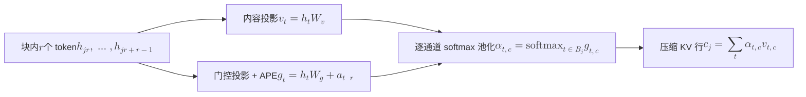
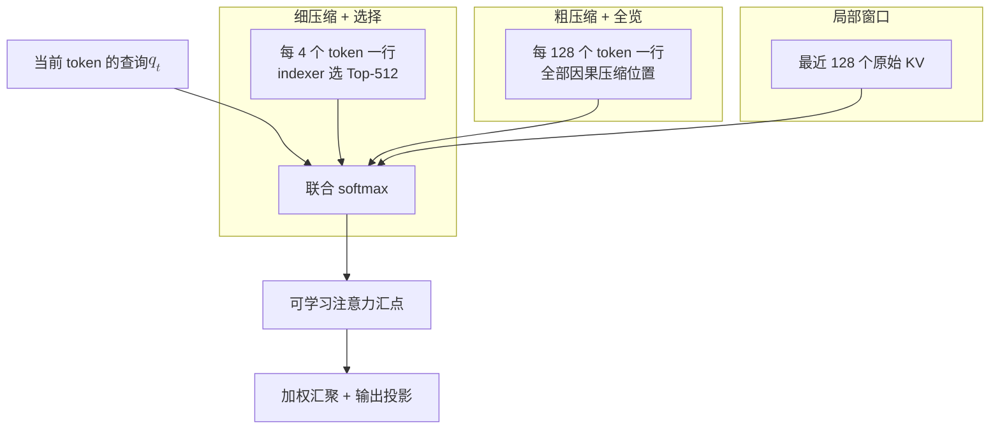

# 压缩式混合注意力：摘要、概览与局部窗口

检索式稀疏注意力仍然要保存全长 KV，只是每次只读一小部分。如果序列长到 128K、256K，光是“存下所有 KV”就够呛。压缩式混合注意力换了一个更彻底的做法：**先把连续的若干 token 压成一行 KV，再在压缩后的序列上做注意力。**

一行压缩 KV 不可能同时保留局部细节和全局概览，所以它通常不是一条支路，而是三条：

- **细压缩 + 选择**：压缩率小（例如 4），保留较多细节，再用 indexer 选 Top-K；
- **粗压缩 + 全览**：压缩率大（例如 128），只保留段落级概览，不做选择，直接看全部压缩位置；
- **局部窗口**：不压缩，保留最近 128 个 token 的原始 KV，负责“眼前”。

三条支路拼在一次 softmax 里，模型自己决定当前 token 更依赖哪一段尺度。

---

## 一、压缩器：把 $r$ 个 token 折成一行

设第 $t$ 个 token 的隐藏表示为 $h_t \in \mathbb{R}^d$。压缩器先做两个投影：

$$
v_t = h_t W_v \in \mathbb{R}^{d_c}, \qquad
g_t = h_t W_g + a_{t \bmod r} \in \mathbb{R}^{d_c}
$$

$W_v$ 产生“内容”，$W_g$ 产生“门控 logits”，$a_{t \bmod r}$ 是可学习的**绝对位置偏置（APE）**，告诉压缩器这个 token 在块内处于第几个位置。

把序列按每 $r$ 个 token 分成块 $B_j = \{jr, \dots, jr+r-1\}$。对每个通道 $c$ 独立地在块内做 softmax：

$$
\alpha_{t,c} = \frac{\exp(g_{t,c})}{\sum_{t' \in B_j} \exp(g_{t',c})}, \qquad
c_j = \sum_{t \in B_j} \alpha_{t,c} \, v_{t,c}
$$

这就是**逐通道门控池化**：不同通道可以关注块内不同的 token。比如某个通道专门保留句首的主语，另一个通道保留句尾的标点；如果换成对所有通道共享一个 softmax 权重，这种分工就做不到了。



### 非重叠与重叠

- **非重叠（non-overlap）**：块与块首尾相接，每块独立产出一行。实现简单，压缩率 $r$ 可以很大（如 128）。
- **重叠（overlap）**：相邻块共享一部分输入 token，每块输出 $2 d_c$ 维（左半、右半），相邻块的重叠半部再按通道门控聚合，最终仍压成一行。它让块边界处的信息不会因为“被切在两边”而丢失，代价是多一套投影和一次聚合。

重叠压缩适合压缩率较小的分支（如 4）：块边界密集，边界效应明显；压缩率 128 时，边界占比很小，非重叠就够了。

### 为什么门控和 APE 要留在 FP32

压缩器的输出直接决定后面注意力的 K/V。门控 logits 的一点误差，会改变块内 softmax 的分配，进而改变整行摘要。实践中通常：

- $W_v, W_g$ 的矩阵乘用 FP32 累加；
- APE 用 FP32 保存；
- softmax 在 FP32 下做，输出再转回 BF16。

这不是“精度洁癖”，而是因为压缩是有损的：一旦摘要偏了，后面的注意力再准也补不回来。

---

## 二、三条支路各管一段尺度

### 1. 细压缩 + 选择

压缩率 $r=4$，序列长度变成 $n/4$。即使如此，128K 序列仍有 32K 个压缩位置，不能全看。于是再加一个 indexer：

- 用一个独立的压缩器（不是主 KV 压缩器）把隐藏状态投到 128 维，得到 **索引 K**；
- 索引 Q 来自当前 token；
- 在压缩位置上打分，选 Top-512；
- 主注意力只读这 512 行压缩 KV。

细压缩保留了较多局部结构，适合需要“段落内细节”的任务。代价是压缩后的序列仍然不短，indexer 还要再选一次。

### 2. 粗压缩 + 全览

压缩率 $r=128$，序列长度变成 $n/128$。128K 只剩 1K 个位置，完全可以全部看，不需要 indexer：

- 非重叠门控池化，每 128 个 token 一行；
- 主注意力对所有因果可见的压缩位置做 softmax；
- 没有选择，也就没有选择错误。

粗压缩负责“全文概览”：主题、实体、篇章结构。它便宜、稳定，但分辨率低，无法区分同一段落内的细粒度差异。

### 3. 局部窗口

不压缩，直接保留最近 $w=128$ 个 token 的原始 KV。它负责：

- 相邻 token 的语法搭配；
- 指代、重复、局部编辑；
- 压缩器在块边界处丢失的细节。

每个压缩层都附加一个局部窗口。否则，压缩率 128 的层会完全看不到“上一个词是什么”。



---

## 三、一次注意力：把三路 KV 拼起来

对第 $t$ 个查询，把三路 KV 拼成一个候选集：

$$
\mathcal{C}_t = \underbrace{S_t^{\text{fine}}}_{\text{选中的 512 行}}
\;\cup\; \underbrace{\{1,\dots,\lfloor t/128 \rfloor\}}_{\text{全部粗压缩位置}}
\;\cup\; \underbrace{\{t-w+1,\dots,t\}}_{\text{局部窗口}}
$$

然后做一次带汇点的因果 softmax：

$$
o_t = \sum_{j \in \mathcal{C}_t}
\mathrm{softmax}_j\Bigl(\frac{q_t k_j^\top}{\sqrt{d}} + s\Bigr) v_j
$$

几个细节：

- **一次 softmax**：三路不是各自算完再加权平均，而是拼在一起竞争。模型可以按当前 token 的需要，把权重分配给细粒度、粗粒度或局部。
- **K=V**：很多实现让压缩 KV 同时充当 Key 和 Value（MQA 风格），只保留一个 512 维向量。这样缓存和通信都省一半。
- **输出分组**：多头输出按组投影（例如 8 组，每组 1024 维），再回隐藏维度；这和低秩注意力的输出低秩是同一类操作。
- **汇点**：可学习标量，FP32 保存；让模型在不需要历史信息时有一个“空选项”。

### 层怎么排

一个 35 层主干（外加 1 个 MTP 层）的示例配置可能长这样：

| 层类型 | 数量 |        压缩率 | 是否有 indexer | 附加窗口      |
| :----- | ---: | ------------: | :------------- | :------------ |
| 细压缩 |   18 |     4（重叠） | 是，Top-512    | 128           |
| 粗压缩 |   17 | 128（非重叠） | 否             | 128           |
| 纯窗口 |    1 |             0 | 否             | 128（MTP 层） |

细压缩和粗压缩通常交替排布，让每一段深度都能同时看到“细节”和“概览”。如果连续堆很多粗压缩层，模型会暂时失去局部分辨率；连续堆细压缩层，全局信息又太贵。交替是一种经验性的折中。

---

## 四、成本：三路各付多少

| 支路     | 注意力长度（每查询） |       KV 存储 | 选择成本                | 通信（上下文并行时）             |
| :------- | -------------------: | ------------: | :---------------------- | :------------------------------- |
| 细压缩   |            512 + 128 |      $n/4$ 行 | indexer 在 $n/4$ 上打分 | 前驱 halo + all-gather 压缩 KV   |
| 粗压缩   |        $n/128$ + 128 |    $n/128$ 行 | 无                      | all-gather 压缩 KV（约 $1/128$） |
| 局部窗口 |                  128 | 128 行原始 KV | 无                      | 相邻 rank 的 P2P                 |

和全长注意力相比：

- 粗压缩把全局长度直接除以 128，注意力核心的计算和 KV 存储都降了两个数量级；
- 细压缩除以 4，再选 512，计算量大约是全长的 $512/n$，但保留了更高的分辨率；
- 局部窗口固定在 128，不随序列增长，负责保底。

压缩本身也有成本：每个 token 都要过 $W_v, W_g$，还要做块内 softmax。这部分是逐 token 的线性开销，和序列长度成正比，但常数比注意力小。压缩率越小，压缩器越贵（块更多），但后续注意力越便宜；压缩率越大则相反。**选择压缩率，本质上是在“压缩器成本”和“注意力成本”之间找平衡。**

---

## 五、一个最小实现

```python
def compress_kv(h, W_v, W_g, ape, ratio, overlap=False):
    # h: [T, d]
    T = h.shape[0]
    v = h @ W_v                       # [T, d_c]
    g = h @ W_g + ape[:ratio]         # [T, d_c]，APE 按块内位置循环
    n_blocks = T // ratio
    v = v[:n_blocks * ratio].reshape(n_blocks, ratio, -1)
    g = g[:n_blocks * ratio].reshape(n_blocks, ratio, -1)

    # 逐通道 softmax：在块内 ratio 维上归一化
    alpha = softmax(g.float(), dim=1).to(v.dtype)
    compressed = (alpha * v).sum(dim=1)          # [n_blocks, d_c]

    if overlap:
        # 相邻块的重叠半部再做一次门控聚合；这里省略具体投影
        compressed = overlap_aggregate(compressed)
    return compressed


def hybrid_attention(x, q_proj, compressors, indexer, window_kv, sink):
    q = q_proj(x)
    candidates = []

    for comp in compressors:
        kv = comp(x)                              # [n/r, d_c]
        if comp.ratio == 4:
            idx = indexer(q, kv)                  # Top-512 压缩位置
            candidates.append(gather(kv, idx))
        else:
            candidates.append(kv)                 # 粗压缩：全部因果位置
    candidates.append(window_kv)                  # 最近 128 个原始 KV

    kv_all = concat(candidates, dim=1)
    attn = softmax(q @ kv_all.transpose(-1, -2) / sqrt(d) + sink)
    return attn @ kv_all
```

真实实现要处理：重叠压缩、变长序列的块边界、上下文并行的 halo/all-gather、FP32 门控、以及和主注意力的融合 kernel。

---

## 六、代价与坑

1. **压缩损失不可逆**：一旦块内的重要 token 被门控压低，后面的注意力无法恢复。APE、逐通道门控、重叠都是为了缓解，但不能消除。
2. **边界效应**：非重叠压缩在块边界处容易丢信息；序列打包（多个样本拼在一起）时，样本边界可能落在块中间，需要特殊处理。
3. **压缩率与层数的耦合**：粗压缩层太多会让模型“看不清”，细压缩层太多又太贵；层排布需要按任务和序列长度调。
4. **门控数值不稳定**：softmax 在 FP32 下做，APE 不能量化；否则长序列上会出现某些块整体“失声”。
5. **三路 KV 的拼接顺序**：拼接本身不改变 softmax 的结果（理想情况下），但会影响 kernel 的内存布局和因果掩码；实现时要保证索引和掩码一致。
6. **上下文并行**：三路通信模式不同（P2P、all-gather、halo），不能简单套用同一种切分；第 12 篇会展开。

---

## 小结

- **压缩**：用逐通道门控池化把 $r$ 个 token 折成一行 KV，$W_v$ 产生内容，$W_g$ 产生门控，APE 提供块内位置。
- **三条支路**：细压缩（$r=4$）+ Top-K 负责段落细节，粗压缩（$r=128$）+ 全览负责篇章概览，局部窗口（128）负责眼前。
- **一次 softmax**：三路 KV 拼在一起竞争，模型自己分配尺度；K=V 和分组输出进一步省带宽。
- **成本**：压缩器是逐 token 线性开销，注意力随压缩率下降；压缩率越小越贵在压缩器，越大越省在注意力。
- **坑**：压缩损失、块边界、层排布、FP32 门控、三路通信，是这条路线的主要工程难点。

下一篇把“复用”推到跨层：既然相邻层连 KV 都可以共享，为什么还要每层重新压缩一遍？
