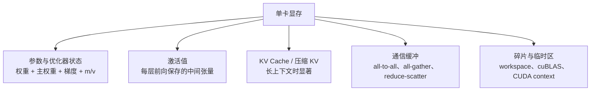

# 算力、显存与带宽：预训练的三本账

在讨论任何结构之前，先学会算账。否则你无法判断一个“优化”是真省了钱，还是只是把开销从一处搬到了另一处。

这一篇给出预训练里最常用的几个估算公式：训练 FLOPs、MFU、显存占用、通信量。它们不追求精确到小数点，但足够你在看论文或设计配置时，快速判断瓶颈在哪一侧。

---

## 一、训练 FLOPs：$6ND$ 从哪里来

设模型有 $N$ 个参与前向计算的参数，训练 token 数为 $D$。对绝大多数以矩阵乘为主的计算：

- 前向：每个参数参与一次乘加，约 $2N$ FLOPs/token，总计 $2ND$；
- 反向：对输入求梯度约 $2N$ FLOPs/token，对权重求梯度约 $2N$ FLOPs/token，合计 $4N$ FLOPs/token，总计 $4ND$。

所以：

$$
C_{\text{train}} \approx \underbrace{2ND}_{\text{前向}} + \underbrace{4ND}_{\text{反向}} = 6ND
$$

这个式子默认所有参数每 token 都被用到。对稠密模型，$N$ 就是总参数量；对 MoE，必须换成**每 token 实际激活的参数**：

$$
N_{\text{active}} = N_{\text{shared}} + N_{\text{attention}} + \frac{k}{E} N_{\text{routed}}
$$

其中 $E$ 是路由专家总数，$k$ 是每 token 选中的专家数。一个总参数 300 亿、每 token 只激活 40 亿的模型，算力应该按 40 亿算，显存却要按 300 亿算——这就是“参数与计算解耦”的第一层含义。

### 注意力项不能丢

$6ND$ 只统计了线性层。注意力打分是另一块：

$$
C_{\text{attn}} \approx 2 \cdot L \cdot n^2 \cdot d
$$

$L$ 是层数，$n$ 是序列长度，$d$ 是模型隐藏维度（这里把 $QK^\top$ 和 $AV$ 各算一次，因果掩码大约再折半）。当 $n$ 远大于 $d$ 时，这一项会超过线性层，成为主导。稀疏注意力之所以有意义，就是把它从 $n^2$ 压到 $n \cdot k$（$k$ 是选中的位置数），代价是增加一个轻量的选择器。

对压缩注意力，$n^2$ 里的第二个 $n$ 要换成压缩后的长度 $n/r$；对跨层复用，同一份 KV 被 $g$ 层共用，KV 的生成成本按 $1/g$ 摊销。

### 一个 30B 级示例的算力构成

假设一个约 300 亿总参数、每 token 激活约 40 亿的稀疏模型，在 BF16 峰值 3500 TFLOP/s 的 GPU 上跑到 4800 token/s/GPU。用 MFU 的定义：

$$
\mathrm{MFU} = \frac{C_{\text{achieved}}}{C_{\text{peak}}}
= \frac{6 \cdot N_{\text{active}} \cdot \text{tokens/s}}{C_{\text{peak}}}
$$

反推一下：$3.48\% \times 3500 \times 10^{12} \approx 1.22 \times 10^{14}$ FLOP/s，除以 4800 token/s，得到每 token 约 $2.5 \times 10^{10}$ FLOPs，再除以 6，约等于 42 亿激活参数。数量级是自洽的。

再把总算力拆开，一个典型的分布可能长这样：

| 组成 | 占比 | 为什么 |
| :--- | ---: | :--- |
| 稀疏专家（MoE） | 37.7% | 专家 FFN 是激活参数的大头，每个 token 要过 $k$ 个专家 |
| 投影层（QKV、输出、压缩器） | 33.9% | 隐藏维度大，逐 token 的矩阵乘不可忽略 |
| Logits + MTP | 12.9% | 词表很大时，输出投影和 softmax 很贵；多 token 预测再加几路 |
| Indexer | 8.5% | 在全长序列上打分，虽然维度小，但 $n^2$ 仍在 |
| 注意力核心 | 7.0% | 选了 Top-K 之后，真正的 $QK^\top$ 和 $AV$ 反而只占一小块 |

这张表最重要的信息不是具体百分比，而是：**注意力核心往往不是最大的开销。** 选择器、输出层、投影和专家 FFN 加起来，可能占掉八成的算力。优化时如果只盯着“注意力”，很容易打偏。

---

## 二、MFU：为什么 GPU 峰值永远跑不满

MFU（Model FLOPs Utilization）是实际算力与硬件峰值的比值。它低，不一定是代码写得差，通常有三个原因。

### 1. 小矩阵与低算术强度

Roofline 模型把一次计算分成两类：

$$
\text{算术强度} = \frac{\text{FLOPs}}{\text{搬运字节数}}
$$

矩阵乘 $[M,K] \times [K,N]$ 的算术强度约为：

$$
\frac{2MNK}{2(MK + KN + MN)} \approx \frac{2}{1/M + 1/N + 1/K}
$$

当 $M,N,K$ 都很大时，算术强度高，计算单元忙，属于**计算受限**；当某一维很小（例如逐 token 的归一化、路由打分、Top-K、小批量解码），搬运一次数据只做很少的乘加，属于**带宽受限**，此时峰值 FLOPs 再高也用不上。

训练里的“大 GEMM”通常是计算受限的，但以下操作会把整体 MFU 拉低：

- LayerNorm、RMSNorm、softmax、激活函数；
- 路由打分、Top-K、gather/scatter；
- 专家 all-to-all 前后的打包与解包；
- 压缩器里的逐通道 softmax、池化；
- 多 token 预测的额外小头。

### 2. 通信没有完全被计算掩盖

张量并行每层都要 all-reduce，专家并行每层都要 all-to-all。如果通信和计算没有重叠，GPU 就会在等数据。实际 MFU 是“计算时间 / (计算时间 + 暴露的通信时间 + 气泡)”。

### 3. 重算与精度转换

激活重算会额外做一次前向；FP8 训练要在 FP8 GEMM 和高精度反量化之间切换；分布式优化器要 gather 参数再更新。这些都不产生“有效模型 FLOPs”，但会占时间。

> **诊断原则**：不要用一个 MFU 数字判断一切。先看 profile：是某个 kernel 的 shape 太小，还是通信暴露，还是负载不均。算术口径只能告诉你“上限在哪”，不能告诉你“为什么没到”。

---

## 三、显存账：参数只是第一行

训练显存可以粗略分成五块：

### 1. 参数与优化器状态

按 BF16 计算 + FP32 主权重 + FP32 梯度 + Adam 的 $m,v$：

$$
\underbrace{2}_{\text{BF16 权重}} + \underbrace{4}_{\text{FP32 master}} + \underbrace{4}_{\text{FP32 梯度}} + \underbrace{4+4}_{m,v} = 18 \text{ 字节/参数}
$$

如果梯度也用 BF16，可以降到 16 字节；如果使用分布式优化器，这些状态按数据并行组切分，单卡只留 $1/N_{\text{dp}}$。但**切分只降低单卡占用，不降低总内存**；总内存仍然是 $18 \times$ 参数量。

一个 300 亿参数的模型，参数与优化器状态约 $540$ GB；一个 6000 亿参数的模型，约 $10.8$ TB。后者显然不能靠单机放下，必须把模型、专家、优化器状态同时切开。

### 2. 激活值

激活值随“层数 × token 数 × 隐藏维度 × 每层保存的张量数”增长。粗略估算一层 Transformer 需要保存的张量包括：注意力输入、Q/K/V、注意力输出、FFN 中间激活、归一化统计量等。按每层每 token 约 $10d$ 个元素、BF16 计算：

$$
M_{\text{act}} \approx L \cdot T \cdot 10d \cdot 2 \text{ 字节}
$$

$T$ 是一个 micro-batch 的总 token 数。以 $L=40$、$d=5120$、$T=32768$ 为例：

$$
40 \times 32768 \times 10 \times 5120 \times 2 \approx 134 \text{ GB}
$$

这还没算注意力矩阵、路由中间量和通信缓冲。**激活值经常比参数更早爆掉**，所以有了重算、卸载、分块这些手段（第 13 篇）。

### 3. KV Cache 与压缩 KV

训练时如果开启长上下文，KV 也不能忽略。标准多头注意力的 KV 缓存（单序列、BF16）：

$$
M_{\text{KV}} = 2 \cdot L \cdot n_h \cdot d_h \cdot n \cdot 2 \text{ 字节}
$$

以 $L=60$、$n_h=128$、$d_h=128$、$n=32768$ 为例，约 129 GB。换成 576 维的潜空间 KV，约 2.3 GB，差了两个数量级。这就是低秩注意力最直接的收益（第 3 篇）。

### 4. 通信缓冲

专家并行的 all-to-all 需要为“最坏情况”预留缓冲：每个 rank 可能收到来自所有 rank 的 token。负载越不均，缓冲越大。上下文并行的 all-gather 也需要为压缩 KV 预留连续空间。

### 5. 碎片

长时间训练会产生显存碎片。`empty_cache`、手动 GC、预分配 workspace 都是缓解手段，但它们只能回收“已经释放但未归还”的块，不能解决真实峰值。

---

## 四、通信账：三种最常见的量级

设参数量为 $P$（字节数按精度换算），数据并行组大小为 $N_{\text{dp}}$，单卡带宽为 $B$。

### 1. 数据并行：梯度 all-reduce

每步要把所有梯度归约一次。ring all-reduce 的通信量约为：

$$
V_{\text{dp}} \approx 2 \cdot \frac{N_{\text{dp}}-1}{N_{\text{dp}}} \cdot S_{\text{grad}}
$$

$S_{\text{grad}}$ 是单卡梯度字节数。$N_{\text{dp}}$ 很大时，系数趋近于 2：一次 reduce-scatter，一次 all-gather。

### 2. 张量并行：每层 all-reduce

张量并行把同一个矩阵乘按列或按行切开。前向和反向各需要一次 all-reduce，每次通信量约为 $2 \cdot T \cdot d \cdot \text{bytes}$（$T$ 是本 micro-batch 的 token 数）。层数越多、层内切得越细，通信次数越多。

### 3. 专家并行：all-to-all

每个 token 要被路由到 $k$ 个专家，可能落在不同 rank。一次 dispatch + 一次 combine 的通信量约为：

$$
V_{\text{ep}} \approx 2 \cdot T \cdot k \cdot d \cdot \text{bytes}
$$

如果专家负载不均，还要加上 padding 和对齐开销。专家并行通常与张量并行、数据并行组合，形成多维网格；通信走 NVLink 还是 IB，差别巨大。

### 4. 上下文并行：P2P 与 all-gather

局部窗口只需要和相邻 rank 交换边界 token（P2P）；压缩 KV 需要 all-gather 全局压缩序列；细粒度选择可能只需要前驱 chunk 的一小段 halo。第 12 篇会详细算这三笔账。

---

## 五、三种受限状态，对应三种设计选择

把上面的账合起来，一个训练步可能处于三种状态之一：

| 状态 | 特征 | 结构上的应对 |
| :--- | :--- | :--- |
| **计算受限** | 大 GEMM 打满，MFU 较高 | 用更少的激活参数换更多总参数（MoE）；用更低精度（FP8/FP4）提高峰值 |
| **带宽受限** | 小 shape、逐元素操作、解码 | 融合算子（norm+rope、compress+pool）；减少中间张量读写；提高 batch |
| **通信受限** | all-to-all、all-gather 暴露 | 通信重叠；层次化并行；压缩通信量（halo、压缩 KV）；换拓扑 |

一个常见的误区是“看到 MFU 低就换更快的 GPU”。如果瓶颈在通信或小 kernel，换 GPU 不会解决问题，反而可能让计算/通信比更失衡。

---

## 六、诊断：把模型账本和实测对上

预训练里最有用的几个观测：

1. **Per-token loss**：不要只看平均 loss。按 token 位置、领域、语言拆开，能发现长尾数据或位置偏差。
2. **专家负载**：每个专家的 token 数、丢弃率、路由熵。负载严重不均会让 EP 的 all-to-all 变成瓶颈。
3. **梯度范数**：分模块看（注意力、专家、嵌入、记忆表）。某个模块突然爆掉，往往是精度或路由出了问题。
4. **MFU 与 kernel 时间线**：用 NVTX/profile 看每个 kernel 的耗时、占用率、通信暴露。
5. **FLOPs 核算**：按实际矩阵 shape 统计，而不是按参数量拍脑袋。共享的 KV、跨层复用的 indexer、只算一次的 teacher QK，都要去重；重算和物理 padding 不算有效 FLOPs。

一个实用的检查方法是：**用实测 tokens/s 反推每 token 的有效 FLOPs，再和理论值对比。** 如果差得离谱，要么有大量无效计算（padding、重算、重复的 teacher），要么通信/气泡吃掉了时间。

---

## 小结

- **算力**：稠密训练约 $6ND$；MoE 用激活参数；长序列还要加注意力项，稀疏/压缩改变的是这一项的指数。
- **MFU**：受小 shape、通信暴露、重算和精度转换共同影响；它衡量的是“有效计算占峰值”，不是代码质量。
- **显存**：参数与优化器状态约 16–18 字节/参数；激活值、KV、通信缓冲和碎片经常才是峰值。
- **通信**：数据并行 all-reduce、张量并行每层 all-reduce、专家并行 all-to-all、上下文并行 P2P/all-gather，量级各不相同。
- **设计**：结构演化本质上是在三本账之间转移压力。看到一个“更高效”的结构，先问它把哪笔账推给了谁。

下一篇从最基础的一笔账开始：如何用低秩分解，把 KV 从“每层每头一份”压成“每 token 一个潜向量”。
