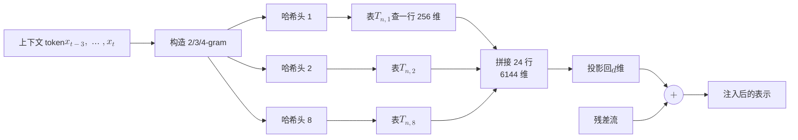
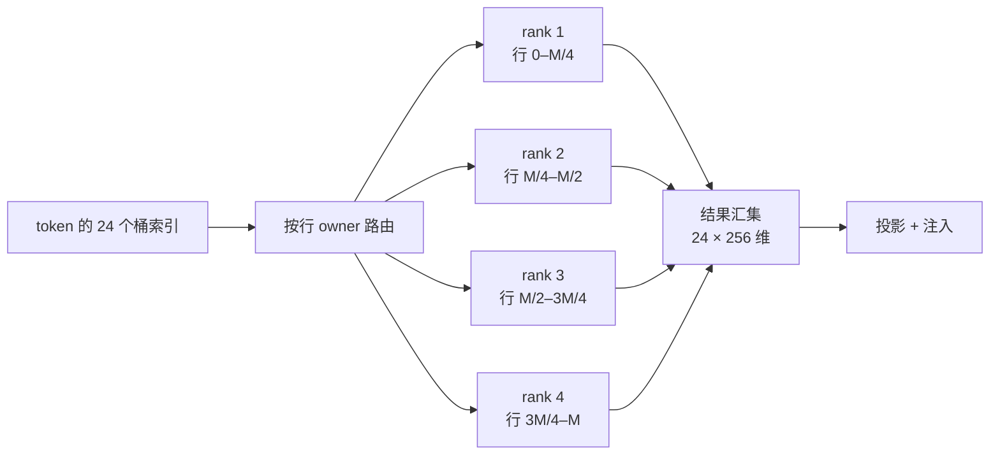

# 条件记忆：把事实从 FFN 里搬出来

一个模型能流畅地解释“法国的首都是巴黎”，但你换一种问法，它可能答“里昂”。这不是它没学过，而是知识压在一个巨大的稠密 FFN 里，没有明确的“那一行”可以定位。

稠密 FFN 是隐式记忆：事实、短语、常见搭配都分布在矩阵的权重里，每次前向都要过一遍全部参数。它容量大，但访问不精确；想更新一条事实，你无法只改“那一行”，只能重新训练。

**条件记忆**换了一个思路：把一部分静态知识从稠密参数里搬出来，存进一张按 n-gram 哈希索引的大表。每个 token 只查询少数几行，投影后加回残差流。这样，记忆的容量可以独立于注意力/FFN 的宽度扩展，而每次查询的计算量仍然很小。

---

## 一、FFN 是隐式记忆，不是数据库

普通 FFN：

$$
y = W_2 \, \phi(W_1 x)
$$

知识分布在 $W_1, W_2$ 的所有元素里。你无法问它“巴黎存在哪一行”，因为它没有行。想改一条事实，只能改一批权重，而且会牵连其他知识。

条件记忆则是：

$$
y = \mathrm{Proj}\bigl(\mathrm{concat}(T_1[b_1], T_2[b_2], \dots, T_m[b_m])\bigr)
$$

每个 $T_i$ 是一张表，$b_i$ 是由当前上下文算出的桶索引。查询是离散的、稀疏的、可并行的：

- 只有被命中的行参与计算；
- 行可以按行切分到不同 rank；
- 表可以独立于主干扩展，不增加注意力的 $O(n^2)$。

代价是：哈希会冲突，行会冷热不均，表的优化器状态可能比主干还大。

---

## 二、n-gram 哈希：用局部上下文做索引

给定 token 序列 $x_1, \dots, x_T$，对每个位置 $t$ 和阶数 $n \in \{2,3,4\}$，取局部 n-gram：

$$
g_{n,t} = (x_{t-n+1}, \dots, x_t)
$$

对每个阶数、每个哈希头 $h=1,\dots,8$，计算桶索引：

$$
b_{n,t,h} = \mathrm{hash}_h(g_{n,t}) \bmod M_n
$$

$M_n$ 是该阶数的桶数，通常取素数，减少规律性冲突。然后查表：

$$
e_{n,t,h} = T_{n,h}[b_{n,t,h}] \in \mathbb{R}^{256}
$$

每个 token 每层查：

$$
3 \text{ 个阶数} \times 8 \text{ 个头} = 24 \text{ 行}, \qquad 24 \times 256 = 6144 \text{ 维}
$$

把 24 行拼起来，投影回隐藏维度，再加回残差流。



为什么用 n-gram，而不是一个可学习的路由器？

- **便宜**：哈希是整数运算，不需要额外的神经网络前向；
- **稳定**：同样的上下文总是命中同样的桶，便于缓存和复现；
- **局部性**：n-gram 天然对应短语、搭配、局部模式，适合存“静态知识”；
- **可扩展**：桶数可以独立于主干扩大，不受注意力宽度限制。

缺点是**不看深层语义**：两个语义相近但字面不同的 n-gram 可能落到不同桶；哈希冲突又会让无关的 n-gram 共享一行。它擅长记“表面模式”，不擅长做推理。

以一个 40 层文本主干、两个记忆层为例：每个记忆层约 3.84 亿行，每行 256 维，单层约 $9.83 \times 10^{10}$ 参数；两层合计约 $1.97 \times 10^{11}$，即约 1966 亿参数。按 BF16 存约 393 GB，按 FP8 存约 196 GB；再加 FP32 主权重、梯度和优化器状态，数字会翻好几倍。**这不是“加一个小模块”，而是一个和主干同量级、甚至更大的记忆体。**

---

## 三、注入：在注意力之前加回残差

记忆通常注入在注意力子层之前：

$$
x' = x + \mathrm{Proj}\bigl(\mathrm{concat}(e_1, \dots, e_{24})\bigr)
$$

然后 $x'$ 进入注意力和 FFN。这样注意力可以直接利用这些静态线索，不改变注意力和 FFN 的内部结构，容易插进现有模型。

注意：

- **MTP 分支通常不创建记忆消费者**。MTP 是额外的预测深度，再查一遍表会让参数量和通信量失控；记忆只服务主干。
- **投影矩阵和门控要保持较高精度**。查表得到的是离散行，投影是唯一的连续变换；如果投影量化误差大，记忆的收益会被抹平。
- **注入强度要可控**。可以加一个可学习的 sigmoid 门控，避免训练初期大表噪声冲击主干。

---

## 四、表并行：按行切，而不是按列切

1966 亿参数的表放不到一张卡上。常见的切法是按行切分：

- 把表的行范围切给一个专门的进程组；
- 每个 rank 只持有自己那段行；
- 查询时按“行 owner”路由：桶索引落在哪个 rank，就把查询发过去；
- 结果汇集回消费者。



表并行组可以独立于 TP/PP/DP。一张表可以有自己的并行度，也可以在每个 PP stage、每个 DP replica 上复制一份。lookup 是 all-to-all 式的：每个 rank 可能收到任意 token 的查询，返回对应行；负载取决于哈希分布。哈希均匀时，行 owner 的负载大致均匀。

行 owner 的路由表在训练中不能变，否则 checkpoint 和缓存都会错位。跨 PP 时，如果记忆层和表不在同一个 stage，需要把查询/结果跨 stage 传递；这就是两种 autograd 模式的差别。

---

## 五、训练：inline 与 separate

**Inline** 把查表和反向都放在层内：前向 lookup，拿到行，投影，注入；反向主干梯度回到该层时，立即对表行求梯度。实现简单，但表必须和消费者在同一个 PP stage；跨 stage 就要复制整张表，不现实。

**Separate** 把“查表”从主干计算图里拆出来：

1. 在 dense pipeline 开始前，先把整个 micro-batch 的所有 n-gram 查询算好，向表 owner 发起 lookup；
2. 把查到的行（或投影后的向量）送到消费者 stage；
3. 主干照常前向/反向，记忆注入只是一个普通的张量加法；
4. 主干反向结束后，把表的梯度交回 owner，由 owner 更新表。

这样做支持跨 PP、合并多个 micro-batch 的查询、异步 combine、激活卸载；代价是编排复杂：要管理查询的生命周期、结果的交付、梯度的回传，以及和重算/检查点的配合。

表适合低精度存储。一个典型的 FP8 方案是：权重用 E4M3，每 32 列一个 E8M0 缩放因子，前向查表返回 FP8，投影前反量化；反向梯度仍按 dense 精度累加；优化器保留 FP32 master。

但 FP8 只解决了“权重存不下”的一半。1966 亿参数的表，FP8 权重约 196 GB，FP32 master 约 786 GB，再加梯度和动量，仍然是 TB 级。所以表必须按行切分，优化器状态也按行切分，冷行可以延迟更新，checkpoint 按行 owner 保存。

表的更新规则也不同于主干。行梯度稀疏，高频行会被反复更新，通用 AdamW 不够用。一个针对表的优化器会把更新拆成两步：Nesterov 动量，然后行列 RMS 平衡（迭代若干次，指数约 0.18），让每一行、每一列的更新尺度大致平衡。表的 LR 通常比主干大（例如 5 倍），因为它需要更快地覆盖新命中的行。

表的 checkpoint 还有一个隐蔽风险：形状对了，但哈希参数或 tokenizer 映射变了，加载后每个桶对应的 n-gram 全错。解决办法是把 tokenizer 压缩映射、哈希种子、桶数、行数、维度一起做 SHA256 指纹，加载时先校验。

---

## 六、代价：1966 亿参数不是小模块

条件记忆的收益很诱人，但它的代价也很具体。

**哈希冲突**：不同 n-gram 共享一行，会互相干扰。素数桶、多个头、足够大的表可以缓解，但不能消除。

**冷热不均**：高频 n-gram 的行被反复更新，低频行几乎不动；行列平衡和 LR 调整是必要的。

**表的并行复杂度**：行切分、路由、all-to-all、跨 PP 交付、checkpoint 映射，每一环都可能出错。

**优化器状态爆炸**：FP8 权重只是开始；FP32 master + 动量 + 梯度仍然是 TB 级，必须行分片。

**语义泛化弱**：n-gram 只看表面形式，近义改写可能命中不同桶；它适合补静态知识，不适合替代推理。

**评估困难**：记忆的收益可能体现在长尾事实、专有名词、代码 API 上，平均 loss 不一定明显；要按领域拆开看。

---

## 七、一个最小实现

```python
def memory_lookup(tokens, tables, hash_seeds, bucket_sizes, orders=(2, 3, 4), heads=8):
    rows = []
    for n in orders:
        for h in range(heads):
            grams = build_ngrams(tokens, n)               # [T]
            buckets = hash_ngrams(grams, hash_seeds[n][h]) % bucket_sizes[n]
            rows.append(tables[n][h].lookup(buckets))     # [T, 256]
    return torch.cat(rows, dim=-1)                        # [T, 24 * 256]


def memory_inject(x, tokens, tables, proj, gate):
    e = memory_lookup(tokens, tables, ...)                # [T, 6144]
    mem = proj(e)                                         # [T, d]
    return x + gate.sigmoid() * mem                       # 门控注入
```

真实实现还要处理：表并行的路由、跨 stage 的 separate autograd、FP8 反量化、行分片的优化器、checkpoint 指纹，以及和 PP/DP 的组合。

---

## 小结

条件记忆把静态知识从稠密 FFN 里搬进按 n-gram 哈希索引的大表：每个 token 每层查 24 行，拼接投影后注入残差。它用离散、稀疏、可并行的查询，换取了独立于主干的记忆容量。

代价是 1966 亿参数的存储与优化器状态、哈希冲突、冷热不均、表并行复杂度，以及“只看表面形式”的语义局限。它适合补静态知识，不适合替代推理；把它当成“更大的 FFN”会低估工程难度，把它当成“查表就完事”会低估优化器和并行。

下一篇离开单卡模型，进入集群：把张量、流水线、专家、数据、序列这些切分方式放在同一张图上，看看它们如何组合，以及通信从哪里来。
