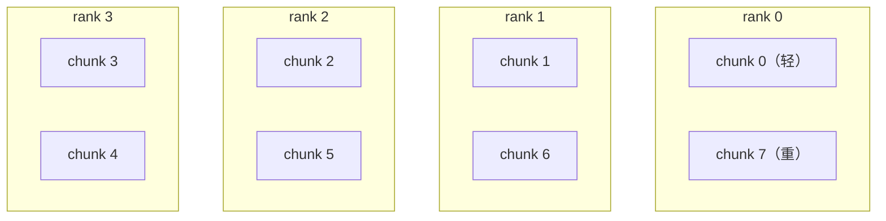
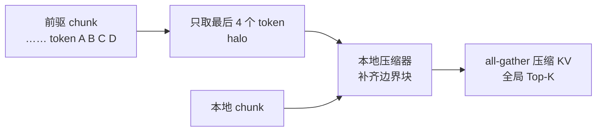
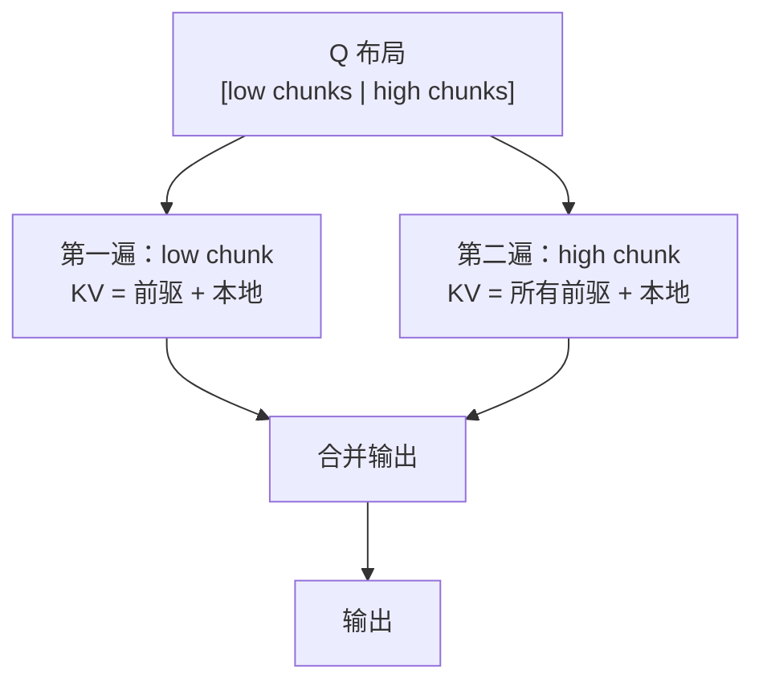
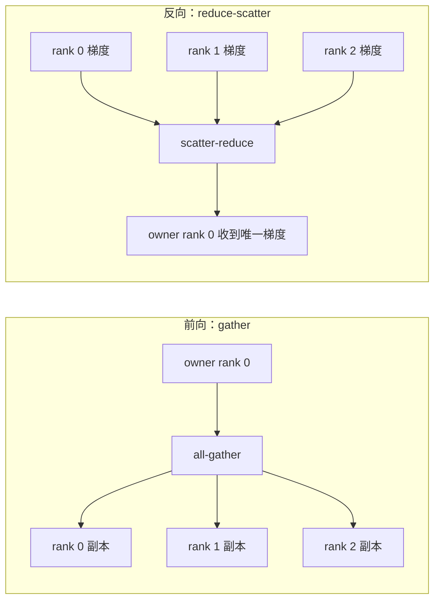

# 上下文并行：长序列怎么切，KV 怎么换

一条 128K 的序列，放不进一张卡。你把它按顺序切成 8 段，分给 8 张卡：rank 0 拿前 16K，rank 7 拿后 16K。

然后你发现，rank 0 几乎瞬间算完——因果注意力下，它只需要看自己；rank 7 要看前面 112K 的 KV，成了唯一的瓶颈。其他 rank 早早空转，等 rank 7 跑完。

**上下文并行（Context Parallel, CP）** 要解决的就是这个。切序列不难，难的是让 8 张卡的因果工作量均衡，同时只交换必要的 KV——不是把整段历史传来传去。

---

## 一、连续切与 zigzag：先让负载均衡

连续切的问题很直观：因果注意力的工作量从前到后递增。rank 0 最轻，rank 7 最重。

**Zigzag 切** 把序列切成 $2P$ 个 chunk，rank $r$ 拿一个靠前的 chunk 和一个靠后的 chunk：

$$
\text{rank } r \text{ 持有 chunk } r \text{ 和 chunk } 2P-1-r
$$

以 $P=4$ 为例：

| rank | 持有的 chunk |
| :--- | :--- |
| 0 | 0, 7 |
| 1 | 1, 6 |
| 2 | 2, 5 |
| 3 | 3, 4 |

rank 0 的 chunk 0 很轻、chunk 7 很重；rank 3 的 chunk 3 和 4 都不轻不重。总因果计算量大致均衡。



每个 rank 拿到两个 chunk 后，Q 通常排成：

```text
[ 所有 low chunk 的 token | 所有 high chunk 的 token ]
```

这样一次 kernel 可以连续处理“低半区”和“高半区”，不需要在两个 chunk 之间来回跳。低半区和高半区的因果范围不同，正好对应下面的“两遍计算”。

---

## 二、三路注意力，三种通信

压缩混合注意力的三条支路，在 CP 下各自需要不同的跨 rank 数据：

| 支路 | 需要什么 | 通信方式 | 通信量 |
| :--- | :--- | :--- | :--- |
| 局部窗口 | 前一个 chunk 的最后 128 个原始 KV | 邻居 P2P | $O(w \cdot d)$ |
| 粗压缩 | 全局压缩 KV | all-gather | $O((n/128) \cdot d)$ |
| 细压缩 | 前驱 chunk 的边界 halo + 全局压缩 KV | P2P + all-gather | $O(r \cdot d + (n/4) \cdot d)$ |

局部窗口是 128，当前 chunk 只需要前一个 chunk 的最后 128 个 token 的原始 KV，和邻居做一次 P2P 即可。

粗压缩把序列压到 $n/128$。每个 rank 先本地压缩自己的 chunk，然后把压缩 KV all-gather 成全局压缩序列。通信量只有原始 KV 的 $1/128$，非常便宜。

细压缩的块大小是 4。压缩块的边界可能落在 chunk 边界上，所以当前 rank 需要前一个 chunk 的**最后 4 个 token**作为 halo，才能正确压缩自己的第一个块。



如果为了边界正确，把整个前驱 chunk 都 P2P 过来，通信量是 $O(n/P \cdot d)$；只取 4 个 token，通信量是 $O(4 \cdot d)$。

具体省多少，取决于 chunk 长度：

- 如果 chunk 长度是 128，$4/128 \approx 3.1\%$，省约 97%；
- 如果 chunk 长度是 8192，$4/8192 \approx 0.05\%$，省约 99.95%。

“halo 省 97%”是一个常见的保守口径，对应较短的 chunk；chunk 越长，比例越低。无论哪种，边界通信都从“整段”降到了“几个 token”。

---

## 三、两遍计算：低半区和高半区

每个 rank 有两个 chunk：一个靠前（low），一个靠后（high）。它们的因果可见范围不同：

- low chunk：可以看更早 chunk 的 KV + 本地 KV；
- high chunk：可以看所有更早 chunk 的 KV（包括 low chunk 和中间 chunk）+ 本地 KV。

如果用一个统一的 mask 把两个 chunk 拼在一起算，会引入大量无效的“未来”位置，还会让 kernel 形状变复杂。更常见的做法是**两遍计算**：第一遍处理 low chunk，第二遍处理 high chunk。

不同 causal 范围可以用 `cu_seqlens` 的重复边界或零长度段来表达：

- 重复边界：让某个 query 段的起始/结束指向同一个位置，等价于“空段”；
- 零长度段：跳过不需要的 KV 区间；
- 一套变长 attention kernel 可以同时处理两种 causal 范围，不需要为每种范围写一个 kernel。



两遍计算的代价是两次 kernel 启动和两次 KV 读取，但换来的是因果范围精确、负载均衡、以及一套 kernel 处理不同 chunk 长度。

---

## 四、反向：gather 的副本要 reduce 回去

All-gather 会把同一份压缩 KV 复制到多个 rank。前向没问题：每个 rank 拿到一份只读副本，各自算注意力。

反向就麻烦了：同一逻辑行在多个 rank 上都有副本，梯度必须 **scatter-reduce** 回唯一 owner，否则会重复累加。



实现上需要维护两套映射：前向 gather ids（逻辑行 → 物理位置）和反向 reduce ids（物理位置 → 唯一 owner）。它们必须严格对应，否则梯度会丢或重复。这也是 CP 实现里最容易出错的地方之一。

通信句柄通常用 `HandleRegistry` 缓存，key 是 `(comm_type, ratio, D, dtype, group_id)`。固定尺寸的 all-gather 用对称内存；细压缩的 halo 尺寸可能随序列长度、块边界变化，是动态的，通常要用 NVSHMEM。对称内存要求所有 rank 对 buffer 大小和 grid 达成一致，动态尺寸容易死锁；选错了库，轻则慢，重则挂死。

---

## 五、动态 CP、打包与位置编码

真实训练数据是变长的。固定 CP 会让短序列浪费、长序列放不下。**动态 CP** 根据当前 batch 的序列长度决定切多少段：

- 设定每个 DP/CP rank 的最大序列长度（例如 20480）；
- 短序列放在更少的 rank 上，或者多个序列打包到同一个 rank；
- 长序列切更多段；
- 调度器同时考虑 dense 和 sparse 两种注意力模式。

打包（Packed THD）把多个变长序列拼成一条长序列，用 `cu_seqlens` 记录边界。CP 切分时，chunk 边界可能落在某个序列中间，需要：

- **非对齐边界**：不要求对齐到 128 或 4，kernel 用变长索引处理；
- **全局 stripe**：按全局 token 位置而不是局部 chunk 位置分配，保证跨 rank 的序列边界一致；
- **padding 单元**：通常按 $2 \cdot CP \cdot \max(w, r)$ 对齐，例如 $2 \cdot CP \cdot 128$，保证窗口和压缩块的边界不会跨 rank 断裂。

长上下文还需要位置编码外推。RoPE 的位置 $t$ 通过旋转角度进入注意力；训练长度 8K、目标 128K，直接外推会让模型在超出训练长度的位置上失准。常见做法是位置插值（$t/s$）、NTK-aware 缩放（调大 base）或 YaRN（插值 + 注意力 logits 温度缩放）。

YaRN 通常用四个参数：base、factor、original_max、target_max。例如 base 10000、factor 40、original 8192、target 327680；或者 base 160000、factor 16、original 65536、target 1048576。不同压缩率的分支可以用不同的 base：压缩率为 0 的纯窗口层用普通 RoPE，压缩率为 1 的层用更大的 base。

几个工程要点：位置 id 必须是全局的，CP 切分后不能用局部偏移；打包的多个样本要在各自内部重置位置；cos/sin 角度表在 FP32 下预计算；只作用于 RoPE 维，不要和压缩器的 APE 混用。

---

## 六、出问题时先查什么

**负载不均**：连续切会让后面的 rank 成为瓶颈；zigzag 是基本操作，但打包后的变长序列仍需调度。

**halo 边界**：少取一个 token 就会让压缩块错位；多取又会增加通信。边界条件要单独测试。

**两遍计算的重复读取**：low/high 两遍会重复读一些 KV；用 L2 缓存或融合 kernel 缓解。

**反向映射错误**：all-gather 的副本没有正确 reduce，梯度会重复或丢失；要用显式的 owner 映射。

**动态尺寸死锁**：对称内存要求所有 rank 的 buffer 一致；halo 这种不规则交换要用支持动态尺寸的库。

**打包边界跨 rank**：chunk 切在序列中间时，`cu_seqlens` 和 mask 要同时调整；否则会把两个样本拼在一起。

**共享 indexer 的 CP**：如果 indexer 跨层共享，CP 核心路径可能需要单独实现；不要假设“普通 CP 能跑，共享 indexer 就能跑”。

---

## 小结

CP 的难点不是“把序列切开”，而是**让 8 张卡的因果工作量均衡，并只交换必要的 KV**。zigzag 解决负载，三路通信解决不同注意力的跨 rank 需求，halo 把边界通信从整段降到几个 token，两遍计算解决 low/high 的因果范围，scatter-reduce 解决反向副本。

长上下文还要叠加动态 CP、打包和位置编码外推。这些机制单独看都简单，组合起来才是 CP 真正难的地方。

下一篇把镜头拉回单卡：在有限的显存里，哪些激活要重算、哪些要卸载、哪些参数必须留在 FP32。
