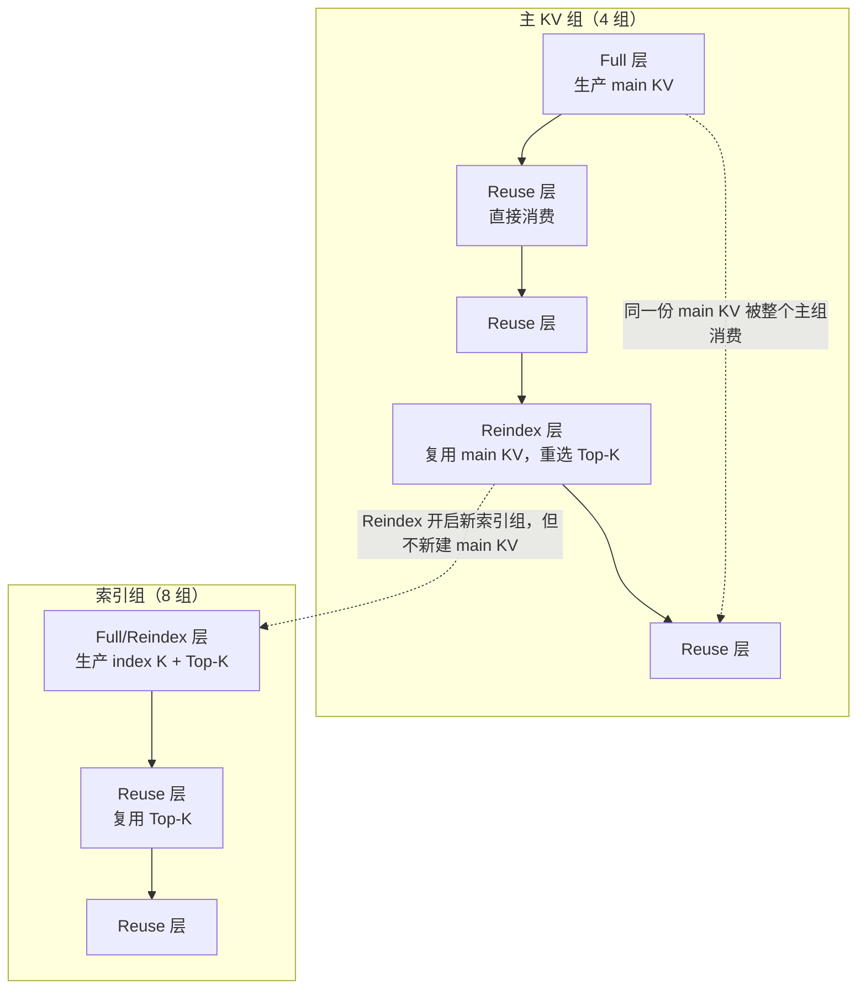
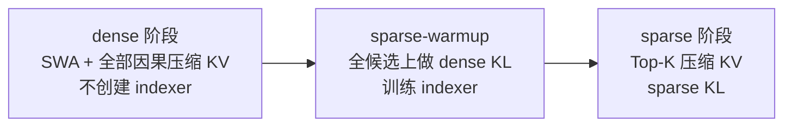
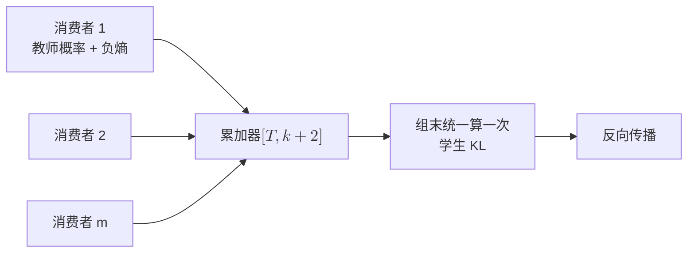

# 跨层 KV 复用：少数层生产，多数层消费

压缩注意力已经把每层的 KV 压得很小，但每一层仍然要**各自**跑一遍压缩器、生成索引、选 Top-K。40 层就是 40 份压缩 KV、40 个 indexer、40 次选择。相邻层的注意力模式高度相关，这些重复计算里有多少是必要的？

跨层复用的回答是：**让少数几层负责生产，其他层负责消费。** 40 层主干可以只保留 4 份全局 KV、8 个索引器；剩下的层复用同一份状态，只做自己的主查询和输出。省下来的不只是算力，还有状态存储、选择 kernel 和跨卡通信。

这一篇讲清楚三件事：三种层角色分别算什么、状态怎么在层间流动、训练时怎么给复用层加监督而不把辅助损失放大。

---

## 一、三种角色：Full、Reindex、Reuse

不是所有层都能直接复用。有些层需要重新选择，有些层连选择都不需要。于是分成三种角色：

| 角色        | 主查询 |  主 KV   |  索引 K  | 索引 Q/权重 |  Top-K   | 主注意力 |  输出  |
| :---------- | :----: | :------: | :------: | :---------: | :------: | :------: | :----: |
| **Full**    | 自己算 | **生产** | **生产** |  **生产**   | **生产** |  自己算  | 自己算 |
| **Reindex** | 自己算 |   复用   |   复用   | **自己算**  | **重选** |  自己算  | 自己算 |
| **Reuse**   | 自己算 |   复用   |   复用   |    不跑     |   复用   |  自己算  | 自己算 |

三个要点：

1. **每个角色都算自己的主查询、主注意力和输出投影**。复用只发生在“全局 KV 和索引”这一层，不意味着整层输出直接复制。
2. **每个角色都算自己的局部窗口 KV**。局部窗口是逐层的、细粒度的，不能跨层复用；否则相邻层的局部信息会完全一样。
3. **Reindex 不生产新的主 KV，但会开启一个新的索引组**。它复用 Full 的主 KV 和索引 K，却用自己的查询重新选 Top-K。这是“主 KV 组”和“索引组”粒度不同的原因。



### 一个 40 层的排布示例

| 层范围 | 角色              | 说明                                       |
| :----- | :---------------- | :----------------------------------------- |
| 0–1    | 纯窗口            | 只做局部注意力，不产生全局 KV              |
| 2–7    | Full + 5×Reuse    | 第 2 层生产，3–7 复用                      |
| 8–13   | Full + 5×Reuse    | 第 8 层生产                                |
| 14–19  | Full + 5×Reuse    | 第 14 层生产                               |
| 20–23  | Full + 3×Reuse    | 第 20 层生产，后面 3 层复用                |
| 24–27  | Reindex + 3×Reuse | 复用 20 的 main KV/index K，但第 24 层重选 |
| 28–31  | Reindex + 3×Reuse | 第 28 层重选                               |
| 32–35  | Reindex + 3×Reuse | 第 32 层重选                               |
| 36–39  | Reindex + 3×Reuse | 第 36 层重选                               |

统计一下：

- **4 个 Full**：2、8、14、20；
- **4 个 Reindex**：24、28、32、36；
- **30 个 Reuse**；
- **4 个主 KV 组**（每组一个 Full 生产）；
- **8 个索引组**（4 个 Full + 4 个 Reindex，各自带 3–5 个 Reuse）。

全局 KV 副本从 40 份降到 4 份，indexer 从 40 个降到 8 个。第 20 层之后的主 KV 组特别长（20 层），因为后面的 Reindex 只重选索引，不再重建 KV。这是有意为之：**主 KV 的变化比索引选择慢**，越往深层，KV 越稳定，重新选择的收益主要在索引侧。

### 压缩率 0/1/2

跨层复用的前提是每层已经有一份压缩 KV。压缩率通常只允许三档：

| 压缩率 | 形态                      | 每 token 行数  | 说明                                              |
| -----: | :------------------------ | :------------- | :------------------------------------------------ |
|      0 | 纯局部窗口                | 0 行全局 KV    | 不产生全局 KV，只做窗口注意力；用普通 RoPE        |
|      1 | 线性投影 + RMSNorm 直通   | 1 行           | 不建门控/APE；每个 token 一行 main KV             |
|      2 | 门控池化（每 2 个 token） | 1 行 / 2 token | FP32 的 $W_{KV}/W_{Gate}$，逐通道 softmax，无 APE |

几个容易忽略的细节：

- **索引 K 从哪来**：不是从隐藏状态另走一个压缩器，也不是从已经旋转过的主 KV 反推，而是从**压缩后、主 RoPE 之前**的 latent 投影得到。这样索引 K 和主 KV 共享同一份内容表示，只是投影不同。
- **主注意力的候选**：局部窗口 KV 与选中的全局压缩 KV 拼在一起，做一次联合 softmax，并带可学习汇点；不是两路各自 softmax 再加权。
- **位置编码按压缩率分开**：压缩率为 1 的层可以用更大的 RoPE base（例如 160000），压缩率为 0 的层用普通 base（例如 10000）。不同压缩率对应不同的有效感受野，没必要强行统一。
- **查询归一化**：默认只在低秩潜变量上做 RMSNorm；可选的逐头 Q RMSNorm 会同时作用于主查询和 indexer 的查询/权重，适合头差异很大的配置。开与不开会改变注意力的数值分布，换配置时要重新调学习率。
- **ratio=1 不一定比 ratio=2 好**：ratio=1 保留更多细节，但 KV 更长；ratio=2 更省，但压缩损失更大。层排布要在两者之间分配。

### 三阶段训练

直接从随机初始化的 indexer 开始做 Top-K，通常会训崩：选择器还没学会，主注意力就已经只能看到一堆噪声位置。更稳的做法是分三阶段：



1. **dense**：主注意力看全部因果压缩 KV，加上局部窗口；indexer 模块不创建（或冻结）。这一步让主干先适应“压缩 KV”这种表示。
2. **sparse-warmup**：仍然看全部候选，但开始训练 indexer；教师在全部候选上算 KL。indexer 学会排序，但还不真正裁剪候选。
3. **sparse**：切到 Top-K，主注意力只看选中的压缩 KV；KL 也切到选中集合上的 sparse 版本。

切换阶段时要明确：

- indexer 的参数是保留还是重置；
- 学习率是否重新 warmup；
- KL 的权重是否变化；
- 主 KV 的压缩器是否冻结。

这些选择会影响收敛，不能只改一个“阶段”开关就假设行为不变。

---

## 二、状态怎么流动：显式张量，不用全局缓存

跨层复用最容易写坏的地方是状态管理。一个看似方便的做法是搞一个进程级全局字典，层与层之间按名字取。它能跑通单卡，但一遇到流水线并行、检查点、重算就全线崩溃：状态属于哪个 micro-batch？重算时怎么恢复？跨 stage 怎么传？

更稳妥的做法是**把状态做成显式张量，沿着层间数据流传递**：

```python
class CompressedState:
    main_kv: Tensor      # [T, d_kv]，全局压缩 KV
    index_k: Tensor      # [T, d_idx]，索引 K
    topk: Tensor         # [T, k]，选中的压缩位置
    compressed_kv: Tensor  # 可选：压缩后的主 KV 视图
    owner: int           # 生产者层号
```

- **生产者创建**：Full 层创建新的 `CompressedState`，填入 `main_kv`、`index_k`、`topk`；
- **消费者读取**：Reuse 层直接读；Reindex 层读 `main_kv/index_k`，但覆盖 `topk`；
- **最后一个消费者释放**：引用计数归零后，状态可以安全释放；
- **检查点边界**：状态作为普通张量参与保存/恢复，不依赖进程内缓存；
- **线性注意力层**：不消费也不重置状态，原样传给后面的层。

这样做的好处是：重算、流水线、检查点、梯度累积都按普通张量处理，不需要额外的“状态一致性”协议。代价是状态要显式地穿过每一层，函数签名会变长；但这比隐式全局状态可维护得多。

---

## 三、训练：复用层也要被监督

如果只有 Full 层接收 indexer 的 KL，Reuse 层就变成了“白搭车”：它们用着别人选的 Top-K，却不为选择质量负责。长期下来，Reuse 层的主查询可能漂移到“选中的位置根本不适合我”的区域。

做法是：**每个消费层都用自己的主查询构造教师，Reuse 层也接受 KL 监督。**

- 教师：该层主注意力在自己可见候选上的分布（detach）；
- 学生：该层实际使用的索引来源（Full/Reindex 的 indexer 分数）；
- 损失：在选中集合上做 KL，再按层平均。

这样，Reuse 层虽然不跑 indexer，但它的主查询会“告诉” indexer：我需要的其实是这些位置。梯度通过共享的 indexer 参数回传，促使选择器兼顾组内所有层。

### 组内 KL 要按层平均

设一个索引组有 $m$ 个消费者，第 $l$ 层的 KL 为 $\mathcal{L}^{(l)}$。组损失是：

$$
\mathcal{L}_{\text{group}} = \frac{1}{m} \sum_{l=1}^{m} \mathcal{L}^{(l)}
$$

不是求和。原因和共享 indexer 一样：求和会让组越大、辅助损失越大，隐式改变主损失与辅助损失的平衡。平均让不同组大小、不同层数的配置具有可比性。

### Grouped KL：组末算一次

逐层算 KL 的问题是：每一层都要物化一份教师概率、一份学生概率、一张计算图。组内有 6 层，就驻留 6 份中间量；长序列下非常可观。

**Grouped KL** 把累积和计算分开：

1. 组内每个消费者只累计三个量：教师概率之和、教师负熵之和、层数；
2. 组末最后一个消费者，用累计量算一次学生 KL；
3. 教师累加器的形状是 $[T, k+2]$（$k$ 个选中位置 + 2 个特殊位置，例如汇点/局部窗口），而不是 $[T, n]$。



好处是：计算图从 $m$ 份降到 1 份，中间概率只保留一份，长序列训练更容易放下。代价是学生分布必须在组末才能算，组内不能提前释放；这和第 13 篇的“提前反向”需要配合。

### KL 的显存优化

Grouped KL 之外，还有两种常见的省显存手段：

- **KL 重算**：warmup 阶段的全支撑 KL 只保留输入投影和少量 metadata，反向时重新算概率，不在前向物化整张概率表。它用一次额外的前向换掉一份 $[T, k]$ 的中间量。
- **只保留教师 LSE**：在某些硬件上，教师只需要 log-sum-exp，不需要完整的 logits；学生 KL 可以用 LSE 和选中位置的分数重建。这样避免物化教师 logits，但要求 kernel 支持按 LSE 计算。

两者都不是“免费”的：重算增加计算，LSE 路径依赖具体算子；和 FP8、完整重算、跨 stage 组合时还要确认兼容性。

### 提前反向：在最后一个消费者处结算

跨层复用的状态会一直活到组末，这是显存的大头。**提前反向（early backward）** 的思路是：在 Full K 源的最后一个消费者处，立刻对 indexer 的计算图做反向，拿到梯度后释放保存的激活和状态，不必等到整个网络反向传回来。

它能把 `index_keys`、`index_query`、`topk`、`compressed_kv` 等大张量尽早释放。但限制很多：

- 只支持流水线并行度为 1、没有虚拟流水线；
- 不能和 FP8/FP4 训练、完整层重算同时用；
- 需要保证组内所有消费者的梯度都已经结算，否则会漏梯度。

所以它是一个“在特定配置下很有效”的优化，不是一个可以无条件打开的开关。

### KV 卸载：把冷状态放到 host

如果显存还是不够，可以把 `main_kv` 和 `index_k` 卸载到 host：

- 每个 storage 只保留一份 host 副本，避免多份拷贝；
- 用弱引用管理生命周期，最后一个消费者释放后，host 副本也可以回收；
- 由重算拥有的 storage 不要卸载——它反正会在反向时重新算出来，卸载反而多一次拷贝。

PCIe 带宽通常只有 HBM 的几十分之一，所以卸载必须和计算重叠，否则会把训练拖慢。它适合“显存峰值卡死、但还有一点带宽余量”的场景，不适合作为常规路径。

---

## 四、并行：CP 与 PP 的边界

### 上下文并行

跨层复用的状态在 CP 下要跨 rank 传递：

- 主 KV 组可能跨 chunk；每个 rank 只持有自己那段序列的压缩 KV；
- 消费层需要 gather 全局压缩 KV，或者至少 gather 自己因果可见的部分；
- 反向要沿同一路径把梯度 scatter 回生产者。

第 12 篇会详细讲 CP 的三路通信；这里只强调：**复用把“每层一次通信”变成了“每组一次通信”**，通信量随组大小下降，但状态的生命周期变长，反向的梯度峰值可能更集中。

### 流水线并行

PP 大于 1 时，Full 层和它的消费者可能落在不同 stage：

- 生产阶段先把 CP-local 的主 KV 传给下一个 stage；
- 第一个消费者按 chunk gather；
- 反向沿同一条边回传梯度；
- 跨 stage 的“影子 indexer”（在消费者 stage 复制一份索引器以提前选择）通常还没有完整实现。

因此，跨层复用 + PP 往往是“部分支持”：能跑，但不要按“所有优化都已落地”来宣称。

### CP 反向分块

共享 K 的梯度会在组末集中回传，峰值可能很高。可以把 CP 反向按 chunk 分块，控制同时驻留的梯度大小。这是一个典型的“用时间换显存”的旋钮。

---

## 五、一个最小实现

```python
def run_layer_plan(x, layers, plan):
    state = None
    for layer, role in zip(layers, plan):
        # 所有角色都算自己的局部窗口
        local_kv = layer.swa_kv(x)

        if role == "swa":
            x = layer.attention(x, local_kv)

        elif role == "full":
            state = CompressedState(
                main_kv=layer.compress_main(x),
                index_k=layer.compress_index(x),
                topk=None,
                owner=layer.id,
            )
            state.topk = layer.index_topk(x, state.index_k)
            x = layer.attention(x, state.main_kv, state.topk, local_kv)

        elif role == "reindex":
            # 复用 main_kv / index_k，但用自己的查询重选
            state.topk = layer.index_topk(x, state.index_k)
            x = layer.attention(x, state.main_kv, state.topk, local_kv)

        elif role == "reuse":
            x = layer.attention(x, state.main_kv, state.topk, local_kv)

        # 线性注意力层不消费也不重置 state
        if role == "linear":
            x = layer.linear_attention(x)

    return x
```

真实实现还要处理：组内 KL 的累加器、最后一个消费者的提前反向、检查点里的状态保存、PP 的跨 stage 传输，以及 CP 下的 gather/scatter。

---

## 六、代价与坑

1. **组太大，选择被迫一致**：40 层只留 4 份主 KV，意味着 10 层共享一份。如果这些层的注意力模式差异很大，复用会伤精度。组大小需要按模型深度和任务调。
2. **主 KV 组和索引组混淆**：Reindex 不生产主 KV，但会开新索引组。如果把两者当成同一个粒度，统计和实现都会错。
3. **组内 KL 求和**：辅助损失随组大小放大，训练会偏。必须按层平均。
4. **状态生命周期跨检查点**：状态是普通张量，不是全局缓存；重算时要能从检查点恢复，不能依赖进程内残留。
5. **提前反向的配置限制**：PP、VPP、FP8/FP4、完整重算都可能与它冲突；打开前要确认组合是否被支持。
6. **KV 卸载的带宽账**：PCIe 拷贝不重叠就会拖慢；只适合显存峰值受限、带宽有余量的场景。
7. **PP 的“影子 indexer”**：跨 stage 复制索引器、同步参数和梯度，是一个尚未完全解决的问题；不要把“能跑 PP”当成“所有复用优化都已支持”。

---

## 小结

- **三种角色**：Full 生产主 KV/索引 K/Top-K；Reindex 复用主 KV/索引 K 但重选；Reuse 全部复用。三者都算自己的主查询、局部窗口、主注意力和输出。
- **两个粒度**：主 KV 组由 Full 划分，索引组由 Full/Reindex 划分；40 层可以只有 4 份主 KV、8 个索引器。
- **状态显式化**：用张量对象沿层间传递，不用进程级全局缓存；这样重算、检查点、PP 都能按普通张量处理。
- **训练监督**：每个消费者都用自己的主查询做教师；组内 KL 按层平均，grouped KL 在组末算一次。
- **显存**：提前反向、KV 卸载、CP 反向分块，都是围绕“状态活得太久”做的优化，各有配置限制。
- **边界**：组太大伤精度，PP 跨 stage 的索引器同步仍未完成，CP 核心路径需要单独实现。

下一篇离开注意力，进入 FFN：当参数量的增长快过算力，怎么用稀疏专家把“总参数”和“每 token 计算”解耦。
