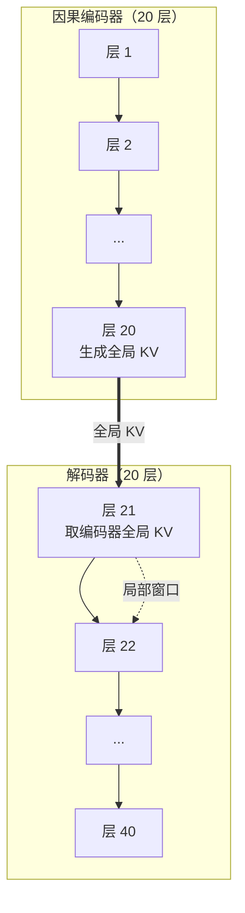

# 边界与未完成：稀疏注意力的下一站

前面十四篇讲的都是“已经能跑”的机制。但一个真实的预训练栈里，总有一部分能力停留在设计文档、配置字段或未接通的代码路径上。把“已经落地”和“只是规划”混在一起讲，是技术报告里最常见的失真。

这一篇做两件事：先看几条正在探索的方向——块级选择、线性注意力、跨层编码器、多草稿层、FP4 记忆；再给出一张诚实的能力矩阵，说明哪些是训练路径，哪些只是结构占位。

---

## 一、块级选择：先选块，再选块内的 token

第 4 篇的检索式稀疏注意力是在**token** 上选 Top-K。序列很长时，逐个 token 打分和 gather 的索引开销会变得可观。一个自然的改进是**分层选择**：

1. 先把序列切成固定大小的块（例如每块 4 个 token）；
2. 用块级分数选出 Top-256 个块；
3. 每个块展开成 4 个 token，得到 1024 个候选；
4. 再加上 128 个局部窗口 token，总共约 1152 个候选。

这样做的好处：

- 索引数量从 $n$ 降到 $n/4$，Top-K 的排序和存储都省；
- 块内 token 在语义上通常相关，选块比选单个 token 更稳定；
- 可以配合块级教师：主注意力在选中 token 上的头平均概率，按块累加；学生只在选中块上归一化，做带裁剪的 KL。

代价是**块边界**：一个块里可能只有一个真正重要的 token，其余三个是“搭便车”进来的。块越小，浪费越少，但索引越长；块越大，索引越短，但候选越脏。4 是一个常见的折中。

块级选择的一个变体是把“主 KV”和“索引 K”分开压缩：

- **主 KV 压缩率为 1，但带因果重叠**：每个 token 的 main KV 由前一个 token 的第 0 组投影和当前 token 的第 1 组投影按通道门控聚合；行数仍等于 token 数，不减少长度，只改变内容。
- **索引 K 压缩率为 4**：从 main KV 的 pre-RoPE latent 投影到 128 维，再对连续 4 个 token 做逐通道 max pooling；这样索引长度是 $n/4$，块内保留最显著的特征。
- **候选展开**：索引器选 Top-256 个索引块，每块展开 4 个 token，得到 1024 个候选；加上 128 个窗口 token，总共约 1152 个。
- **块级教师**：主注意力在选中 token 上的 head 平均概率，按块累加；学生在选中块上归一化，做带裁剪的 KL。这样教师信号是“块级”的，不会因为块内某一个 token 的噪声而剧烈波动。

一个教学用的示例规模是：40 层、隐藏 4096、64 个注意力头、每头 512 维、查询低秩 1280、8 组输出；路由专家 512 个、top6；条件记忆表约 1600 亿参数；单遍多流残差；CP 用连续切分；EP 度 64。数字只用来说明量级，不是必须复刻的配方。

系统上，这类结构通常会把 max-pool、norm、RoPE 融合成一个 kernel，并把 overlap 压缩的 value/gate 打包成一次 FP32 投影，减少中间张量。专家并行的通信重叠在实测中可能带来约 9%–11% 的提升，但块级重排本身的收益并不稳定，仍需要按模型和负载 profile。

还有一个更激进的版本：分层候选池，例如 2048 个块 × 每块 8 个位置 = 16384 个候选，再由第二阶段选 token。它通常属于后训练或推理阶段，训练路径不一定需要。

---

## 二、门控线性注意力：把 $O(n^2)$ 换成状态递推

稀疏注意力仍然要在“选中的历史”上做 softmax。线性注意力换了一条完全不同的路：用一个固定大小的状态递推，把历史压进矩阵里。

门控线性注意力（例如门控 delta 规则一类结构）的核心是：

$$
S_t = \alpha_t \odot S_{t-1} + \beta_t \, k_t v_t^\top, \qquad
o_t = q_t^\top S_t
$$

$S_t$ 是一个 $d_k \times d_v$ 的状态矩阵，$\alpha_t$ 是逐通道的衰减门控，$\beta_t$ 是写入强度。它不需要保存全部 KV，推理时每步只更新状态，训练时可以用分块并行扫描。

在混合架构里，线性注意力层可以插在压缩注意力层之间：

- 线性层不消费也不重置跨层共享的 KV/index 状态；
- 共享状态可以穿过线性层，传给后面的压缩层；
- 线性层有自己的 `dt_bias`、`A_log` 等参数，通常保持 FP32。

它的吸引力在于：状态大小与序列长度无关，长序列推理便宜；缺点是固定容量的状态会丢信息，召回类任务通常不如全注意力。它更适合做“局部/流式”支路，而不是完全替代稀疏注意力。

目前这条路径在不少实现里还是**结构/模块级支持**，不是主干默认配置。插入位置、门控初始化、和共享 KV 的交互，都需要实验。门控初始化尤其敏感：`A_log` 零初始化可以让衰减从 1 附近开始，`dt_bias`/`A_log` 保持 FP32；初始化偏了，状态会在训练早期指数衰减或爆炸。

---

## 三、跨层编码器-解码器：把全局 KV 从编码器搬到解码器

第三代跨层复用已经让 40 层只保留 4 份主 KV。再往前一步，是**编码器-解码器式**的跨层结构：

- 前 20 层是因果编码器，负责读上下文；
- 后 20 层是解码器，不再自己生成全局 KV，而是直接取编码器第 20 层的全局 KV；
- 解码器只保留局部窗口，用“有界重放”补局部细节；
- 通过 `kv_reuse_sources` 之类的机制，指定哪些层复用哪些源的 KV。

好处是全局 KV 只生成一次，解码器完全复用；代价是编码器和解码器的分工要学，局部窗口要足够大以避免“看不到眼前”，跨阶段的状态传递也更复杂。

另有一个独立的跨层编码器迁移示例，规模小得多：9B 参数、40 层，其中 30 层局部窗口 + 10 层全注意力，用 `kv_reuse_sources` 指定跨层 KV 复用；查询/KV 用 LoRA，FFN 用 GEGLU，RoPE 用 FP32，选择性重算默认只覆盖 MLP。它的限制也很明确：

- 不支持序列并行、PP/VPP、动态 CP、FSDP；
- 不支持 MoE、MTP、FP8/FP4、激活卸载、CUDA Graph；
- 不提供推理 KV Cache。

这个示例是“用已有权重 warm-start 的跨层编码器复现”，不是主线 20+20 编码器-解码器结构的实现。把两者混为一谈，会高估主线的完成度。

这类结构在配置里可能只表达“层角色”，真正训练路径未必接通。判断它是否可用，要看：

- 是否有训练入口和 checkpoint；
- 全局 KV 的跨层/跨 stage 传输是否实现；
- 局部窗口的重放是否有边界处理；
- 反向是否能正确回传到编码器。

如果这些都没有，它只是一个结构草图，不是可训练的能力。

---

## 四、多草稿层：为推测解码准备更长的草稿

第 8 篇的 MTP 是一个物理层重复几次，主要作为训练监督和短草稿。更激进的版本是**多草稿层**：

- 3 个草稿层，每层有自己的块大小和路由；
- 块大小 5，即一次提出 5 个 token；
- 马尔可夫 rank 256，用来建模草稿 token 之间的依赖；
- 128 个专家，top-3；
- 目标层是主干的最后几层（例如 37–39）。

它更像是“训练一个小的草稿模型”，而不是“给主模型加一个头”。用途是推测解码：草稿层快速提出多个 token，主模型并行验证。

但这类能力通常只存在于配置字段里：

- 训练脚本可能注释掉，实际用普通 MTP1 代替；
- 草稿层和主干的参数共享、梯度隔离、checkpoint 都没接通；
- 推理侧的验证逻辑是另一套工程。

所以看到“3 层草稿、块大小 5、Markov rank 256”时，要问：这是训练配置，还是推理规划？两者不是一回事。

---

## 五、FP4 与更低精度：先解决“哪里能低”

FP8 已经在 GEMM 和通信里落地。下一步是 FP4：

- **主 KV 的 FP4**：E2M1 权重 + 块缩放（例如每 16 个通道一个 E4M3 scale）；在 RoPE 之后量化，避免旋转放大误差；
- **Indexer 的 Q/K MXFP4**：量化感知训练，保持选择排序的稳定；
- **局部窗口 KV 的 FP8 缓存**：只作为训练缓存格式，不改变计算精度；
- **记忆表的 FP4**：进一步压缩超大表。

这些方向的共同难点是：

1. **缩放因子开销**：块越小，精度越好，但 scale 的存储和反量化越贵；
2. **反向精度**：前向 FP4，反向仍然需要 BF16/FP32 的梯度；
3. **敏感边界**：汇点、APE、路由、indexer 分数不能一起降；
4. **组合限制**：FP4 往往和 MTP、EP overlap、完整重算、激活卸载有冲突。

所以“支持 FP4”通常是一个矩阵，而不是一个布尔值：哪些张量、哪条路径、和哪些优化组合，都要单独列。

---

## 六、视觉编码器：另一条模态的账

文本主干的很多结构可以迁移到视觉，但账本不同：

- 图像 patch 化：patch 14，3×3 pixel-unshuffle；
- 2D RoPE：位置是二维的，旋转要按行/列分解；
- 32 层、1024 隐藏、16 个头的 ViT；
- 视觉 token 数和分辨率挂钩，注意力可能比文本更贵；
- 和文本主干的对齐、投影、冻结策略，都是额外的工程。

这类能力在纯文本预训练栈里通常是“未实现”或“独立模块”，不要假设文本主干的稀疏注意力可以直接套到视觉上。

---

## 七、能力矩阵：已落地、部分支持、仅设计

把前面提到的能力放在一张表里，比任何宣传语都清楚：

| 能力                | 状态                        | 说明                                                |
| :------------------ | :-------------------------- | :-------------------------------------------------- |
| 低秩潜空间注意力    | 已落地                      | 训练/推理都有路径；吸收与显式展开要对齐             |
| 检索式稀疏注意力    | 已落地                      | indexer + Top-K + KL；共享 indexer 降低开销         |
| 压缩混合注意力      | 已落地                      | 细压缩/粗压缩/局部窗口三路                          |
| 跨层 KV 复用        | 已落地                      | Full/Reindex/Reuse；PP 跨 stage 仍部分支持          |
| 稀疏专家            | 已落地                      | 路由、分组、共享专家、EP；不整除要 padding          |
| 多 token 预测       | 已落地                      | 一个物理层重复多次；与稀疏注意力的 KL 按深度平均    |
| 多残差流            | 已落地（有约束）            | BF16、4 流、TP=1、无序列并行等                      |
| 条件记忆表          | 已落地                      | inline/separate、FP8、Sinkhorn 优化器               |
| 上下文并行          | 已落地（部分组合）          | zigzag、halo、两遍计算；共享 indexer 的 CP 可能受限 |
| FP8 训练            | 已落地（可选）              | GEMM/通信/表；压缩器/indexer 保持高精度             |
| 块级选择            | 结构/实验                   | 块级教师、裁剪 KL；训练路径不一定默认               |
| 门控线性注意力      | 结构支持                    | 可插在压缩层之间；不是主干默认                      |
| 跨层编码器-解码器   | 仅设计/配置（独立示例另算） | 层角色可表达；主线训练入口和 KV 传输未完整          |
| 多草稿层            | 仅配置                      | 常被普通 MTP 替代；推理验证另算                     |
| 分层候选池          | 未实现                      | 属于后训练/推理阶段                                 |
| 主 KV FP4           | 未实现                      | 当前 BF16/可选 FP8                                  |
| Indexer Q/K FP4 QAT | 未实现                      | 当前 BF16                                           |
| 视觉编码器          | 未实现                      | 独立模块，不能直接复用文本栈                        |

这张表不是“进度排名”，而是**使用前必须确认的边界**。一个结构在配置里存在，不代表：

- 有训练入口；
- 有 checkpoint；
- 和你想用的并行/精度组合兼容；
- 有数值对齐和回归测试。

有些完整结构预设甚至只是 **structure-only**：配置能表达层角色和模块，但训练入口会明确拒绝，实际训练走的是另一套文本主干配置。判断一个能力是否可用，不能只看配置文件里有没有字段，要看训练脚本是否真的接了这条路径。

---

## 八、还没解决的问题

### 1. 选择的召回率

Top-K 选得再快，选错位置就是损失。块级选择、分层候选池、线性注意力都在尝试用更少的候选保住召回，但目前没有一个通用的“选择质量”指标。离线评估、教师 KL、长尾任务表现，需要一起看。

### 2. 状态的生命周期

跨层复用把 KV/index 状态的生命周期拉长到组末。PP 跨 stage、CP 跨 rank、重算、卸载、提前反向，每一组合都有自己的所有权问题。没有一套统一的“状态协议”，实现就容易在某个组合下出错。

### 3. 超大表的优化器

1966 亿参数的表，FP8 权重只是第一步；FP32 master、动量、梯度仍然是 TB 级。行分片、冷行延迟更新、Sinkhorn 平衡、checkpoint 指纹，都是必要的，但还缺少标准做法。

### 4. 长上下文的 CP

zigzag、halo、两遍计算解决了“能跑”，但共享 indexer 的 CP、跨 PP 的索引器同步、动态尺寸的通信句柄，仍然是部分支持。长上下文 + 复杂注意力 + 多并行维度的组合，是最容易出问题的区域。

### 5. 评估与复现

稀疏注意力、MoE、记忆表的收益往往体现在长尾、专有名词、代码 API、长文档上，平均 loss 不一定明显。需要按领域、按位置、按长度拆分的评估，以及可复现的短程配置；否则很容易把“实现细节的差异”误判为“结构的收益”。

---

## 九、回到三条主线

把整个系列收束成三句话：

1. **第一代是“检索式稀疏”**：KV 仍然是全长，但每层只读 Top-K；indexer 用主注意力做教师，跨层共享把 60 层降到 18 个物理 indexer；系统上靠分块、对齐、融合算子把选择、KL、反向做快。

2. **第二代是“压缩 + 混合注意力”**：把 KV 按 4/128 折叠成摘要，细压缩选 Top-K，粗压缩全览，局部窗口补眼前；多残差流让深度方向的路由可学习；系统上靠 zigzag CP、halo、all-gather 压缩 KV 和两遍计算。

3. **第三代是“跨层复用 + 条件记忆”**：40 层只保留 4 份主 KV、8 个索引器；单遍多残差流把混合矩阵的预测提前一个子层；n-gram 哈希表把静态知识移出稠密参数；系统上靠状态生命周期管理、grouped KL、提前反向、KV 卸载和表并行。

它们不是互相替代的关系。第一代的 indexer 思想活在第二代的细压缩里，第二代的压缩器活在第三代的复用里，第三代的记忆表又可能需要第一代的检索思路。**结构在演化，账本没有变：算力、显存/带宽、通信，总有一侧是瓶颈。**

读到这里，如果你看到一个陌生的“高效注意力”结构，可以先问：

- 它省的是哪一项：注意力计算、KV 存储、参数、还是通信？
- 它把压力转移到了哪里：indexer、压缩器、状态管理、还是并行复杂度？
- 它的“已落地”边界在哪：训练入口、checkpoint、精度组合、并行组合，哪些真的跑过？

能回答这三个问题，比记住任何一个缩写都更有用。
