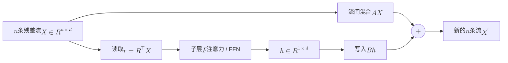
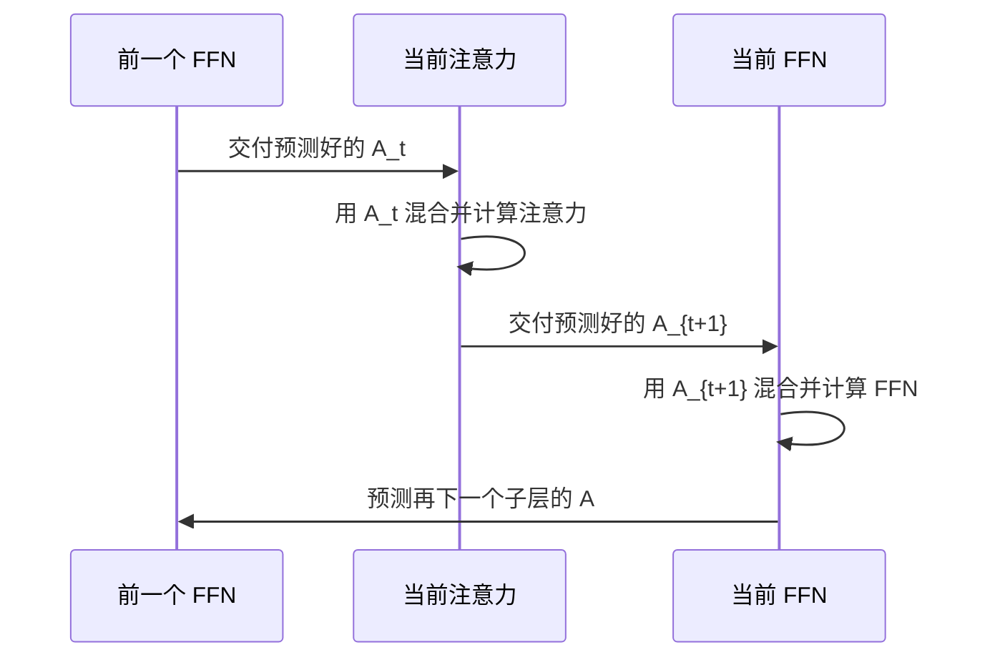

# 多流残差：一条残差主干为什么不够

把一个 40 层模型加深到 80 层，loss 却没有变好，甚至更难训。初始化、归一化、学习率都检查过了，梯度也没有明显消失。问题可能不在“梯度传不回去”，而在**所有子层都往同一条残差流里写**。

残差连接 $x_{l+1} = x_l + F_l(\mathrm{LN}(x_l))$ 是一条共享总线。注意力写一次，FFN 写一次，每一层都往同一个 $d$ 维向量上叠加。层数越多，这条总线越拥挤：不同子层想表达的东西互相覆盖，残差范数随深度增长，归一化只能把尺度拉回来，拉不回“信息被挤在一起”。

多流残差（hyper-connections）换了一个结构：把一条总线拆成 $n$ 条，让子层在写入时可以选择“写进哪条流、写多少”，在读取时可以选择“从哪条流读”。混合矩阵不是固定的，而是由当前表示预测出来的。

---

## 一、单流残差：一条总线上的所有写操作

标准残差里，每个子层只做两件事：读当前状态，写回当前状态。

$$
x_{l+1} = x_l + F_l(\mathrm{LN}(x_l))
$$

这有两个隐含假设：

1. **所有子层共享同一个表示空间**。注意力想保留的局部细节、FFN 想写入的语义特征，都挤在同一组 $d$ 个维度里。
2. **写入权重固定为 1**。不管这个子层当前有多重要，它的输出都以同样的尺度加到主线上。

浅层网络里这没问题；深层网络里，子层数量一多，总线上的信号就会互相干扰。你可能会看到：某些层的输出范数特别大，主导了残差；另一些层的贡献被淹没。归一化能控制总尺度，但不能控制“谁占了多少”。

多流残差的出发点很直接：**既然一条总线不够，就给它多条车道，让子层自己决定怎么并线。**

---

## 二、$n$ 条流：读、混、写

设每个 token 不再是一个向量 $x \in \mathbb{R}^d$，而是一个矩阵：

$$
X \in \mathbb{R}^{n \times d}
$$

$n$ 条流，每条 $d$ 维。子层 $F$ 仍然只接受一个 $d$ 维向量，所以需要**读**和**写**：

$$
r = R^\top X \in \mathbb{R}^{1 \times d}, \qquad h = F(r)
$$

$$
X' = A X + B h
$$

- $R \in \mathbb{R}^{n \times 1}$ 是读取权重，决定从各条流各取多少；
- $A \in \mathbb{R}^{n \times n}$ 是流间混合矩阵；
- $B \in \mathbb{R}^{n \times 1}$ 是写入权重，决定把子层输出写进各条流多少；
- $h$ 广播到每一行。

当 $n=1$ 时，$A=[1]$、$B=[1]$、$R=[1]$，就退化成普通残差。所以多流不是“另一个模型”，而是普通残差的推广。



$A$ 和 $B$ 由当前表示预测：

$$
A = \mathrm{Sinkhorn}\bigl(\mathrm{softmax}(X W_A)\bigr), \qquad
B = \mathrm{sigmoid}(X W_B)
$$

$W_A \in \mathbb{R}^{d \times n^2}$、$W_B \in \mathbb{R}^{d}$ 很小。$n=4$ 时，$A$ 只有 16 个数，$B$ 只有 4 个数。**多流增加的参数量几乎可以忽略，增加的是激活的宽度和带宽。**

---

## 三、Sinkhorn：混合不能放大

如果 $A$ 只是一个普通 softmax 矩阵，它的行和或列和不一定为 1。多层连乘后，某些流可能指数放大，另一些流可能指数衰减；深度一长，数值就失控。

Sinkhorn–Knopp 归一化交替归一化行和列：

$$
A_{ij} \leftarrow \frac{A_{ij}}{\sum_{j'} A_{ij'}}, \qquad
A_{ij} \leftarrow \frac{A_{ij}}{\sum_{i'} A_{i'j}}
$$

重复 $K$ 次（例如 20 次），把正矩阵逼近成双随机矩阵：

- 每行和为 1，每列和为 1；
- 左乘全 1 向量和右乘全 1 向量都保持不变；
- 混合不会系统性地放大或缩小总质量。

这相当于给流间路由加了一个“守恒律”。没有它，多流残差在深层会变成“某些流越来越大、某些流越来越小”，最后退化成一条流。

---

## 四、单遍：把预测提前一个子层

传统多流有一个串行依赖：

1. 先有完整的 $X_{t-1}$；
2. 从 $X_{t-1}$ 预测 $A_t$；
3. 用 $A_t$ 混合 $X_{t-1}$；
4. 再算子层 $F_t$。

第 2 步必须等 $X_{t-1}$ 的归约完成，第 3 步才能开始。这在高性能实现里会形成一个同步点：混合矩阵的预测和子层计算无法重叠。

**单遍多流残差** 把预测提前：

- 当前子层**消费**上一个子层预测好的 $A_t$，直接开始混合和计算；
- 同时，它用自己混合前的状态预测**下一个子层**的 $A_{t+1}$；
- 注意力子层消费上一层 FFN 预测的 $A$，FFN 消费当前注意力预测的 $A$；
- 首层 carry 是 one-hot；末尾用最后一个 FFN 的 pre-mix 做最终收缩。



好处是打断依赖链：混合矩阵的预测不再阻塞当前子层，预测和计算可以重叠；同时，每个子层在计算时就知道“下一个子层会怎么混合”，相当于给网络一个一步的前瞻。

代价是预测的 $A_{t+1}$ 基于“混合前”的状态，而不是混合后的最终状态。它未必和传统版本完全等价；这是一个结构性近似，需要训练来适应。

---

## 五、代价：4 倍宽度，值不值

多流残差最直接的代价是激活宽度乘 $n$。4 条流就是 4 倍的残差激活；注意力、FFN 的中间张量不一定乘 4，但残差流、混合矩阵、读写权重都在涨。

训练时，单遍多流残差仍然是多个 kernel：预测、混合、子层、写入分别启动，显存里要保存多条流和中间状态。部署版可能用一个融合 kernel，把一次子层的流读写压到 $(2n+2)d$ 的带宽下界；训练框架通常拿不到这个收益。

所以看到“单遍把带宽降到 $(2n+2)d$”时，要区分：

- **算法上的激活读写下界**：融合 kernel 在理想情况下需要读 $n d$、写 $n d$、读 $d$、写 $d$；
- **训练时的实际带宽**：多 kernel、多中间张量、重算和通信都会让它更高。

一个可用的单遍多流残差实现通常有这些约束：

- BF16 计算（混合矩阵/系数 FP32）；
- 固定 4 条流；
- 张量并行度为 1（多流与 TP 的切分需要额外设计）；
- 不做序列并行；
- dropout 为 0；
- CUDA Graph、MTP detach、共享归一化、重复层、知识蒸馏等组合可能未接入。

训练实现里，残差通常是 BF16 的 $[S, B, 4d]$，carry 是 FP32 的 $[S, B, 4]$；映射/聚合参数保持 FP32，投影内部可能用 TF32 舍入。融合 kernel 会把 mapping、aggregate、post 合成一步；没有这些 kernel 时，训练只能接受多 kernel 的开销。

---

## 六、什么时候值得

多流残差不是“更深就一定更好”的万能药。它适合：

- 模型很深，单流残差的干扰明显，loss 随深度收益递减；
- 需要更稳定的深层训练，愿意用激活宽度换数值稳定性；
- 可以接受 TP=1 或愿意为多流单独设计切分。

如果模型只有十几层、或者集群强依赖 TP/序列并行，多流的收益可能抵不过实现复杂度和带宽成本。它的价值在“深度方向的表示路由”，不在“多几条流看起来更高级”。

一个最小实现：

```python
def hyper_connection(X, F, W_A, W_B, R, sinkhorn_iters=20):
    # X: [n, T, d]（n 条流）
    r = torch.einsum("n,ntd->td", R, X)          # 读取 [T, d]
    h = F(r)                                      # 子层输出

    A_logits = torch.einsum("ntd,dk->ntk", X, W_A).view(n, T, n)
    A = softmax(A_logits, dim=-1)
    A = sinkhorn(A, iters=sinkhorn_iters)         # 双随机
    B = sigmoid(torch.einsum("ntd,d->nt", X, W_B)).unsqueeze(-1)

    X_new = torch.einsum("nts,std->ntd", A, X) + B * h.unsqueeze(0)
    return X_new


def sinkhorn(A, iters):
    for _ in range(iters):
        A = A / A.sum(dim=-1, keepdim=True).clamp_min(1e-6)
        A = A / A.sum(dim=0, keepdim=True).clamp_min(1e-6)
    return A
```

单遍版本还要维护一个“预测好的 $A,B$”状态，在子层之间传递；首层用 one-hot carry，末尾用 pre-mix 收缩。真实实现还要处理 FP32 混合、变长序列、张量并行切分、以及和重算/检查点的配合。

---

## 小结

单流残差把所有子层塞进同一条总线；多流残差给它多条车道，用可学习的 $A$ 混合、$B$ 写入、$R$ 读取。Sinkhorn 把混合矩阵约束成双随机，保证深层不放大；单遍把混合矩阵的预测提前一个子层，打断串行依赖。

代价是激活宽度乘 $n$、训练多 kernel、并行组合受限。它解决的是“深度方向的表示拥挤”，不是“所有模型都该换成多流”。如果模型不够深，或者集群强依赖 TP/序列并行，先算清楚这笔带宽账。

下一篇把“记忆”从残差和 FFN 里再往外挪一层：用一张按 n-gram 哈希索引的大表，专门存静态知识。
