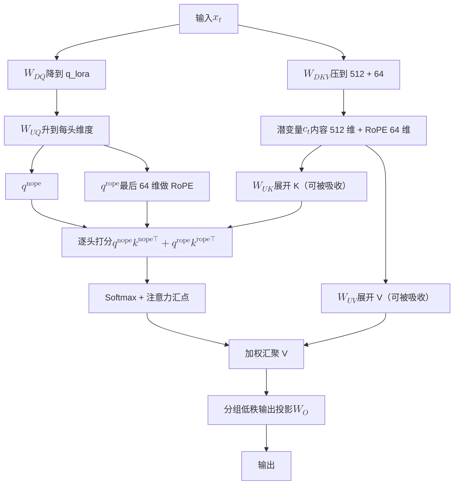
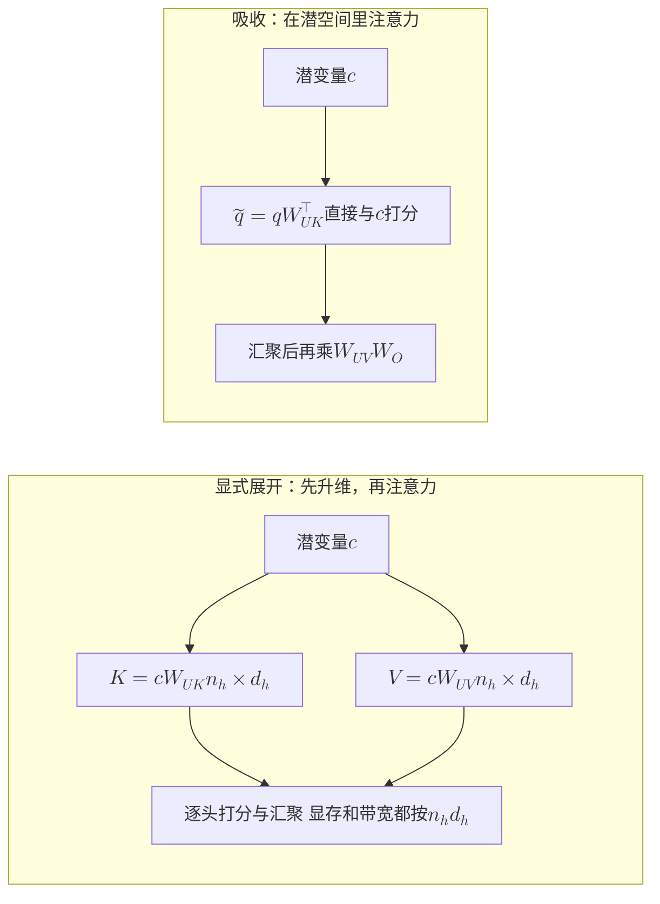
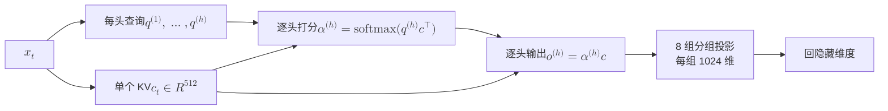

# 低秩注意力：把 KV 压进潜空间

标准多头注意力有一个昂贵的习惯：每个 token、每一层、每一个头，都要保存一份 Key 和一份 Value。序列一长，KV Cache 就成了显存里最大的一块；训练时即使不保留完整 Cache，逐层的 K/V 展开也要占用大量带宽。

低秩注意力换了一个问法：**Key 和 Value 真的需要这么高的秩吗？** 如果不同头、不同位置之间存在大量冗余，能不能先压成一个低维潜向量，等到真正需要时再展开？这一篇讲两种常见写法：**潜空间注意力** 和 **共享 KV 的 MQA**，以及它们共用的几个小零件——低秩查询、分组输出、注意力汇点。

---

## 一、先算一笔 KV 账

标准多头注意力（$L$ 层、$n_h$ 个头、每头 $d_h$ 维、BF16）的 KV Cache：

$$
M_{\text{KV}} = \underbrace{2}_{K,V} \cdot L \cdot n_h \cdot d_h \cdot n \cdot \underbrace{2}_{\text{字节}}
$$

取 $L=60$、$n_h=128$、$d_h=128$、$n=32768$：

$$
2 \times 60 \times 128 \times 128 \times 32768 \times 2 \approx 129 \text{ GB}
$$

一条 32K 序列就要 129 GB，还只是一个样本。推理时并发几条，显存立刻见底。

如果每层每 token 只存一个 576 维的潜向量（512 维内容 + 64 维位置），同样的配置：

$$
60 \times 576 \times 32768 \times 2 \approx 2.3 \text{ GB}
$$

差了约 56 倍。这个差距不是靠量化挤出来的，而是靠**改变表示方式**：不再为每个头保存独立的 K/V，而是保存一个所有头共享的压缩源。

---

## 二、潜空间注意力：先压缩，再按需展开

### 1. 压缩与展开

设输入 token 表示为 $x_t \in \mathbb{R}^d$。标准 MHA 直接算出每头的 $q,k,v$。潜空间注意力多做一步“下采样”：

$$
c_t = x_t W_{DKV} \in \mathbb{R}^{d_c}, \qquad d_c = d_{kv} + d_r
$$

$c_t$ 是这一层、这个 token 的**潜变量**。它的前 $d_{kv}$ 维存内容，后 $d_r$ 维留给旋转位置编码（RoPE）。然后：

$$
k_t^{\text{nope}} = c_t[:, :d_{kv}]\, W_{UK}, \qquad
v_t = c_t[:, :d_{kv}]\, W_{UV}
$$

$W_{UK}, W_{UV}$ 把 $d_{kv}$ 维潜变量展开成 $n_h$ 个头的 K/V。查询侧同样低秩：

$$
q_t^{\text{nope}} = \bigl(x_t W_{DQ}\bigr) W_{UQ}, \qquad
q_t^{\text{rope}} = x_t W_{QR}, \qquad
k_t^{\text{rope}} = x_t W_{KR}
$$

位置编码只作用在单独的 $d_r$ 维上，不参与低秩压缩。这一点很关键：**旋转操作与线性吸收不对易**，如果把 RoPE 混进潜变量再吸收，位置信息会被破坏。



### 2. 吸收：把升维矩阵折进 Q 和 O

潜空间注意力最漂亮的一步是**吸收（absorption）**。观察打分：

$$
q^{\text{nope}} \cdot k^{\text{nope}}
= q^{\text{nope}} \bigl(c\, W_{UK}\bigr)^\top
= \underbrace{\bigl(q^{\text{nope}} W_{UK}^\top\bigr)}_{\tilde q}\, c^\top
$$

我们可以预先算出一个“吸收后的查询” $\tilde q = q^{\text{nope}} W_{UK}^\top$，它的维度是 $d_{kv}$，而不是每头 $d_h$。于是打分不再需要显式展开 K，直接拿 $\tilde q$ 和潜变量 $c$ 做内积。

输出侧同理：

$$
\Bigl(\sum_j \alpha_j\, c_j\Bigr) W_{UV} W_O
$$

可以先把 $W_{UV}$ 和输出投影 $W_O$ 乘在一起，得到一个新的输出矩阵。这样整个注意力都在潜空间里完成，**K/V 的逐头展开被彻底省掉**。



吸收是一个**代数等价改写**，不是新的模型。它改变的是计算顺序和数值路径：训练时如果显式展开 K/V，数值更稳、调试更直观；推理或长上下文训练时用吸收，显存和带宽更省。两者要保证数值一致，需要在 FP32 下累加，并注意矩阵乘的结合顺序带来的舍入差异。

### 3. 为什么要低秩

- **KV 冗余**：不同头、不同层的 K/V 高度相关，低秩瓶颈相当于强制共享信息，起到正则化作用。
- **Cache 友好**：每层每 token 只存 $d_c$ 维，而不是 $2 n_h d_h$ 维；解码时每步只读一个向量。
- **计算不亏**：吸收之后，打分和汇聚都在潜空间完成，FLOPs 与标准注意力同量级，省的是展开和搬运。
- **可扩展**：潜变量维度 $d_c$ 是一个独立的旋钮，可以在“表达力”和“显存”之间调。

代价是表达力受瓶颈限制。如果任务需要每头保留非常不同的键值子空间，低秩会损失精度；这时可以增大 $d_c$、增加头数，或者回到分组共享的方案。

---

## 三、MQA 变体：只留一个 KV 头，且 $K=V$

另一条更激进的路线干脆不做“先压缩再展开”，而是让所有查询头共享**同一个** KV 向量：

$$
c_t = x_t W_{KV} \in \mathbb{R}^{d_{kv}}, \qquad K = V = c_t
$$

每个查询头 $q_t^{(h)} \in \mathbb{R}^{d_{qk}}$ 独立与 $c_t$ 打分：

$$
\alpha_t^{(h)} = \mathrm{softmax}\Bigl(\frac{q_t^{(h)} c_t^\top}{\sqrt{d_{qk}}}\Bigr), \qquad
o_t^{(h)} = \alpha_t^{(h)} c_t
$$

因为 $K=V$，注意力输出就是同一个 KV 向量的加权副本；不同头通过不同的查询权重，从同一个向量里“读出”不同方面。每个头输出 $d_{kv}$ 维，再拼接起来做分组输出投影。

输出前通常还要做一次 **inverse RoPE**：查询侧做过的旋转要在输出侧逆回来，否则位置信息会以错误的方式叠加到内容上。可选的逐头 sigmoid 门控可以控制每个头对最终输出的贡献；这些细节不影响主结构，但会影响数值稳定性和头的利用率。



这条路线把 KV Cache 压到每层每 token 一个 512 维向量，比潜空间注意力还省（没有 64 维 RoPE 尾巴，也没有 K/V 两份）。代价是：

- K 和 V 被强制共享，键空间和值空间无法解耦；
- 所有头共享一个内容向量，表达力依赖查询头的多样性；
- 需要额外的归一化和门控来稳定训练。

### 查询侧的三个小零件

1. **低秩查询**：先降到 $d_{ql}$（例如 1280），再升到 $n_h \times (d_{qk} + d_r)$。这减少了查询投影的参数和带宽，和 KV 的低秩是两件独立的事。
2. **逐头 RMSNorm**：在查询进入注意力之前，对每个头的非 RoPE 维做 RMSNorm；或者在低秩潜变量上做一次 RMSNorm 再升维。前者更细，后者更省。逐头归一化能抑制个别头的数值爆炸，但也可能削弱头的多样性。
3. **分组输出投影**：不做一个 $d \times d$ 的大矩阵，而是把头分成若干组（例如 8 组），每组先投到 $d_{ol}$（例如 1024），再拼起来投回 $d$。这相当于对输出也做低秩分解，减少参数和通信量。

### 注意力汇点（Attention Sink）

在每个头的打分上加一个可学习的标量 $s_h$：

$$
\alpha_{t,j} = \mathrm{softmax}_j\Bigl(\frac{q_t k_j^\top}{\sqrt{d}} + s_h\Bigr)
$$

它等价于在序列前面附加一个“零值 key”：模型可以选择把一部分注意力放到“什么都不看”上。好处是：

- 当当前 token 不需要历史信息时，不必强行把权重摊给所有位置；
- 长上下文或流式推理时，吸收掉多余的注意力质量，减少“注意力稀释”；
- 训练时给模型一个显式的“空选项”，有时能改善稳定性。

汇点通常用 FP32 保存，因为它的数值直接影响 softmax 的温度；如果和其他参数一起量化，容易在长序列上漂移。

---

## 四、形状与成本对照

把几种方案放在同一组配置下（$L=60$、$n_h=128$、$d_h=128$、$n=32768$、BF16）：

| 方案 | 每层每 token 的 KV 元素 | Cache 大小 | 键值是否解耦 | 主要代价 |
| :--- | ---: | ---: | :--- | :--- |
| MHA | $2 \times 128 \times 128 = 32768$ | 129 GB | 是 | Cache 最大 |
| GQA（8 组共享） | $2 \times 8 \times 128 = 2048$ | 8.1 GB | 是 | 组内头共享，表达力折中 |
| 潜空间注意力 | $512 + 64 = 576$ | 2.3 GB | 是（展开后） | 需要吸收与 RoPE 分离 |
| MQA（$K=V$） | $512$ | 2.0 GB | 否（键值同一） | 表达力最受限 |

注意这张表只算 Cache，不算训练时的激活和中间张量。训练时是否吸收、是否显式展开，会改变峰值显存，但不会改变“每 token 需要保存多少 KV”这个根本量级。

---

## 五、一个最小实现

下面是一段只保留核心路径的伪代码，用“显式展开 + 可选吸收”展示两种写法：

```python
def latent_attention(x, W_dkv, W_uk, W_uv, W_dq, W_uq, W_qr, W_kr, W_o,
                     n_heads, d_head, d_kv, d_rope, sink, absorb=True):
    # x: [T, d]
    c = x @ W_dkv                      # [T, d_kv + d_rope]
    c_content, c_rope = c[:, :d_kv], c[:, d_kv:]

    q = (x @ W_dq) @ W_uq              # [T, n_heads * d_head]
    q = q.reshape(T, n_heads, d_head).transpose(0, 1)   # [n_heads, T, d_head]
    q_nope = q[..., :d_head - d_rope]
    q_rope = q[..., d_head - d_rope:]                   # [n_heads, T, d_rope]

    k_rope = x @ W_kr                  # [T, d_rope]，所有头共享
    q_rope = apply_rope(q_rope, positions)
    k_rope = apply_rope(k_rope, positions)              # [T, d_rope]

    if absorb:
        # 把 W_uk 吸收进查询：q_tilde 的维度是 d_kv，而不是 d_head
        q_tilde = q_nope @ W_uk.T      # [n_heads, T, d_kv]
        scores = q_tilde @ c_content.T # [n_heads, T, T]
    else:
        k_nope = (c_content @ W_uk).reshape(T, n_heads, d_head).transpose(0, 1)
        scores = q_nope @ k_nope.transpose(1, 2)

    scores = scores / sqrt(d_head) + q_rope @ k_rope.T  # [n_heads, T, T]
    scores = scores + sink.view(n_heads, 1, 1)          # 注意力汇点
    weights = causal_softmax(scores)                    # [n_heads, T, T]

    if absorb:
        out = weights @ c_content                       # [n_heads, T, d_kv]
        out = out.transpose(0, 1).reshape(T, n_heads * d_kv)
        out = out @ (W_uv @ W_o)                        # 折叠后的输出矩阵
    else:
        v = (c_content @ W_uv).reshape(T, n_heads, d_head).transpose(0, 1)
        out = (weights @ v).transpose(0, 1).reshape(T, n_heads * d_head)
        out = out @ W_o
    return out
```

真实实现里还要处理：逐头 RMSNorm、分组输出、张量并行下的切分、序列打包的变长边界、FP32 累加，以及吸收路径中 `W_uv @ W_o` 的预计算和精度。

---

## 六、常见坑

1. **把 RoPE 吸收进去**：旋转矩阵依赖位置，不能和静态的 $W_{UK}$ 交换。RoPE 维度必须单独保留，先旋转再打分。
2. **训练和推理用不同的结合顺序**：训练显式展开、推理吸收，数值会有细微差异。要确保两边都在 FP32 下累加，并做对齐测试。
3. **逐头归一化位置放错**：在 RoPE 之前还是之后、在低秩潜变量上还是每头展开后，效果不同。一般先归一化非 RoPE 维，再做旋转。
4. **汇点被量化**：汇点是一个全局温度偏置，量化误差会被 softmax 放大；至少保持 FP32。
5. **低秩瓶颈太小**：$d_c$ 太小会让不同头被迫共享过多信息，表现为注意力头同质化、长程召回下降。它不是越小越好。

---

## 小结

- **KV 账**：标准 MHA 的 Cache 随 $L \cdot n_h \cdot d_h \cdot n$ 增长；低秩方案把它压成每层每 token 一个潜向量。
- **潜空间注意力**：$c = x W_{DKV}$，K/V 从潜变量展开；吸收把 $W_{UK}$ 折进 Q、把 $W_{UV}W_O$ 折进输出，使注意力在潜空间完成。
- **MQA 变体**：所有头共享一个 $K=V$ 的 512 维向量，Cache 最省，但键值不解耦，表达力最受限。
- **小零件**：低秩查询、逐头 RMSNorm、分组输出、注意力汇点，都是围绕“稳定 + 省带宽”做的局部改造。
- **代价**：低秩瓶颈、RoPE 不能吸收、训练/推理数值路径不一致，是这条路线最常见的三个坑。

下一篇把“选哪些位置”这件事单独拿出来讲：既然 KV 已经压得很小，为什么还要在全长序列上做 Top-K？
