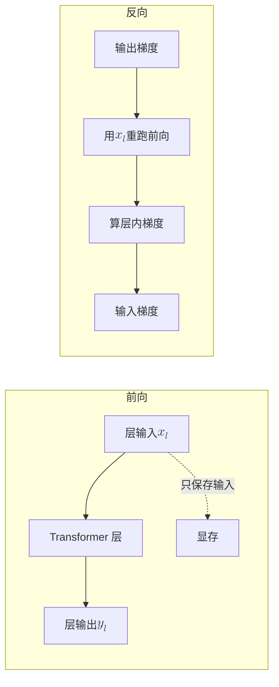
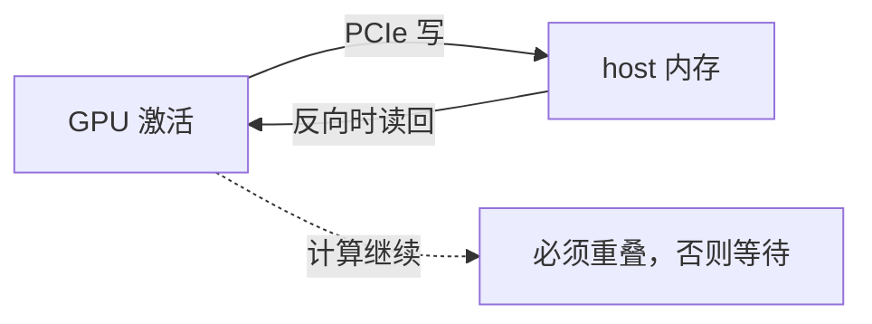

# 显存账本：先爆的为什么总是激活

一次很典型的故障：模型参数明明放得下，训练到第 3 层就 OOM。把序列从 8K 拉到 32K，显存曲线像台阶一样往上跳；把 batch 减半，还是炸；把优化器状态切了，也只多撑了几层。

问题不在参数，在**激活**。

一个 40 层、$d=5120$ 的模型，32K token 的层内激活约 134 GB。这不是“总共 134 GB、每层分摊”，而是**每一层都要保存自己那份中间张量**，反向时才能算梯度。参数可以分片，激活不能凭空消失；它要么被重算，要么被卸载，要么根本不存在。

这一篇按“先定位、再动手术”的顺序，讲清楚重算、卸载和精度边界各自解决哪一块，以及它们的代价。

---

## 一、先定位：哪一块在涨

训练显存大致分五块：

| 区块 | 40 层、$d=5120$、32K token 的量级 | 随什么增长 |
| :--- | ---: | :--- |
| 参数与优化器状态 | 取决于总参数；500B 约 8 TB | 参数量、精度、分片度 |
| 层内激活 | 约 134 GB | 层数、token 数、隐藏维度 |
| KV / 压缩 KV | 标准 MHA 可达数百 GB；压缩 KV 约 6 GB/序列 | 序列长度、头数、压缩率 |
| 通信缓冲 | 取决于 EP/CP 的最坏情况 | 并行度、负载均衡 |
| 碎片与 workspace | 几 GB 到几十 GB | 分配模式、重算、卸载 |

这张表最重要的信息是：**参数和激活是两种不同的东西。** 参数可以按 DP/TP/EP 切，切完每卡只留一小片；激活是前向产生的，切分只能减少单卡 token 数，不能减少“每层要保存多少中间量”。

所以第一步不是“加卡”，而是量一下：OOM 发生在第几层？把序列减半后是否消失？关掉重算/卸载后峰值怎么变？只有知道是哪一块在涨，后面的手段才不会用错。

---

## 二、重算：把 120 GB 换成 33% 的算力

完全重算的做法是：前向只保存每层输入，不保存层内激活；反向到某一层时，用输入重新跑一遍前向，得到中间量，再算梯度。

它把层内激活从 134 GB 压到约 13 GB（只剩 40 层的输入），代价是多一次前向：训练 FLOPs 从约 $6ND$ 变成约 $8ND$，增加 33%。这是一个很直接的交换：**用三分之一的算力，换掉九成的激活。**

但不是所有重算都划算。注意力核心的中间矩阵大、重算成本相对低，通常最值得重算；FFN 的激活也大，但重算要再跑一遍大矩阵乘，成本更高。于是有了**选择性重算**：只重算注意力核心、压缩器、多流混合、QKV 上投影等“激活大、计算相对便宜”的模块，其他激活保留。

选择哪些模块，取决于两件事：

- **省下的激活**：这个模块的中间张量有多大；
- **多花的计算**：重跑这个模块的前向要多少 FLOPs。

一个模块如果中间张量很小，重算它没有意义；如果重算成本接近整个反向，也不划算。实际配置通常是“注意力核心必重算，FFN 视显存决定”。

重算还有两个隐蔽的坑。**第一，随机性**：dropout、随机路由、数据增强在重算时必须得到相同结果，否则梯度不一致。通常在这些位置固定 RNG，或者直接关闭随机性。**第二，共享状态**：跨层复用的 KV/index 状态要在 checkpoint 之间以张量形式传递，不能依赖进程内缓存；重算时状态的生命周期要能被正确恢复。

---

## 三、卸载：PCIe 的带宽账

重算解决“不保存”，卸载解决“保存了但先放到 host”。两者经常被混为一谈，其实它们的代价完全不同。

卸载的关键不是“能不能搬”，而是“搬的时候 GPU 有没有活干”。假设你要卸载 100 GB 激活，PCIe 带宽 50 GB/s，搬一遍就是 2 秒。如果一个训练 step 只有 0.5 秒，这次卸载会让吞吐直接崩掉。只有**搬一小部分、且能完全重叠**时，卸载才划算。

三种常见卸载对象：

- **激活卸载**：把暂时不用的层内激活搬到 CPU，反向需要时再搬回。适合“显存峰值卡死、但带宽有余量”的场景。
- **KV 卸载**：长上下文训练时，压缩 KV 和索引 K 可能很大；每个 storage 只保留一份 host 副本，用弱引用管理生命周期，最后一个消费者释放后回收。由重算拥有的 storage 不要卸载——反向会重新算出来，卸载反而多一次拷贝。
- **优化器状态卸载**：分布式优化器已经把状态按 DP 组切分；如果还不够，可以把部分状态放到 CPU，更新时再取回。每步都有大量 PCIe 传输，通常只作为最后手段。

卸载和重算通常不能对同一批张量同时使用：重算假设“没有保存”，卸载假设“保存了但在 host”，两者的所有权和生命周期冲突。框架一般会禁止这种组合，或者只允许在不相交的模块上使用。

碎片是另一个容易被误判的问题。`empty_cache` 后显存没降，不代表泄漏；可能是分配器保留的缓存块。预分配 workspace、固定 buffer 大小、定期手动 GC，能减少碎片，但不能解决真实峰值。

---

## 四、精度：哪些数一量化就坏

解决了“存不下”，还有“存得不对”。低精度的诱惑很大：BF16 省一半，FP8 再省一半，FP4 更省。但有些参数只有几十、几百个，却直接控制数值路径，一量化就会在长序列上放大误差。

最典型的是**注意力汇点**。它直接加在 softmax logits 上，相当于一个温度偏置。量化误差会被 softmax 放大，表现为长上下文注意力分布突然变平或变尖。汇点必须留在 FP32。

类似地，**压缩器的 APE** 决定块内门控分配；**多残差流的混合矩阵/系数** 控制流间路由和范数；**路由 logits** 在 Top-K 边界附近，BF16 的舍入会让同一个 token 在不同 step 选到不同专家；**indexer 的分数/逐头权重** 决定选择排序，长序列上会漂移。这些参数的共同点是：数量少、影响大、直接进入非线性或选择。

一个实际的分层策略是：

| 层级 | 用什么 | 放什么 |
| :--- | :--- | :--- |
| 计算 | BF16 / FP8 GEMM | 大部分矩阵乘、专家 FFN、通信 |
| 状态 | FP32 master | 参数更新、优化器状态、梯度累加 |
| 敏感边界 | FP32 | 汇点、APE、多流系数、路由 logits、indexer 分数、`dt_bias/A_log` |
| 缓存 | FP8 / FP4 | KV、记忆表权重；反向仍按 dense 精度 |

FP8 不是“全局打开”的开关。常见做法是：GEMM 用 FP8，通信用 FP8，压缩器/indexer/汇点保持高精度。FP4 更激进，适合 KV、表等特定缓存，训练路径通常还不成熟。

除了精度，**结合顺序**也会改变结果。低秩吸收、压缩、跨层复用都会改变矩阵乘的顺序；数学上等价，浮点上不等价。关键路径要在 FP32 下累加，吸收前后要做对齐测试，不能假设“数学等价 = 训练等价”。

---

## 五、一笔 32K 的预算

把上面的手段放到一个具体场景里：

| 决策 | 选择 | 理由 |
| :--- | :--- | :--- |
| 40 层激活 134 GB | 完全重算注意力核心 + 选择性重算 FFN | 先把峰值压到 30 GB 量级 |
| 跨层 KV 状态 | 组末提前反向 + 必要时的 host 卸载 | 状态活得太久，先结算再释放 |
| 长序列 KV | 压缩 KV；标准 MHA 不可行 | 129 GB vs 2–6 GB 的差距 |
| 参数状态 | FSDP/分布式优化器 | 8 TB 不可能单卡放下 |
| 计算 | BF16 基线；GEMM 可试 FP8 | 先稳住数值，再谈吞吐 |
| 敏感参数 | FP32 保留 | 汇点/APE/路由/indexer 不能省 |

这张表不是“标准答案”，而是展示一种顺序：**先压激活，再压状态，最后动精度。** 反过来的顺序往往更危险：先把精度降了，loss 出问题，你很难判断是精度、重算还是并行导致的。

---

## 六、NaN 与静默错误

显存优化最怕的不是 OOM，而是“跑通了但算错了”。

**NaN** 常见于四个地方：softmax 溢出（logits 太大）、FP8 scale 为零或过小、Sinkhorn 除零、卸载/重算的竞态。定位方法不是猜，而是逐个关掉：先关 FP8，再关卸载，再关重算，看 NaN 是否消失；同时用 FP32 参考实现跑一个小 batch，对比前向输出。

**静默错误**更麻烦。比如：

- 重算时 RNG 没对齐，dropout mask 不同，梯度有细微偏差；
- KV 卸载的弱引用提前释放，反向读到旧数据；
- 跨层复用的状态在 checkpoint 边界没有正确恢复，训练重启后 loss 跳变；
- 逐头拆分和 TP 边界不一致，两个头被混在一起，训练仍然能跑，但效果变差。

这些问题的共同点是：它们不会立刻报错，只会让曲线“有点不对”。所以每次改显存/精度配置，都要做三件事：跑一个短程 baseline 对比 loss、检查梯度范数、确认 checkpoint 能无损恢复。

---

## 小结

32K 序列 OOM，通常不是参数放不下，而是激活和状态活得太久。完全重算用 33% 的算力换掉九成激活；选择性重算只对“激活大、计算便宜”的模块下手；卸载只在能重叠时划算；精度则要区分“可以低的矩阵乘”和“不能动的敏感边界”。

显存工程的核心不是省字节，而是决定**哪些张量值得活到反向**。这个决定做对了，后面的并行和精度才有意义。

下一篇讲优化器：当矩阵参数的更新方向本身成为瓶颈，Adam 的逐坐标步长为什么不够用。
