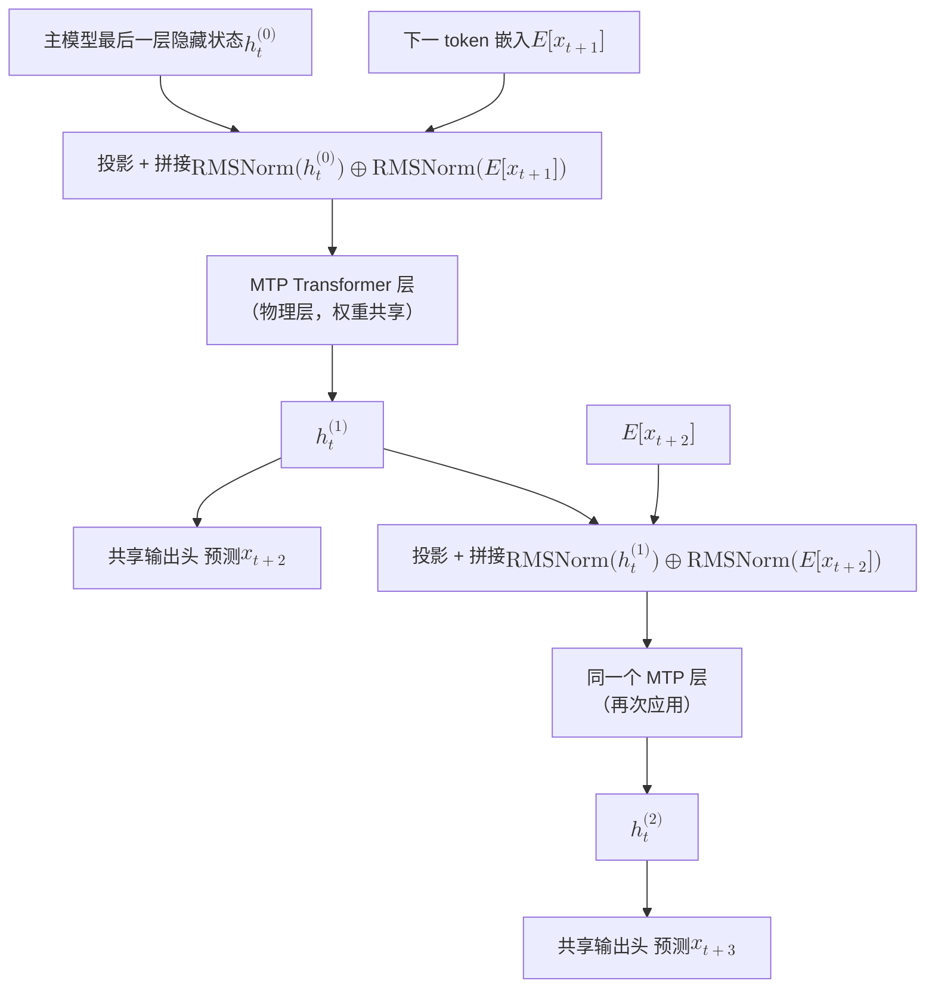

# 多 token 预测：让模型在同一个位置多答几次

一个 40 层的模型在 8K 上下文上训练，next-token loss 降到 2.1，单句续写看起来很顺。但让它写一段长文，三句之后经常跑题：它能接住“下一句”，却接不住“下一段”。

原因不一定是容量不够，而是**监督太稀**。每个位置只有一个标签：下一个 token。模型只需要让隐藏状态编码“下一步够用”的信息，就能把 loss 压下去；它没有动力去规划更远的结构。

多 token 预测（Multi-Token Prediction, MTP）在同一个位置上多加几路目标：除了预测 $t+1$，还预测 $t+2, t+3, \dots$。它的目的不是“让模型多背几个词”，而是**逼隐藏状态保留更多关于句子走向的信息**。

---

## 一、单步监督的极限

标准语言模型在位置 $t$ 的输出是：

$$
p(x_{t+1} \mid x_{\le t})
$$

损失只回传到“预测下一个词”这一个目标。对浅层任务，这足够了；但对需要规划的任务（长文结构、代码补全、数学推导），模型很容易学成“局部接龙”：每个词都接得顺，整体却偏离。

更关键的是，**隐藏状态的容量被浪费了**。一个 $d=5120$ 的向量，如果只用来预测下一个词，很多维度可以编码与下一步无关的信息；模型没有压力去保留“三句之后要回到主题”这类长程信息。

MTP 的直觉是：如果一个表示能同时预测未来多个 token，它就必须编码更抽象、更稳定的结构。这相当于给每个位置加了更密的监督。

---

## 二、结构：一个物理层，重复 $K$ 次

最朴素的做法是训练 $K$ 个独立的预测头，每个头有自己的 Transformer 层。参数和显存都按 $K$ 倍增长，不划算。

更常见的做法是**共享一个物理 MTP 层，重复应用 $K$ 次**：



形式化地，设主模型在位置 $t$ 的隐藏状态为 $h_t^{(0)}$，第 $k$ 个深度的计算为：

$$
u_t^{(k)} = M_k \Bigl[ \mathrm{RMSNorm}(h_t^{(k-1)}) \; ; \; \mathrm{RMSNorm}(E[x_{t+k}]) \Bigr]
$$

$$
h_t^{(k)} = \mathrm{Block}\bigl(u_t^{(k)}\bigr), \qquad
p\bigl(x_{t+k+1} \mid x_{\le t+k}\bigr) = \mathrm{softmax}\bigl(W_{\text{out}}\, \mathrm{RMSNorm}(h_t^{(k)})\bigr)
$$

这里有三个设计选择，每一个都会影响训练行为。

**输入是已知的下一 token。** 训练时 $x_{t+k}$ 来自真实序列，所以第 $k$ 层是在“看到 $t+1 \dots t+k$”的条件下预测 $t+k+1$。这让每一层都有完整前缀，而不是让模型凭空猜。但也带来了训练/推理的分布差异：推理时 $x_{t+k}$ 是模型自己生成的，一旦前面错了，后面会级联。

**物理层共享，投影深度相关。** `Block` 在所有深度共享，$M_k$ 每个深度不同。参数只多一个 Block，而不是 $K$ 个；激活仍然按深度累积。

**输出头和最终归一化共享。** 不为每个深度单独学一套词表投影，否则参数量直接乘 $K$。词表很大时，logits 本身就是一笔不小的算力，共享是必要的。

---

## 三、损失：加权、平均与 detach

总损失是主损失加 MTP 损失：

$$
\mathcal{L} = \mathcal{L}_{\text{main}} + \lambda \cdot \frac{1}{K} \sum_{k=1}^{K} \mathcal{L}_{\text{MTP}}^{(k)}
$$

$$
\mathcal{L}_{\text{MTP}}^{(k)} = -\frac{1}{T} \sum_{t=1}^{T} \log p\bigl(x_{t+k+1} \mid x_{\le t+k}\bigr)
$$

$\lambda$ 通常取 0.1–0.3；太大压过主任务，太小起不到规划作用。按深度取**平均**，不是求和；否则深度越多，辅助损失越大，等效于放大 $\lambda$。

真正需要明确的是 **detach 与否**。

- **不 detach**：MTP 梯度回传到主模型隐藏状态，主模型被迫学出“对多个未来 token 都有用”的表示。这是把 MTP 当成主训练目标的一部分。
- **detach**：把送入 MTP 的 $h_t^{(0)}$ 截断，MTP 只训练自己的投影、Block 和输出头。这是把 MTP 当成辅助正则或推理草稿。

两种接法对应两种意图，不能“部分 detach”导致梯度路径难以解释。detach 会省一部分反向计算和显存，但也削弱了 MTP 对主模型的影响。

如果主模型用了检索式稀疏注意力，每个 MTP 深度还要跑一次 indexer 和 KL。每个深度有自己的查询和教师分布；indexer 的 KL 按深度取平均，和主损失一样，不按深度累加。共享 indexer 的组内平均仍然适用：先组内按层平均，再按深度平均。

---

## 四、它买到了什么，又卖了什么

MTP 的收益主要来自三处。

**更密的监督。** 每个位置不再只有一个标签，而是 $K$ 个。同样的 token 预算下，模型收到更多梯度信号，尤其是中间表示层。

**迫使表示向前看。** 如果模型只编码“下一个词是‘的’”，它无法预测 $t+2$ 的内容。MTP 迫使隐藏状态保留更多关于句子走向、主题、语法结构的信息。

**推理加速的接口。** MTP 头可以直接用于推测解码：草稿阶段一次提出多个候选，主模型并行验证，接受最长的一致前缀。因为 MTP 头共享主模型的大部分计算，草稿成本比独立的小模型低。

代价也很直接：

| 项目 | 成本 |
| :--- | :--- |
| 参数 | 一个物理 Block + $K$ 个投影；远小于 $K$ 个独立层 |
| 计算 | $K$ 次 Block 前向/反向；约等于多跑 $K$ 层主模型 |
| 激活 | 每个深度保存中间张量；可用重算压缩 |
| 输出头 | 每个深度一次 logits；词表大时不可忽略 |
| 稀疏注意力 | 每个深度一次 indexer + KL；显存显著 |

一个 4 深度的 MTP，计算量大约相当于多跑 4 层主模型。对一个 40 层的模型，这是 10% 量级的额外算力；如果词表很大，logits 的占比还会更高。所以 MTP 不是“免费的监督”，它要和主模型的层数、词表大小一起算账。

---

## 五、实现上的取舍

MTP 最容易写错的地方不是公式，而是**标签移位**和**掩码**。第 $k$ 个深度预测的是 $t+k+1$，输入的是 $t+k$；少移一位就会造成标签泄漏或错位。变长序列里，移位后的标签可能落到 padding 上，损失掩码要跟着移位。

第二个坑是**输出头不共享**。每个深度一套词表投影，参数量直接乘 $K$，通常不值得。共享输出头和最终归一化是默认做法。

第三个坑是**推理时直接用真实 token**。训练时输入是真实序列，推理时输入是模型自己的预测；这种曝光偏差会让草稿质量随生成长度下降，通常只用于前几个 token。如果 MTP 只是训练辅助，不用于推理，也要明确这一点，避免评估时误用。

最后是**并行放置**。MTP 层放在最后一个 stage 最自然；如果跨 stage，激活和梯度的传输要额外处理。MTP 的输出 logits 和 KL 对精度敏感，FP8 训练时通常让 MTP 头保持更高精度。

---

## 六、什么时候值得

MTP 不是所有训练的默认项。它适合：

- 数据量相对模型容量偏紧，需要更密的监督；
- 长文生成、代码补全、数学推导等需要“向前看”的任务；
- 推理侧想要一个便宜的推测解码头。

如果训练算力已经很紧，MTP 的 $K$ 层额外计算可能不划算；如果推理不需要草稿，MTP 的收益主要落在表示学习上，需要用短程 ablation 确认，而不是默认打开。

```python
def mtp_loss(hidden, tokens, block, proj, norm, out_head, depth, lam):
    total = 0.0
    h = hidden
    for k in range(1, depth + 1):
        next_emb = embed(tokens shifted by k)
        u = proj[k](torch.cat([norm(h), norm(next_emb)], dim=-1))
        h = block(u)                       # 共享物理层
        logits = out_head(norm(h))         # 共享输出头
        total = total + cross_entropy(logits, tokens shifted by k + 1)
    return lam * total / depth
```

真实实现还要处理：变长序列的移位、padding 掩码、共享参数初始化、MTP 与主模型的计算图连接（detach 或 not），以及和流水线并行的层放置。

---

## 小结

MTP 的本质不是“多预测几个词”，而是**用更密的监督逼表示编码更远的结构**。它用一个共享物理层重复 $K$ 次，代价是 $K$ 层计算和额外激活，收益是规划压力、更密的梯度和一个便宜的推测解码头。

它最适合“数据相对容量偏紧、任务需要向前看”的场景；如果算力已经很紧，或者推理不需要草稿，先用短程 ablation 确认收益，再决定是否默认打开。

下一篇换一条完全不同的轴：不改注意力或 FFN，而是改残差连接本身——把一条残差流拆成多条，让模型自己学习如何在深度方向上路由信息。
