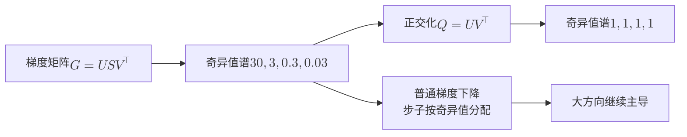
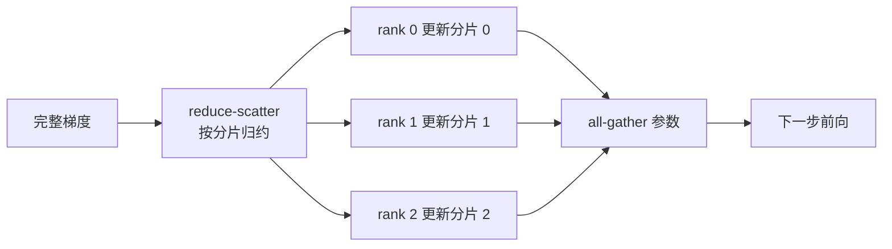

# 优化器：为什么矩阵参数不该共用 Adam 的步长

先看一个具体的病。

一个 40 层、隐藏维度 5120 的模型，某个 Q 投影是 $5120 \times 5120$ 的矩阵。它的梯度矩阵 $G$ 做奇异值分解，奇异值可能从 $30$ 一路掉到 $0.03$——最大的方向和最小的方向差了一千倍。梯度下降会沿着大奇异值方向猛走，沿着小奇异值方向几乎不动。训练 loss 还在降，但这个矩阵的条件数越来越差，后面再想调整就难了。

Adam 看起来能救：它给每个坐标除以自己的梯度均方根，让每个坐标的步长大致可比。但注意，**Adam 归一化的是坐标，不是矩阵的方向**。一个 $5120 \times 5120$ 的矩阵有 2620 万个坐标，Adam 把它们当成 2620 万个独立的标量；它不会保证更新矩阵的奇异值谱变平。于是你可能会看到：每个坐标的步长都差不多，但整个矩阵的更新仍然集中在少数几个方向上。

Muon 针对的正是这个病：**不要逐坐标归一化，直接把更新矩阵的奇异值拉平。**

---

## 一、Adam 对矩阵做了什么，没做什么

Adam 的更新是：

$$
\theta_t = \theta_{t-1} - \eta \frac{\hat m_t}{\sqrt{\hat v_t} + \varepsilon}
$$

分母 $\sqrt{\hat v_t}$ 是每个坐标自己的历史梯度幅度。梯度大的坐标被压，梯度小的坐标被抬，所以不同坐标的有效步长大致在同一量级。这对嵌入层、归一化参数、稀疏梯度非常有效。

但对一个二维矩阵，这个操作有一个盲区：**它只保证坐标尺度可比，不保证方向尺度可比。**

举个极端的例子。假设梯度矩阵只有一个方向很大：

$$
G = 30 \, u_1 v_1^\top + 0.03 \, u_2 v_2^\top
$$

梯度下降在第一个方向上的步子是第一万个方向的 1000 倍。Adam 会把每个坐标的梯度除以它的历史 RMS；如果两个方向的梯度在坐标上分布得很均匀，Adam 确实会把差距压小。但如果大奇异值方向只涉及少数坐标，Adam 的逐坐标归一化就无法把整个矩阵的谱拉平——它没有“矩阵”这个概念。

这不是说 Adam 不好。它的问题只是：**它优化的对象是坐标，而矩阵参数的几何对象是线性算子。** 当你开始关心条件数、方向性和深层复合时，这个错位就会显现。

Adam 的另一个代价是状态。一个 $5120 \times 5120$ 的矩阵有 2620 万参数：

| 内容        | 精度   |      大小 |
| :---------- | :----- | --------: |
| BF16 权重   | 2 字节 |     52 MB |
| FP32 master | 4 字节 |    105 MB |
| FP32 梯度   | 4 字节 |    105 MB |
| Adam $m,v$  | 8 字节 |    210 MB |
| 合计        |        | 约 472 MB |

一个模型有几十个这样的矩阵，光优化器状态就是几十 GB。分布式优化器能把它按 DP 组切开，但总内存不会变。

---

## 二、Muon：把更新矩阵的奇异值拉平

Muon 的做法很直接。设梯度矩阵的 SVD 为：

$$
G = U S V^\top
$$

普通梯度下降走 $U S V^\top$，奇异值大的方向步子大。Muon 走：

$$
Q = U V^\top
$$

$Q$ 的所有奇异值都是 1。更新在所有方向上等幅，条件数被压到 1。直觉上，这相当于把“梯度告诉你的方向”保留下来，但把“梯度有多大声”抹掉，让每个方向都得到同样的关注。



### 1. 为什么是 Newton–Schulz

直接做 SVD 太贵。Muon 用 Newton–Schulz 迭代近似 $U V^\top$。先按 Frobenius 范数归一化：

$$
X_0 = \frac{G}{\|G\|_F + \epsilon}
$$

然后重复：

$$
X_{k+1} = a X_k + b\, X_k X_k^\top X_k + c\, (X_k X_k^\top)^2 X_k
$$

常用系数是 $a=3.4445$、$b=-4.7750$、$c=2.0315$，迭代 5 次左右。这个迭代只做矩阵乘，不做 SVD，适合 GPU。

但“适合 GPU”不等于“免费”。对一个 $5120 \times 5120$ 的矩阵，一次迭代大约要做 3 次 $5120^3$ 的矩阵乘，5 次就是约 $2 \times 10^{12}$ FLOPs。对比一层 32K token 的前向+反向（约 $6 \times 32768 \times 5120^2 \approx 5.2 \times 10^{12}$ FLOPs），正交化可能吃掉这一层 25%–40% 的计算。**Muon 省的是状态和方向性，不是算力。**

### 2. Nesterov 与缩放

Muon 通常和动量一起用：

$$
M_t = \mu M_{t-1} + G_t, \qquad \tilde G_t = G_t + \mu M_t
$$

Nesterov 让更新方向更早地“看向”下一步。然后对 $\tilde G_t$ 做正交化。

正交化后的 $Q$ 奇异值为 1，尺度和原始梯度无关。直接乘学习率，可能比 Adam 的步长大得多或小得多。所以要乘一个缩放 $s$：

$$
\Delta W = \eta \cdot s \cdot Q
$$

$s$ 常取 $\sqrt{\max(1, m/n)}$ 或 $0.2\sqrt{\max(m,n)}$，有的配方再乘一个全局因子（例如 0.18）。这个因子不是装饰：它决定了 Muon 和 Adam 的更新尺度是否可比。**换模型宽度、换 Muon 系数、换 head split，都要重新校准它。**

### 3. 逐头拆分

注意力和输出投影通常按头组织。如果对整个 $Q$ 做正交化，不同头的子空间会被混在一起；某些头可能被其他头的奇异值压制。

逐头拆分的做法是：把 Q/O 投影按头切成子矩阵，每个子矩阵独立做 Newton–Schulz，再拼回去。这样每个头保留自己的更新尺度。代价是更多小矩阵迭代，kernel 效率下降；而且拆分边界必须和 TP 的切分对齐——如果 TP 把某些头分到了另一个 rank，你在本地按“全局头”切就会错位。

---

## 三、哪里不能直接用 Muon

Muon 的适用对象是**二维、稠密、梯度有意义的矩阵**。离开这个范围，它很快会出问题。

**一维参数**（LayerNorm 的 $\gamma/\beta$、偏置、汇点、APE、路由偏置）没有奇异值可谈，正交化没有意义，直接用 AdamW。**嵌入层和输出头**的梯度稀疏、词表巨大，正交化的收益不明显，而且这些参数通常需要自己的学习率，用 Adam 更稳。**极小的矩阵**做 Newton–Schulz，开销可能超过收益。

最特殊的是**记忆表**。它不是普通矩阵：行稀疏、冷热不均，高频行会被反复更新。Muon 的全局正交化在这里没有意义，需要的是行列平衡（第 10 篇）：Nesterov 动量 + 行/列 RMS 归一化，迭代若干次，把更新尺度摊平。

所以一个实际可用的参数分组通常是：

- 二维隐藏层矩阵：Muon；
- 1 维参数、嵌入、输出头、路由、汇点、APE：AdamW；
- 记忆表：专用 Sinkhorn 优化器。

这不是“哪个优化器更先进”的问题，而是**不同参数对应不同的几何对象**。

---

## 四、状态放在哪：分布式优化器的真实账本

先算一笔 5000 亿参数模型的账：

| 内容        | 每参数字节 | 总量 |
| :---------- | ---------: | ---: |
| Adam $m,v$  |          8 | 4 TB |
| FP32 master |          4 | 2 TB |
| FP32 梯度   |          4 | 2 TB |
| 合计        |         16 | 8 TB |

64 路数据并行，平均每卡约 125 GB，还没算激活、KV 和通信缓冲。**优化器状态本身就是模型能不能放下的决定因素。**

分布式优化器的做法是：

1. 每个 rank 只持有 $1/N_{\text{dp}}$ 的参数分片和对应的优化器状态；
2. 反向得到梯度后，reduce-scatter 到各分片 owner；
3. owner 在本地更新自己的分片；
4. 下一步前向前，all-gather 参数。



这里有几个容易混淆的地方。

**分布式优化器不是 FSDP。** FSDP 连参数都切，前向前 all-gather 一整层；分布式优化器主要切优化器状态，参数可以仍然按 TP/PP 分布。两者可以组合，但必须明确“谁拥有哪一块”，否则会出现重复 all-gather 或重复分片。

**Muon 的状态更少。** 它只需要动量，不需要二阶矩，单参数状态从 8 字节降到 4 字节。对 5000 亿参数，这意味着总状态从 8 TB 降到 6 TB。但 Newton–Schulz 的计算又加回来了，所以它是“用算力换显存”，不是纯赚。

**checkpoint 要支持重新分片。** 今天用 64 路 DP 保存，明天换 128 路，分片边界变了，加载时要把 local shard 重新拼成 global tensor。专家数不能整除 EP 时，还要做 local/global expert key 映射。

---

## 五、调度与表：两种不同的时间尺度

学习率调度看起来是独立问题，其实和优化器强耦合。Warmup 的作用之一是给二阶矩和路由统计量热身；Muon 没有二阶矩，但动量同样需要热身。稳定段保持较高学习率，衰减段再收小步幅。Muon 和 Adam 的峰值学习率不能直接互换——正交化改变了更新尺度，同一个 $\eta$ 在两种优化器下含义不同。

记忆表则是另一种时间尺度。1966 亿参数的表，FP8 权重约 196 GB，Adam 状态约 1.57 TB；64 路切分后每卡仍有二十多 GB。它的更新不是“每个矩阵乘”，而是“按行查表、按行更新”。所以它需要自己的规则：Nesterov 动量，行/列 RMS 平衡，迭代 11 次，指数 0.18，学习率放大 5 倍。这些数字不是普适常数，而是针对“行稀疏、冷热不均”这个具体结构的经验值。

---

## 六、怎么选：一个决策顺序

如果只能记住一段，记住这个顺序：

1. **先看参数形状。** 一维、嵌入、输出头、路由、汇点、APE → AdamW。二维稠密矩阵 → 可以考虑 Muon。记忆表 → 专用 Sinkhorn。
2. **再看瓶颈。** 显存不够 → 先分片，Muon 的状态更少，可能帮你放下；算力不够 → 慎用 Muon，Newton–Schulz 不便宜。
3. **最后看数值。** 换 Muon 后，先观察更新范数、loss 曲线和短程吞吐；不要直接套 Adam 的学习率。逐头拆分要和 TP 对齐，动量保持 FP32。
4. **不要一次换全部。** 先在一部分矩阵上试，保留 Adam 对照组；确认更新尺度和收敛都正常，再扩大范围。

优化器不是越新越好。AdamW 的问题是“矩阵方向性被忽略”，Muon 的问题是“正交化有计算成本、尺度和并行耦合”。你选择的是**愿意为哪种病付哪种代价**。

```python
def adamw_step(W, G, m, v, lr, beta1, beta2, eps, wd, step):
    m = beta1 * m + (1 - beta1) * G
    v = beta2 * v + (1 - beta2) * G * G
    m_hat = m / (1 - beta1 ** step)
    v_hat = v / (1 - beta2 ** step)
    W = W * (1 - lr * wd) - lr * m_hat / (sqrt(v_hat) + eps)
    return W, m, v


def muon_step(W, G, M, lr, momentum, scale, ns_iters=5):
    M = momentum * M + G
    G_eff = G + momentum * M              # Nesterov
    Q = newton_schulz(G_eff, ns_iters)    # 近似 U V^T
    W = W - lr * scale * Q
    return W, M


def newton_schulz(G, iters):
    X = G / (G.norm() + 1e-7)
    a, b, c = 3.4445, -4.7750, 2.0315
    for _ in range(iters):
        A = X @ X.T
        X = a * X + (b * A + c * A @ A) @ X
    return X
```

代码只展示单矩阵的更新。真实实现还要处理参数分组、按头拆分、TP 切分、FP32 主权重、分布式分片，以及和 FSDP 的所有权划分。

---

## 小结

AdamW 把矩阵当成 2620 万个独立坐标，逐坐标归一化；Muon 把矩阵当成线性算子，把更新谱拉平。前者适合 1 维、稀疏、嵌入类参数，后者适合二维稠密矩阵，但要付 Newton–Schulz 的算力和重新校准学习率的代价。分布式优化器决定状态怎么切，记忆表则需要另一套行/列平衡规则。

真正要判断的不是“哪个优化器更强”，而是：**你的瓶颈是方向性、显存，还是算力？** 答案不同，选择就不同。

下一篇是系列的收尾：那些还没有完全落地的能力——块级选择、线性注意力、跨层编码器、草稿层、视觉编码器——以及它们各自卡在哪。
