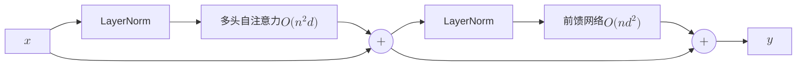
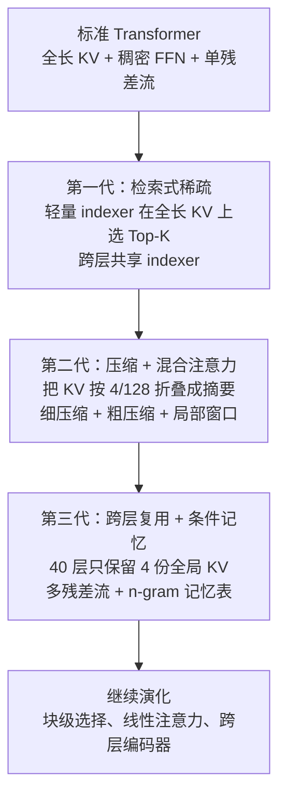
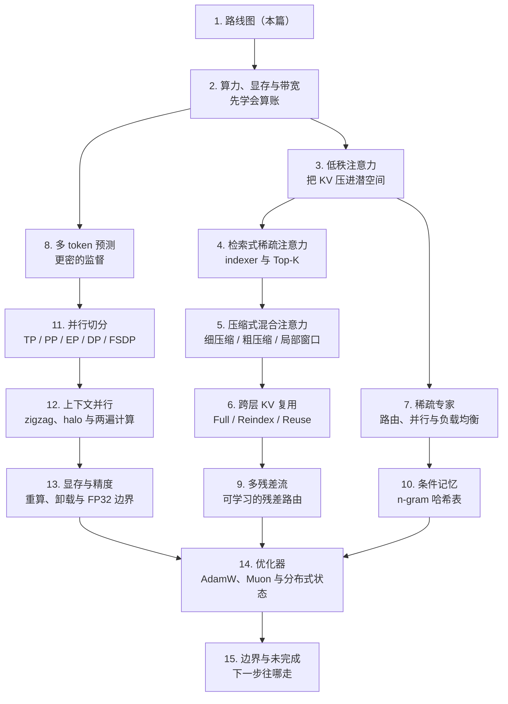

# 预训练的结构演化：一条被工程约束推着走的路

大模型预训练表面上只做一件事：用海量 token 把下一词预测的损失压下去。但真正决定一个模型长什么样的，往往不是损失函数，而是三本账——**算力、显存与带宽、通信**。

同样是堆 Transformer 层，把隐藏维度加大、把序列拉长、把专家数翻倍，都会立刻撞上不同的墙：注意力矩阵随序列长度平方膨胀，KV Cache 随层数和头数线性膨胀，专家并行的 all-to-all 把网络打满，流水线并行的气泡让 GPU 空转。过去几年里那些看起来越来越复杂的结构——低秩潜空间注意力、检索式稀疏注意力、压缩 KV、跨层复用、多残差流、可学习的记忆表——本质上都是在回答同一个问题：

> **在给定的算力与集群拓扑下，怎样用更少的“必算”和“必传”，换到更多的有效参数与更长的上下文？**

这个系列沿着这条主线，把一套完整预训练栈拆成十几个可以独立理解的机制。下面出现的层数、专家数、压缩率都只是教学用的示例配置，用来把数量级对齐；不同实现会取不同的值，它们不构成对某个具体模型的复现。

---

## 三本账：预训练到底在优化什么

先把“训练一个大模型”拆成三个互相拉扯的目标。

### 1. 算力账

设模型有 $N$ 个**参与前向计算**的参数，训练了 $D$ 个 token。前向大约需要 $2ND$ FLOPs，反向大约需要 $4ND$，合计：

$$
C_{\text{train}} \approx 6ND
$$

这个式子只统计矩阵乘法。真正跑起来还要加上注意力打分、归一化、路由、Top-K、通信开销，所以它是一个下限。对稀疏模型，$N$ 必须换成**激活参数** $N_{\text{active}}$，而不是总参数量；否则会把“参数很多但每 token 只算一小部分”的 MoE 误算成稠密模型。

### 2. 显存与带宽账

一个参数在训练中通常不止占一份内存：

| 内容                         | 典型精度     | 每参数字节数 |
| :--------------------------- | :----------- | -----------: |
| 前向/反向计算用的权重        | BF16         |            2 |
| FP32 主权重（master weight） | FP32         |            4 |
| 梯度                         | BF16 或 FP32 |          2–4 |
| Adam 一阶矩 $m$              | FP32         |            4 |
| Adam 二阶矩 $v$              | FP32         |            4 |

按 BF16 计算 + FP32 主权重 + FP32 梯度 + Adam 状态估算，每个参数大约要 $18$ 字节。一个 300 亿参数的模型，光参数与优化器状态就要五百多 GB；这还没算激活值、KV Cache、通信缓冲区和碎片。**模型能不能放下，往往比模型好不好算更早成为约束。**

### 3. 通信账

数据并行要归约梯度，张量并行每层要做 all-reduce，专家并行要把 token 发到持有对应专家的 rank，上下文并行要交换相邻 chunk 的 KV。通信量乘以“每步要做多少次”，再除以链路带宽，就是无法被计算掩盖的时间。

三本账互相耦合：想用专家并行省算力，就要付 all-to-all；想用上下文并行拉长序列，就要付 KV 交换；想用低精度省显存，就要接受数值误差和额外的量化/反量化。**结构设计的大部分“创新”，其实是在三本账之间重新分配压力。**

---

## 一个标准块的四堵墙

从最朴素的 Pre-Norm Transformer 块出发：

把层数堆上去、把宽度拉大、把序列拉长，会依次撞上四堵墙：

1. **注意力墙**：打分矩阵是 $n \times n$。序列从 8K 拉到 128K，注意力核心计算涨 256 倍，KV Cache 也线性涨 16 倍。
2. **前馈墙**：FFN 参数量通常占全模型的三分之二以上。稠密 FFN 每 token 都要过全部参数，参数越大，单 token 算力越贵。
3. **深度墙**：残差主干只有一条，层数越深，不同层的信息越容易挤在同一条通道里；归一化和初始化能稳住方差，但稳不住“每一层都只能做同一种加法”。
4. **通信墙**：模型一大，单卡放不下，必须切分。切得越细，跨卡依赖越多，通信越难被计算掩盖。

后面的三条技术路线，就是分别对这四堵墙下手。

---

## 三条路线：从“选 token”到“压 KV”再到“复用状态”

把近几年稀疏注意力的演进压缩成一张图，大致是这样一条路径：

### 第一代：检索式稀疏——让每个 token 只读该读的部分

思路最直接：KV 仍然按全长保存，但每一层先用一个**很轻的 indexer** 给所有历史位置打分，只把得分最高的 $k$ 个位置送进主注意力。主注意力因此从 $O(n^2)$ 降到 $O(nk)$，而 indexer 的维度远小于主注意力，额外开销可控。

这一代的工程重点在“选得准”和“选得快”：

- indexer 用独立的小 Q/K 和逐头权重，输出每个历史位置的分数；
- 训练时用主注意力的分布做教师，对 indexer 做 KL 蒸馏；
- 相邻几层共享同一个 indexer，减少重复打分和 Top-K；
- 选择、KL、反向都做成融合算子，避免在显存里物化巨大的分数矩阵。

一个 60 层的示例配置会把 indexer 从 60 个降到 18 个物理实例，主注意力保留低秩潜空间 KV。这条路线适合“序列很长，但每层真正需要看的位置很稀疏”的场景。

### 第二代：压缩 + 混合注意力——先把 KV 折叠成摘要

检索式稀疏省了主注意力的计算，但 KV 本身还是全长的。第二代换了个方向：**先把连续的 $r$ 个 token 压缩成一行 KV，再在压缩后的序列上做注意力。**

- 压缩率 $r=4$ 的分支负责较细的全局信息，配合一个 indexer 在压缩 KV 上选 Top-K；
- 压缩率 $r=128$ 的分支负责很粗的全局概览，不做选择，直接对全部压缩位置做因果注意力；
- 每个压缩层再附加一个窗口为 128 的局部注意力，保证邻近 token 的细粒度不被压掉。

三条支路各管一段尺度：局部窗口管“眼前”，细压缩管“段落”，粗压缩管“全文”。代价是压缩器本身要学，压缩会丢信息，三条支路的 KV 布局和通信模式也各不相同。

### 第三代：跨层复用 + 条件记忆——让状态在层间流动

第三代进一步问：**相邻层的全局 KV 真的需要各算一份吗？**

答案是可以共用。把 40 层分成若干组：只有组首的 **Full 层**真正生成主 KV、索引 K 和 Top-K；中间的 **Reuse 层**直接消费同一份状态；少数 **Reindex 层**复用主 KV 和索引 K，但用自己的查询重新选一次 Top-K。这样 40 层主干可能只需要 4 份全局 KV、8 个索引器。

与此同时，另外两条线在改残差和记忆：

- **多残差流**：把一条残差主干拆成多条流，用可学习的混合矩阵在子层之间路由；混合矩阵用 Sinkhorn 归一化保持数值稳定。
- **条件记忆**：把一部分静态知识从稠密 FFN 里搬出来，存进按 n-gram 哈希索引的大表；每层按 token 查询若干行，投影后加回残差流。

这一代的难点不再是“怎么算”，而是“状态怎么管”：跨层状态的生存周期、组内 KL 的归一化、KV 的卸载与重算、超大表的并行与优化器状态，都会变成主要矛盾。

---

## 一张结构对照表

把三条路线放在同一组维度上比较，差异会更清楚：

| 维度          | 第一代：检索式稀疏          | 第二代：压缩混合                 | 第三代：跨层复用 + 记忆       |
| :------------ | :-------------------------- | :------------------------------- | :---------------------------- |
| 注意力        | 低秩潜空间 KV + 全长 Top-K  | 压缩 KV（4/128）+ 局部窗口       | 压缩 KV + 跨层共享 + 重选索引 |
| KV 来源       | 每层自己的潜变量            | 每层自己的压缩器                 | 组首生成，组内复用            |
| 选择方式      | indexer 在 token 上选 Top-K | 细压缩在压缩位置上选；粗压缩不选 | Full/Reindex/Reuse 三种角色   |
| 残差          | 标准单流                    | 多流 + Sinkhorn                  | 多流 + 单遍预测               |
| 稀疏专家      | 路由专家 + 共享专家         | 路由专家 + 共享专家 + 哈希层     | 更细粒度专家 + 哈希层         |
| 多 token 预测 | 一个物理层重复多次          | 一层                             | 一层（更大规划另算）          |
| 额外结构      | 跨层共享 indexer            | 压缩器、可学习位置偏置           | 条件记忆表、跨层状态对象      |
| 主要瓶颈      | indexer 选择与 KL           | 压缩器与三路通信                 | 状态生命周期、超大表          |

这张表不是“谁更先进”的排名。每往右走一步，省下的是算力和显存，付出的是实现复杂度和新的失效模式。实际系统里经常是混着用的：第一代的 indexer 思想会出现在第二代的细压缩分支里，第二代的压缩器又会被第三代复用。

---

## 阅读地图

这个系列按“先算账，再拆结构，最后看系统”的顺序组织：

每个机制篇都尽量回答三个问题：

1. **它在算什么**：前向和反向各需要哪些矩阵乘，复杂度随什么增长。
2. **它在存什么**：哪些张量必须常驻，哪些可以重算或卸载。
3. **它在传什么**：跨卡、跨层、跨阶段分别要交换什么，通信量是什么量级。

把这三个问题问顺了，看到一个陌生结构时，也能很快判断它是在省哪本账、又把压力转移到了哪里。

---

## 怎样读这个系列

- 如果你只关心“为什么模型长这样”，读第 1、3、4、5、6 篇，再跳到第 15 篇看边界。
- 如果你要动手复现或调参，第 2、11、12、13、14 篇是工程底座；它们解释为什么同样的结构在你的集群上可能跑不出论文里的吞吐。
- 如果你在做长上下文，重点看第 3、4、5、6、12 篇；注意“能放下”和“算得快”是两件事。
- 如果你在做 MoE 或多模态，第 7、10、11 篇会更直接。

最后提醒一句：**结构图上的一个方框，落到 GPU 上可能是一组完全不同的 kernel。** 同一个“稀疏注意力”名字，可能意味着一次 Top-K 加 gather，也可能意味着压缩、all-gather、两遍计算和一整套反向 scatter。后面的文章会尽量把方框拆到这一层。
