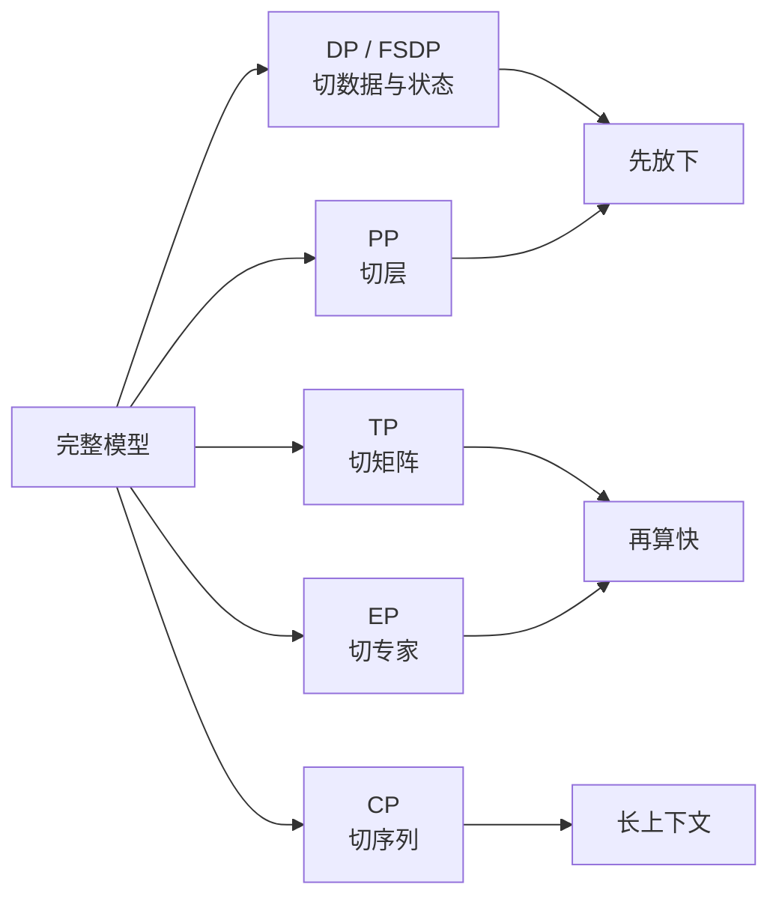

# 并行切分：模型放不下时，先切哪一刀

假设你手上有 64 张卡，模型 40 层、隐藏维度 5120、384 个路由专家，训练序列 128K。你把它按数据并行铺到 64 张卡上，第一步就 OOM；改成 8 路张量并行，模型能放下了，但每层 all-reduce 把 GPU 等到空闲；再加流水线并行，气泡又吃掉了吞吐。

并行不是把 TP、PP、EP、DP 全部拉满。它是**先找到当前最疼的那本账，再切对应的维度**。这一篇按这个顺序走：先定位瓶颈，再逐个看每种切分买到了什么、付了什么，最后拼出一个能跑的计划。

---

## 一、先定位：是放不下，还是算不快

三本账里，先看哪一本爆了。

**显存**：5000 亿参数的模型，按 BF16 计算 + FP32 主权重 + FP32 梯度 + Adam 状态，约 16 字节/参数，总计 8 TB。64 张卡平均每卡 125 GB，还没算激活、KV 和通信缓冲。仅这一项就决定了“纯 DP 不可能”。

**激活**：40 层、$d=5120$、32K token，层内激活约 134 GB（第 2 篇的估算）。128K 序列再乘 4，单卡更放不下。

**算力**：如果模型能放下，但 MFU 只有 3%，那瓶颈可能不在计算，而在通信或小 kernel。此时加更多 TP 只会让 all-reduce 更频繁。

**通信**：TP 的 all-reduce 适合 NVLink，EP 的 all-to-all 适合跨机 IB，PP 的 P2P 延迟敏感，DP 的梯度归约可以重叠。把维度放错链路，比不切还慢。

所以第一步不是选并行，而是回答：**当前是显存墙、计算墙，还是通信墙？** 下面的每一种切分，都是对其中一面墙的手术。

这张图不是“五种并行都要开”，而是“五种手术刀对应五种病灶”。DP/FSDP、PP、EP 主要解决放不下；TP 主要解决单层太大或单卡算不过来；CP 解决序列太长。选错刀，伤口不会愈合，只会换个地方流血。

---

## 二、DP 与 FSDP：先把状态切开

如果模型能放进单卡，DP 最简单：每张卡一份完整模型，吃不同数据，反向做梯度 all-reduce。通信量约为：

$$
V_{\text{dp}} \approx 2 \cdot \frac{N_{\text{dp}}-1}{N_{\text{dp}}} \cdot S_{\text{grad}}
$$

但 5000 亿参数放不进单卡，DP 的第一步就失败了。这时要切的是**状态**，不是数据。

ZeRO 分三阶段：ZeRO-1 切优化器状态，ZeRO-2 再切梯度，ZeRO-3/FSDP 连参数也切。FSDP 通常以 Transformer 层为一个 full-shard unit：

1. 前向进入第 $l$ 层前，all-gather 这一层的参数；
2. 用完立刻释放完整参数，只留分片；
3. 反向重新 all-gather，算梯度；
4. 反向结束，reduce-scatter 梯度，释放。

峰值显存只需要一层完整参数，而不是整个模型。代价是每层两次集合通信，必须和计算重叠。

这里有两个实际坑。

**第一，FSDP 不是“免费的 DP”。** 它把参数也切了，所以前向要 gather、反向要 gather，通信量比纯 DP 大。如果模型本来能放下，开 FSDP 只会更慢。

**第二，所有权要审计。** 共享参数（绑定嵌入、跨层共享的 indexer、专家参数）可能被多个模块引用；如果 FSDP 不知道谁拥有哪一块，就会出现重复 gather 或漏更新。构造完模型后做一次 ownership audit，比训练到一半发现梯度不对要便宜得多。

对 5000 亿参数、64 路 DP，FSDP 把 8 TB 状态摊到每卡 125 GB 左右；再叠加激活和 KV，仍然紧张。所以通常还要 PP 或 EP。

---

## 三、TP：切矩阵，但别跨机

TP 切的是单个矩阵乘。FFN 的 $W_1 \in \mathbb{R}^{d \times 4d}$ 可以按输出维切（列并行），每个 rank 算 $4d/N_{\text{tp}}$ 列；$W_2$ 按输入维切（行并行），最后 all-reduce 求和。

每层至少一次 all-reduce，通信量约为 $2Td$。TP 越大，单层计算越少，但 all-reduce 次数不变、单次数据量按 $Td$ 走——所以 TP 通常限制在单机 NVLink 域内。跨机 TP 的 all-reduce 延迟会把收益吃光。

TP 还有整除约束：

- 查询头数要被 $N_{\text{tp}}$ 整除。64 个头、TP=8，每卡 8 个头，刚好。
- KV 头数也要能被整除，或者复制 KV。GQA/MQA 下 KV 头少，TP 太大就会被迫复制。
- 低秩潜空间的维度、压缩器通道数、逐头 RMSNorm 的边界，都要按 TP 切。

**序列并行（SP）** 是 TP 的补充：LayerNorm、dropout、残差这些逐 token 操作本来不需要切，但激活会重复。SP 把它们按序列切分，列并行前 all-gather、行并行后 reduce-scatter，激活显存按 TP 组下降。代价是额外的集合通信，通常和 TP 一起开。

一个常见的误判是“TP 越大越快”。TP 的收益是单卡显存和单层计算，成本是每层 all-reduce。当单层矩阵已经很小、或者 all-reduce 跨了机，TP 的边际收益会变成负数。

---

## 四、PP：切层，但要填气泡

PP 把层按深度切到不同 stage。一个 micro-batch 在 stage 之间流水，最朴素的 GPipe 调度有大量气泡；1F1B 让每个 stage 交替做前向和反向，气泡比例约为：

$$
\text{bubble} \approx \frac{N_{\text{pp}}-1}{M + N_{\text{pp}}-1}
$$

$M$ 是 micro-batch 数。$N_{\text{pp}}=4$、$M=8$ 时，气泡约 $3/11 \approx 27\%$。要把气泡压下去，要么增大 $M$（激活显存也跟着涨），要么用 VPP 把模型切成更多、更小的 chunk。

PP 的通信量不大，只传 stage 边界的激活和梯度，但延迟敏感。stage 划分不好，GPU 会大量空转。两个实际约束：

- **按计算量均衡，不是按层数均衡。** 如果某个 stage 全是 MoE 层，另一个全是稠密层，层数一样也会严重偏斜。
- **共享状态跨 stage 要显式传。** 跨层 KV、共享 indexer 不能假设“同一进程内可以随便读”；PP 下它们在不同 stage，必须通过张量传输。

对 40 层、PP=4，每 stage 10 层。如果每层激活约 3.3 GB（32K token 的粗略量级），一个 stage 约 33 GB；再叠加参数分片和通信缓冲，仍然要配合 FSDP 或重算。

---

## 五、EP：切专家，但 all-to-all 会反噬

EP 把专家分到不同 rank。384 个专家、EP=8，每 rank 48 个专家；254 个专家、EP=8 不整除，就要向上取整到 32 个槽位、物理 256 个专家，多出来的槽位空着。

每个 token 按路由结果发送到专家 owner，算完再收回：

$$
V_{\text{ep}} \approx 2 \cdot T \cdot k \cdot d \cdot \text{bytes}
$$

$k$ 是每 token 激活的专家数。负载不均时，还要加 padding 和对齐。EP 的难点不在“切”，而在“均衡”：

- 少数热点专家会收到大量 token，对应 rank 的 all-to-all 成为瓶颈；
- 可以给热点专家做副本，把 token 分给负载较轻的副本，反向再聚合梯度；
- 可以用 FP8 dispatch 把通信量减半，但要做分块量化和正确的反量化；
- 可以把 all-to-all 分块，和专家 GEMM 交替进行，隐藏一部分通信。

EP 通常和 TP 组合：专家内部再做张量并行。但 EP 的 all-to-all 跨机，TP 的 all-reduce 在机内，两者的拓扑要求不同，不能随便互换。

---

## 六、把 64 张卡拼起来：三个方案

现在回到最初的问题。64 张卡，40 层，384 专家，128K 序列。可以拼出至少三种计划：

| 方案 | TP | PP | EP | DP | 适合的瓶颈 | 主要代价 |
| :--- | ---: | ---: | ---: | ---: | :--- | :--- |
| A | 2 | 4 | 8 | 1 | 单卡放不下，专家多 | EP all-to-all 跨机 |
| B | 4 | 4 | 1 | 4 | 专家少、层间通信多 | 专家参数每卡复制，显存放不下 |
| C | 1 | 4 | 8 | 2 | NVLink 域小，想少用 TP | 单层矩阵更大，计算更集中 |

方案 A 的乘积是 $2 \times 4 \times 8 \times 1 = 64$。它把模型切得最散，适合“显存墙 + 专家多”的场景；代价是 EP 的 all-to-all 要跨机，负载不均时很难受。

方案 B 不用 EP，专家在每张卡复制；如果专家总参数不大，这样通信最简单。但 384 个专家、每个都是独立 FFN，复制一份就很重，通常放不下。

方案 C 放弃 TP，把省下的卡给 DP。单层矩阵更大、计算更集中，适合 NVLink 域小、但跨机带宽还不错的集群；代价是单卡显存压力更大，需要更强的 FSDP/重算。

没有“最优解”，只有“当前集群拓扑下的最不坏解”。一个实用的选择顺序是：

1. 先保证模型能放下：FSDP/PP/EP；
2. 再保证单步算得快：TP 放 NVLink 内，EP 负载均衡；
3. 最后用 DP 扩吞吐；
4. 长上下文再考虑 CP。

不要一上来就把所有维度拉满。维度越多，通信路径越复杂，调试成本越高。

---

## 七、数据管道：别让 GPU 等 token

模型切好了，数据供不上也会空转。预训练的数据管道有三件事必须和并行方案对齐。

**Packed THD**：把多个变长序列拼成一条长序列，用 `cu_seqlens` 记录边界。好处是不按最长序列 padding，短样本不浪费；代价是边界处理——loss mask 只在真实 token 上算，EOD 要正确设置，因果掩码之外还要阻止跨样本注意力。

**离线批次**：训练前 tokenize、打包、切 batch，训练时只读二进制。每个 step 再分词，会把 CPU 变成瓶颈。checkpoint 要记录数据迭代位置，否则重启后会重复或漏样本。

**CPU affinity**：把 dataloader worker 绑到固定的 CPU/NUMA 节点，减少跨 socket 访问；用预取让数据准备和 GPU 计算重叠。

这些不是“模型之外”的事。一个 EOD 没设的 bug，会让 loss 看起来正常，但模型学到的是错误的跨样本依赖；一个 worker 数不匹配的配置，会让 GPU 在每步开头等几十毫秒。

---

## 八、出问题时先查什么

**loss 尖峰**：先看是全局尖峰还是某个 DP rank。全局尖峰可能是学习率/精度；单 rank 尖峰可能是数据分布或专家负载。

**吞吐突然下降**：先看通信时间线。TP 的 all-reduce 是否跨机？EP 的 all-to-all 是否被热点专家拖住？PP 是否有 stage 空转？

**OOM 但参数没变**：看激活、KV、通信缓冲和碎片。FSDP 的 all-gather 峰值、EP 的最坏情况 buffer、CP 的 all-gather 连续空间，都是常见来源。

**换并行度后加载错权重**：检查 checkpoint 的 local/global 映射，尤其是专家不整除、共享参数、绑定嵌入。

---

## 小结

并行切分不是把模型切成更多块，而是**把瓶颈从一处搬到另一处**。DP/FSDP 切状态，TP 切矩阵，PP 切层，EP 切专家，CP 切序列；每一种都有自己的通信量和整除约束。

真正要记住的是选择顺序：先放下，再算快，最后扩吞吐；TP 留在 NVLink 内，EP 看负载均衡，PP 填气泡，CP 处理长序列。维度越多不等于越快，很多时候只是把等待从一处转移到了另一处。

下一篇专门讲上下文并行：当序列本身长到一张卡放不下，注意力要怎么切、KV 要怎么交换、为什么需要 zigzag 和两遍计算。
