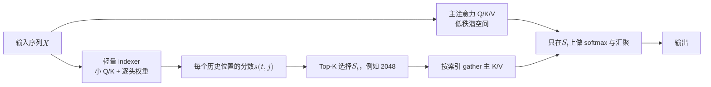
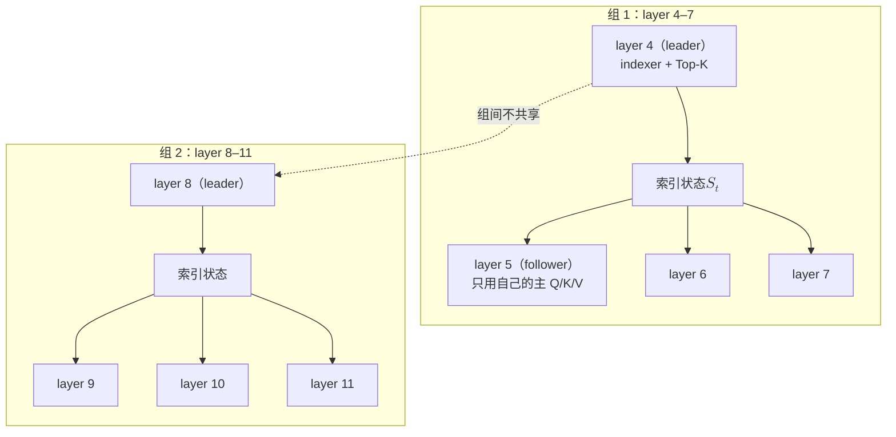

# 检索式稀疏注意力：先让一个小模型决定看哪里

低秩注意力解决了“每个位置存多少 KV”，但没有解决“每个位置要和多少 KV 打分”。序列长到 128K 时，即使 KV 已经压得很小，$n^2$ 的打分仍然是灾难。

最直接的办法是：**不要对全部历史位置做注意力，先用一个便宜的模型挑出一小部分，再在选中的位置上做完整注意力。** 这就是检索式稀疏注意力。它的核心不是“稀疏”两个字，而是那个负责挑选的 **indexer**：选得准不准、选得快不快、训练时怎么让选择器学会主注意力的偏好，决定了整套方案能不能用。

---

## 一、把注意力拆成“选择”和“计算”

标准因果注意力对第 $t$ 个查询计算：

$$
o_t = \sum_{j \le t} \mathrm{softmax}_j\Bigl(\frac{q_t k_j^\top}{\sqrt{d}}\Bigr) v_j
$$

所有 $j \le t$ 都要参与打分，计算量随 $t$ 线性增长，总和是 $O(n^2)$。

检索式稀疏注意力把它拆成两步：

1. **选择**：用一个轻量打分函数 $s_\theta(t,j)$ 给所有 $j \le t$ 打分，取 Top-K 集合 $S_t$，$|S_t| = k \ll n$；
2. **计算**：只在 $S_t$ 上做标准注意力：

$$
o_t = \sum_{j \in S_t} \mathrm{softmax}_j\Bigl(\frac{q_t k_j^\top}{\sqrt{d}}\Bigr) v_j
$$

如果选择器足够便宜，主注意力的 $O(n^2)$ 就变成了 $O(nk)$。关键在于：**选择器自己也要打分，它的复杂度不能又是 $O(n^2)$ 且常数很大。**

需要区分的是：这条路线本身不引入压缩器，也不依赖局部窗口或注意力汇点。它保留全长 KV，只是每次只读 Top-K。局部窗口、汇点、压缩是其他分支的补充，不是检索式稀疏的必要条件。



---

## 二、Indexer 长什么样

一个典型的 indexer 是一个“多头、低维、独立”的打分器：

$$
q^{(h)}_t = x_t W_q^{(h)}, \qquad k^{(h)}_j = x_j W_k^{(h)}, \qquad
s(t,j) = \sum_{h=1}^{H_i} w_h \cdot \phi\Bigl(\frac{q_t^{(h)} k_j^{(h)\top}}{\sqrt{d_i}}\Bigr)
$$

其中 $H_i$ 是 indexer 头数（例如 32），$d_i$ 是每头维度（例如 128），$w_h$ 是可学习的逐头权重，$\phi$ 通常是一个简单的非线性（如 ReLU）或恒等映射。注意几个设计点：

- **维度远小于主注意力**：indexer 每头 128 维，主注意力可能每头 128–512 维；indexer 头数也可能少于主头数。它不需要精确复现主注意力，只需要排对顺序。
- **独立参数**：indexer 有自己的 $W_q, W_k$，不共享主注意力的 Q/K。这样主注意力可以专注于内容，indexer 专注于“哪里值得看”。
- **逐头权重**：不同头可以关注不同类型的线索（局部、句法、实体），最后加权汇总成一个标量分数。
- **输出是分数，不是概率**：Top-K 只需要排序；概率只在训练 KL 时用。

### 为什么不用主注意力的 Q/K 直接选？

可以，但有两个问题：

1. 主注意力的 Q/K 维度大，算全量分数仍然贵；
2. 主注意力是“内容匹配”，而选择需要的是“是否值得看”的粗粒度判断，两者目标不完全一致。独立的小打分器可以学到一个更便宜、更鲁棒的召回策略。

---

## 三、训练：用主注意力当教师

Top-K 是离散操作，不可导。梯度无法从“被选中的索引”传回 indexer。解决办法是**蒸馏**：让 indexer 的分数分布在训练时逼近主注意力的分布。

### 1. 教师与学生

- **教师**：主注意力在全部可见位置上的 softmax 分布 $p_T(t,\cdot)$，用主注意力的 $Q,K$ 计算，**detach**，不接收梯度；
- **学生**：indexer 的分数经过 softmax 得到的分布 $p_S(t,\cdot)$；
- **损失**：在可见位置上做 KL：

$$
\mathcal{L}_{\text{idx}} = \sum_t \sum_{j \le t} p_T(t,j) \log \frac{p_T(t,j)}{p_S(t,j)}
$$

教师只提供“哪些位置重要”的信号，学生负责把这个信号压缩成一个便宜的打分器。主注意力的参数不通过这条损失更新。

### 2. Dense KL 与 Sparse KL

如果学生的分布覆盖全部可见位置，就是 **dense KL**：计算和显存都是 $O(n^2)$，但信号最完整，适合预热阶段。如果只在选中的 Top-K 集合上算，就是 **sparse KL**：

$$
\mathcal{L}_{\text{idx}}^{\text{sparse}}
= \sum_t \sum_{j \in S_t} \tilde p_T(t,j) \log \frac{\tilde p_T(t,j)}{p_S(t,j)}
$$

其中 $\tilde p_T$ 是把教师分布限制在 $S_t$ 上再归一化的结果。它省显存，但教师落在 $S_t$ 之外的概率被丢掉了，长期可能让 indexer 越来越自信于自己已经选中的位置。常见做法是：**预热用 dense，稳定后用 sparse，并保留一定的探索或周期性 dense 校准。**

### 3. 共享 indexer：60 层降到 18 个

相邻层的注意力模式高度相关。与其每层都跑一个 indexer，不如让一组层共享：

- 组内选一个 **leader**，持有 indexer 参数，负责计算 indexer 的 Q/K、分数和 Top-K；
- 其他层是 **follower**，不注册 indexer 参数，只消费 leader 产生的索引状态；
- 每层仍然用自己的主 Q/K/V 做注意力，也仍然用自己的主注意力分布做教师。



一个 60 层的示例会把前几层设成各自独立的 indexer，后面每 4 层共享一个，总共 18 个物理 indexer。收益有三块：

1. **参数**：indexer 的 Q/K/权重从 60 份降到 18 份；
2. **计算**：分数和 Top-K 只算一次，后 3 层直接复用；
3. **状态**：选择结果只存一份，降低显存和通信。

代价是组内层被迫使用同一套选择。如果第 4 层需要局部细节、第 7 层需要长程实体，共享会让其中一方妥协。实践中组大小是一个需要实验的旋钮：太小省得少，太大伤精度。

### 4. 组内 KL 要取平均，不是求和

这是共享 indexer 最容易写错的地方。如果组内有 $g$ 层，每层都有一个 KL，那么组损失应该是：

$$
\mathcal{L}_{\text{group}} = \frac{1}{g} \sum_{l=1}^{g} \mathcal{L}_{\text{idx}}^{(l)}
$$

而不是 $\sum_l$。求和会让组内层数隐式放大辅助损失的权重：组越大，KL 项越压过主损失，训练会偏向“把 indexer 拟合好”而不是“把语言模型做好”。取平均则让不同组大小的配置具有可比性。

同样的原则适用于多 token 预测：如果每个预测深度都跑一次 indexer 和 KL，最后应按深度数取平均，而不是累加。

---

## 四、系统实现：选择器不能变成新的瓶颈

Indexer 的 FLOPs 看起来不大，但在长序列上很可观。取 $n=32768$、$H_i=32$、$d_i=128$，单层 indexer 的打分 FLOPs 约为：

$$
2 \cdot n^2 \cdot H_i \cdot d_i
= 2 \times 1.07 \times 10^9 \times 4096
\approx 8.8 \times 10^{12}
$$

60 层就是 $5.3 \times 10^{14}$ FLOPs。对比一个 300 亿激活参数、32K token 的训练步：

$$
6ND = 6 \times 3 \times 10^{10} \times 32768 \approx 5.9 \times 10^{15}
$$

Indexer 大约占 9%，和前面算力构成表里的 8.5% 对得上。**它绝不是“免费”的。** 共享 4 层能把这块摊到约 2%，这就是共享 indexer 最大的系统收益。

除此之外，还有几项工程处理：

### 1. 不要物化 $n \times n$ 的分数矩阵

把查询按 chunk 切分，每次只算一个 chunk 对全序列的分数，立刻做 Top-K，只保留索引和少量中间量。chunk 大小是一个显存/效率的折中：太小则 kernel 启动多，太大则峰值高。

### 2. Top-K 的 kernel 对齐

厂商的 Top-K / gather kernel 往往对头数、K 值有对齐要求。把 indexer 的逻辑头数补到 64 的倍数、把 K 对齐到 64，可以避免落回慢路径。多出来的头用零权重或掩码处理，不参与实际选择。

### 3. FP32 分数与 Hadamard 旋转

Indexer 的分数和逐头权重通常用 FP32 计算，避免 BF16 在长序列上累积误差。还可以对 indexer 的 Q/K 做 Hadamard 旋转（正交变换），把离群值摊平，降低量化或低精度矩阵乘的误差。旋转是正交的，不改变内积，只改变数值分布。

### 4. 融合算子

选择、KL、主注意力反向是三个不同的计算阶段，但可以融合：

- 稀疏主注意力的前向用 Flash 风格的 kernel，只读选中的 K/V；
- 反向用厂商的稀疏注意力 kernel，避免物化完整的注意力矩阵；
- indexer 的前向/反向、Top-K、KL 各自融合，减少中间张量的读写。

### 5. 选择状态的生命周期

Top-K 的结果要在前向保存，供反向和主注意力使用。它的大小是 $n \times k$ 个索引，虽然比 $n^2$ 小，但在长序列、多层、多 micro-batch 下仍然可观。共享 indexer 让这份状态只存一份，是省显存的关键。

---

## 五、代价与失效模式

| 问题             | 表现                                   | 常见处理                                                 |
| :--------------- | :------------------------------------- | :------------------------------------------------------- |
| **召回不足**     | 真正重要的位置没进 Top-K，长程依赖丢失 | 增大 $k$、增加 indexer 头数、dense KL 预热、保留局部窗口 |
| **选择器漂移**   | 训练后期 indexer 只选自己熟悉的模式    | 周期性 dense KL、教师温度、探索噪声                      |
| **组内冲突**     | 共享组的层需要不同选择                 | 缩小共享组、按层类型分组、组内加轻量偏置                 |
| **Top-K 不稳定** | 相邻 step 的选择剧烈跳变               | 分数平滑、温度退火、对索引做一致性正则                   |
| **长序列显存**   | 分数矩阵或索引状态爆掉                 | 查询分块、只存索引、FP32 仅用于分数                      |
| **并行受限**     | 跨 PP/CP 时索引状态难传递              | 限制共享 indexer 跨阶段；CP 核心路径单独实现             |

还有一个更根本的问题：**主注意力的分布真的是最好的教师吗？** 主注意力自己也可能有噪声、位置偏差或“注意力汇点”。如果教师本身不稳定，indexer 会学到噪声。实践中会用温度、剪枝、或多教师平均来缓解，但这仍然是一个开放问题。

---

## 六、一个最小实现

```python
def sparse_attention_with_indexer(x, main_qkv, idx_q, idx_k, idx_w,
                                  k_select, n_heads_i):
    # x: [T, d]
    q_idx = (x @ idx_q).reshape(T, n_heads_i, -1)
    k_idx = (x @ idx_k).reshape(T, n_heads_i, -1)

    # 1. indexer 打分：逐头内积，加权求和
    scores = torch.einsum("thd,shd->hts", q_idx, k_idx) / sqrt(q_idx.shape[-1])
    scores = (scores * idx_w.view(-1, 1, 1)).sum(dim=0)   # [T, T]
    scores = scores.masked_fill(causal_mask, -inf)

    # 2. Top-K：只保留索引，不保留完整分数
    topk_idx = scores.topk(k_select, dim=-1).indices      # [T, k]

    # 3. 主注意力：gather 选中的 K/V，做标准 softmax
    q, k, v = main_qkv
    k_sel = gather(k, topk_idx)                            # [T, k, d]
    v_sel = gather(v, topk_idx)
    attn = softmax(q @ k_sel.transpose(-1, -2) / sqrt(d) + sink)
    out = attn @ v_sel
    return out, scores, topk_idx


def indexer_kl(scores, teacher_logits, topk_idx=None, sparse=False):
    # teacher_logits 来自主注意力，detach；scores 来自 indexer
    teacher = softmax(teacher_logits.detach(), dim=-1)
    if sparse:
        # 只在选中的位置上比较，教师先限制再归一化
        teacher = gather(teacher, topk_idx)
        teacher = teacher / teacher.sum(-1, keepdim=True)
        student = gather(softmax(scores, -1), topk_idx)
    else:
        student = softmax(scores, -1)
    return (teacher * (teacher.log() - student.log())).sum(-1).mean()
```

真实实现还要处理：分组共享、逐头权重、FP32 累加、变长序列打包、张量并行下按头切分、以及 Top-K 的 kernel 对齐。

---

## 小结

- **两步走**：indexer 先在全长序列上选 Top-K，主注意力只在选中的位置上做完整计算。
- **独立小打分器**：低维、多头、逐头权重，目标是排序而不是精确复现主注意力。
- **蒸馏训练**：主注意力做教师，indexer 做学生；dense KL 预热，sparse KL 省显存；组内按层平均。
- **共享 indexer**：一组层共用一个物理 indexer，参数、分数、Top-K 和状态都只算一份；代价是组内选择被迫一致。
- **系统成本**：长序列上 indexer 可占约 9% 的算力，共享 4 层能摊到约 2%；分块、对齐、融合、FP32 分数都是必要的工程手段。
- **边界**：召回不足、选择漂移、组内冲突、并行受限，是这条路线最常见的失效模式。

下一篇换一个方向：不再“从全长 KV 里挑”，而是**先把 KV 压缩成摘要**，再在摘要上做注意力。这样连“全长 KV”本身都不需要保存。
