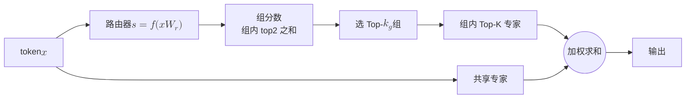

# 稀疏专家：路由坍缩才是默认结局

一个 254 个路由专家的模型，训练到几千步后，监控面板上出现了一条很熟悉的曲线：排名前 12 的专家接收了 80% 的 token，其余两百多个专家几乎不再更新。loss 还在缓慢下降，但验证集开始变差；再往后，几个热点专家的梯度越来越大，学习率稍微一提就尖峰。

这不是实现 bug，而是 MoE 的默认结局。**路由是一个富者愈富的系统**：某个专家早期多接了几个 token，梯度更新更多，打分更高，下一步就会接更多 token；其他专家得不到训练，打分更低，逐渐饿死。

MoE 的结构设计，一大半是在对抗这个正反馈。这一篇按“坍缩为什么发生、怎么用路由结构缓解、怎么用辅助损失兜底、EP 又带来了什么新问题”的顺序讲。

---

## 一、稠密 FFN 的墙，和 MoE 的诱惑

稠密 FFN 的硬约束是：每个 token 都要过全部参数。把 FFN 从 $4d$ 扩到 $8d$、$16d$，模型容量上去了，每 token 的算力也线性上去。MoE 换了一个分配方式：

$$
y = \sum_{e \in \mathcal{T}(x)} w_e \, E_e(x) \;+\; E_{\text{shared}}(x)
$$

总参数按专家数扩展，单 token 只激活 $k$ 个专家。一个总参数 300 亿、每 token 只激活 40 亿的模型，算力按 40 亿算，显存按 300 亿算——这就是“参数与计算解耦”。

但“解耦”带来一个副作用：**路由变成了一个可学习的、离散的、竞争性的分配器**。稠密 FFN 里，所有参数每步都更新；MoE 里，一个专家如果没被选中，这一步就完全没有梯度。路由选错一次，可能让某个专家永远起不来。

---

## 二、坍缩的机制：分数、Top-K 与正反馈

路由器是一个线性层：

$$
z = x W_r \in \mathbb{R}^E
$$

然后把 logits 变成非负分数。常见三种：

| 函数         | 表达式                         | 行为                                                      |
| :----------- | :----------------------------- | :-------------------------------------------------------- |
| Sigmoid      | $\sigma(z)$                    | 有界、饱和；分数接近 0 或 1，区分度强，但大 logits 梯度小 |
| Softmax      | $e^{z_e}/\sum_{e'} e^{z_{e'}}$ | 全局归一化；一个专家变强会压低其他专家                    |
| SqrtSoftplus | $\sqrt{\log(1+e^z)}$           | 非负、平滑、无上界；比 sigmoid 少饱和，比 ReLU 平滑       |

Sigmoid 的问题是饱和：热点专家的分数接近 1，梯度接近 0，反而不容易继续拉开；但它也会让冷门专家的分数接近 0，彻底失去梯度。Softmax 的问题是全局竞争：一个专家变强，其他专家的分母被抬高，分数被压低，富者愈富更明显。SqrtSoftplus 介于两者之间：非负、平滑、无上界，负半轴仍有梯度，正半轴增长比线性慢，能抑制个别专家分数爆炸。

但分数函数只是缓解，真正决定坍缩的是 Top-K。Top-K 是离散选择，没被选中的专家梯度为 0；一旦某个专家连续几步没被选中，它的分数就不会更新，形成“死专家”。

所以结构上要做三件事：**让选择更分散、让未选中的专家也有梯度、让早期路由不要过早固化。**

---

## 三、分组、偏置与缩放：把路由变成结构

### 1. 分组路由

如果直接在 $E$ 个专家里选 Top-K，选中的专家可能集中在少数几个，负载不均，EP 的 all-to-all 也会碎。分组路由先把专家分成 $G$ 组：

1. 对每个组，取组内最高的两个分数之和作为组分数；
2. 选出分数最高的 $k_g$ 个组；
3. 只在这些组内选 Top-K 个专家。

例如 254 个专家分成两组各 127 个，每组选 7 个，总共激活 14 个。这样既限制了单个组的负载，也让通信更集中。

### 2. 偏置只影响选择，不影响权重

负载不均时，给每个专家加一个可学习的偏置 $b_e$：

$$
\tilde s_e = s_e + b_e
$$

用 $\tilde s_e$ 做 Top-K，但最终权重仍然用**未加偏置**的 $s_e$ 归一化：

$$
w_e = \frac{s_e}{\sum_{e' \in \mathcal{T}} s_{e'}} \cdot \alpha
$$

这是很多实现里最容易写错的地方。如果偏置进入权重，路由器就可以通过“把偏置调大”来绕过负载均衡，最终学到的权重不再反映内容相关性。让偏置只做“排队”，不做“打分”，系统才干净。

$\alpha$ 是全局缩放因子（例如 1.5 或 2.5），补偿 Top-K 归一化后权重总和为 1 带来的尺度变化。

### 3. 共享专家

共享专家是所有 token 都过的 FFN，始终激活：

$$
E_{\text{shared}}(x)
$$

它的作用是承载通用知识，让路由专家专注于差异化。如果所有专家都靠路由选择，每个专家都要同时学“通用语言能力”和“专门领域知识”，容易同质化；留一两个始终激活的共享专家，可以显著降低路由的负担。

两个教学用的配置：

| 示例  | 路由专家 | 共享专家 | 路由方式                       | 分数         | 缩放 | 专家 FFN |
| :---- | -------: | -------: | :----------------------------- | :----------- | ---: | -------: |
| 60 层 |      254 |        2 | 2 组 × 127，组内 top7（共 14） | sigmoid      |  2.5 |     1024 |
| 40 层 |      384 |        1 | 全局 top6                      | sqrtsoftplus |  1.5 |     2304 |

数字只用于对齐数量级；真正的配置要按总参数、激活参数、EP 度和显存预算来定。

---

## 四、哈希路由：让第一层不要学

深层的路由可以学，但第一层往往最难学：参数随机，路由分数噪声大，容易一开始就坍缩。一个办法是让前一两层不学路由，直接用哈希：

$$
e = \mathrm{hash}(\text{token id}, \text{layer id}) \bmod E
$$

为了让同一 token 在不同层分到不同专家，同时对每个 token 保证“选中的专家不重复”，可以用 Fisher–Yates 洗牌：按层用固定种子打乱专家列表，再按 token id 取前 $k$ 个。

哈希路由无参数、无梯度、不会坍缩，负载天然均匀；代价是不看内容。所以它只适合第一层或少数几层，帮模型度过最不稳定的早期。层数一多，路由器还是要学内容相关的分配。

---

## 五、辅助损失：不是调参，是防止系统塌缩

即使有分组和偏置，路由仍可能坍缩。辅助损失是最后一道防线。

负载均衡损失用专家接收的 token 比例 $f_e$ 和路由器给专家的平均概率 $P_e$：

$$
f_e = \frac{1}{T} \sum_{t=1}^{T} \mathbb{1}[e \in \mathcal{T}_t], \qquad
P_e = \frac{1}{T} \sum_{t=1}^{T} s_{t,e}
$$

$$
\mathcal{L}_{\text{bal}} = E \sum_{e=1}^{E} f_e P_e
$$

均匀时 $f_e \approx 1/E$、$P_e \approx 1/E$，损失接近 1；集中时变大。它同时惩罚“实际分配不均”和“路由器偏好不均”。

还有两个补充：

- **序列级 aux**：在每个序列内部算负载，而不是整个 batch，避免长序列主导统计；
- **z-loss**：惩罚路由器 logits 的整体尺度过大，防止 sigmoid/softmax 进入饱和区。

训练时还可以给路由 logits 加一点噪声（jitter，$\sigma \approx 0.01$），让早期路由探索不同专家。推理时关闭。

这些系数的量级通常很小（$10^{-4}$ 到 $10^{-2}$），太大伤语言建模，太小压不住坍缩。它们不是“调参技巧”，而是维持系统不塌缩的必要条件。

还有一个工程细节：算辅助损失时，不要重新算一遍全局 Top-K。训练时已经为了 dispatch 算过一次路由，直接复用那张 map；否则你会多算一次 Top-K，还可能因为数值差异得到不一致的统计。

---

## 六、EP：all-to-all 的账

专家放不到一张卡上，就要专家并行。$E=254$、$N_{\text{ep}}=8$ 时，$254/8 = 31.75$，不整除。常见做法是向上取整：

$$
\text{每 rank 槽位} = \lceil 254/8 \rceil = 32, \qquad
\text{物理专家数} = 32 \times 8 = 256
$$

多出来的 2 个槽位空着，不参与计算，但要在通信和 checkpoint 里占位。保存时按物理槽位，加载时按逻辑专家 id 对齐；否则换 EP 度就会错位。

每个 token 按路由结果发送到专家 owner，算完再收回。通信量约为 $2Tkd$。负载不均时，还要加 padding 和对齐。这里的工程手段包括：

- **分组 GEMM**：把所有专家的同形状矩阵乘合并成一次批量调用；
- **permute 融合**：把 token 的 gather/scatter 与转置融合进 GEMM 前后处理；
- **dropless**：所有 token 都处理，用变长 buffer，避免随机丢数据；
- **FP8 dispatch**：发送前量化，接收后反量化，通信量减半；
- **热点专家副本**：给长期过热的专家做副本，把 token 分给负载较轻的副本，反向再聚合梯度。

热点副本是一个很实用的补丁，但它是“用显存换带宽”。如果所有专家都复制，就退化成“每卡一份”，不如直接换并行策略。

---

## 七、诊断：看负载，不要只看 loss

MoE 的故障很少直接表现为 loss 爆炸。更常见的是：

- **专家负载**：每个专家的 token 数、最大/平均比、丢弃率。最大/平均比超过 3–5 倍，就要查路由。
- **路由熵**：熵太低说明路由过于自信，可能在坍缩；熵太高说明路由没有区分度。
- **辅助损失**：负载损失、z-loss 是否在合理区间；突然下降不一定是好事，可能是路由已经放弃探索。
- **per-token loss**：按领域/位置拆开，看长尾样本是否被热点专家忽略。
- **梯度范数**：分专家看，热点专家的梯度是否异常大。

一个实用的排查顺序是：先看负载，再看路由熵，再看辅助损失，最后才看主 loss。主 loss 是结果，路由才是原因。

---

## 小结

MoE 的默认结局是路由坍缩：少数专家吃掉大部分 token，其余专家饿死。对抗它需要结构（分组路由、共享专家、哈希层）、损失（负载均衡、序列级 aux、z-loss、jitter）和工程（偏置只做选择、复用 dispatch map、dropless、热点副本）三方面同时作用。

EP 则把问题从“路由是否均衡”放大成“all-to-all 是否均衡”：不整除要 padding，热点专家要副本，通信要能和计算重叠。MoE 不是“把 FFN 切小”这么简单，它是一个需要持续监控的分配系统。

下一篇回到训练目标：除了预测下一个 token，还能不能让它一次预测多个，从而在同样的数据上获得更密的监督。
